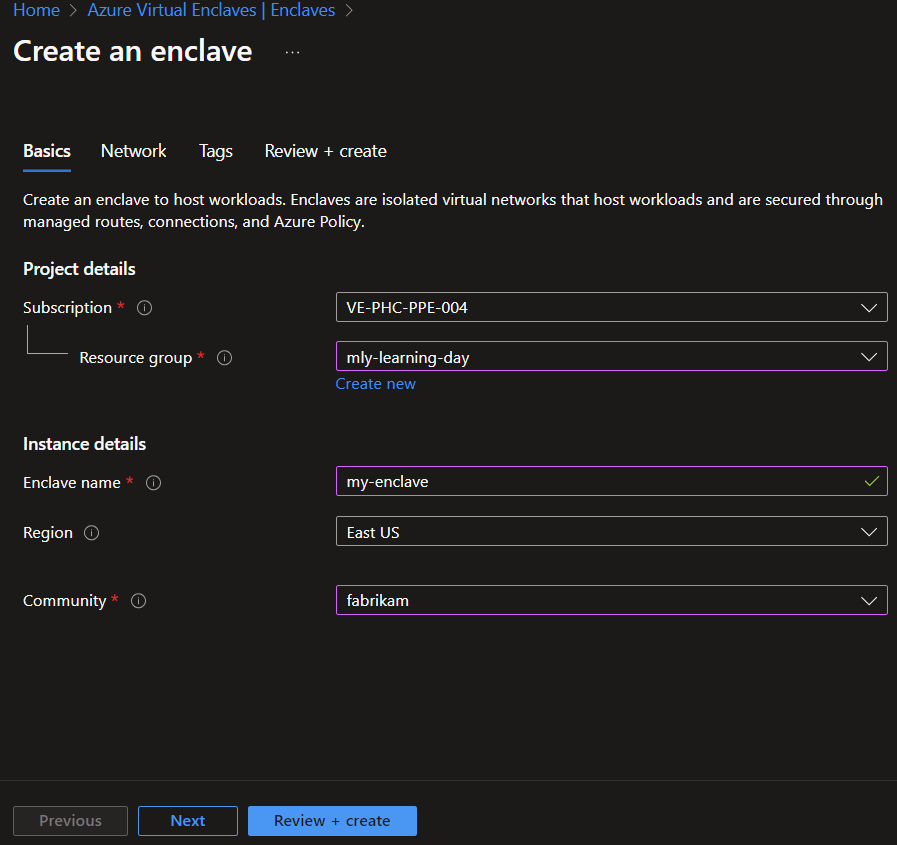
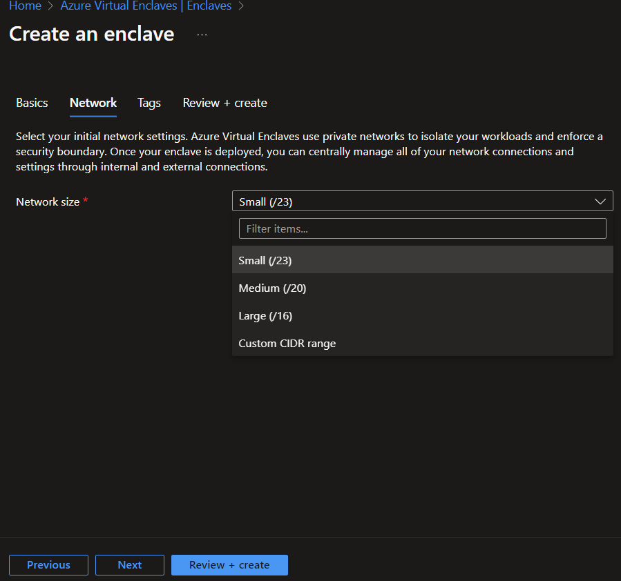

An [Enclave](./what-is-an-enclave.md) is a completely isolated Virtual Network that is part of a Community in which one or more workloads are hosted. These workloads can be completely isolated from other Enclaves in the Community. An Enclave Owner can enable other Enclaves to connect to theirs by creating an Endpoint. Endpoints are used by other Enclaves to establish Connections.

## Prerequisites

- To access Azure Virtual Enclaves, you'll need an Azure subscription. If you don't already have a subscription, create a [free account](https://azure.microsoft.com/free/) before you begin.
- Before you can create an enclave, you must [create a community](./create-a-community-in-the-azure-portal.md) using the Azure portal.
- **If you are using on-prem/custom DNS** - each Enclave _must deploy a DNS resolver_ workload in order to resolve private endpoints for Azure Storage, Key Vault, and Log Analytics. 

## Sign-in to Azure
Sign-in to the Azure portal at https://portal.azure.com. For our MVP and Private Preview experience, you will have to navigate to the [RC Azure Portal](https://aka.ms/ave/privatepreview).

## Create enclave
Enclave deployments will take around 30-45 minutes to complete. Once it completes, open your Enclave and verify that the Status is **succeeded**.

1. Enter _Azure Virtual Enclaves_ in the search.

2. Under **Services**, select **Azure Virtual Enclaves**.

3. In the **Azure Virtual Enclaves** page, select the **Enclaves** in the left menu.

4. On the **Enclaves** page, select **Create**.

5. Enter the basic details for your Virtual Enclave
   - Subscription: **Select an existing Subscription**
   - Resource Group: Create a new or select an existing Resource Group
   - Enclave name: Name of the Virtual Enclave (ex: "**My-Enclave**')
   - Region: Azure region the Virtual Enclave will be created in. Ensure that the region matches the Community's region selected below.
   - Select a Community: Select an existing **Community** 

6. Click **Next**.

7. Select a network size for your Enclave. Learn more about [Azure best practices regarding Azure Virtual Networks](../virtual-network/concepts-and-best-practices.md), and how to use [Plan Azure Virtual Networks](../virtual-network/virtual-network-vnet-plan-design-arm.md).

> Note:
>
> Enclave Owners can choose to provide a custom CIDR address when creating their enclaves. Azure Virtual Enclaves will automatically allocate the next best fit block of network addressable space based on the existing networks allocated to the community that the enclave is targeting.

8. Click **Next**.

9. Enter any [Tags](../azure-resource-manager/management/tag-resources.md) for your Enclave.

10. Click **Review + create**, ensure the details for your Enclave are correct, and click **Create**.

**References**
- [What is an Enclave](./what-is-an-enclave.md)
- [Create a Community](./create-a-community-in-the-azure-portal.md)
- [Best practices](./best-practices.md)
- [Azure best practices regarding Azure Virtual Networks](../virtual-network/concepts-and-best-practices.md)
- [Plan Azure Virtual Networks](../virtual-network/virtual-network-vnet-plan-design-arm.md)
