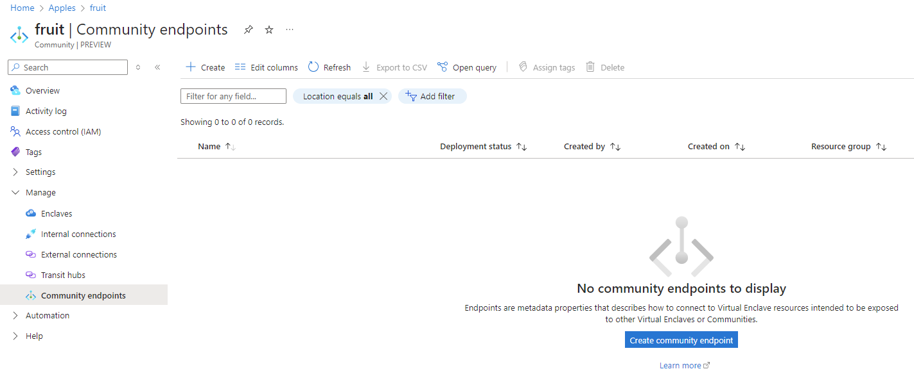
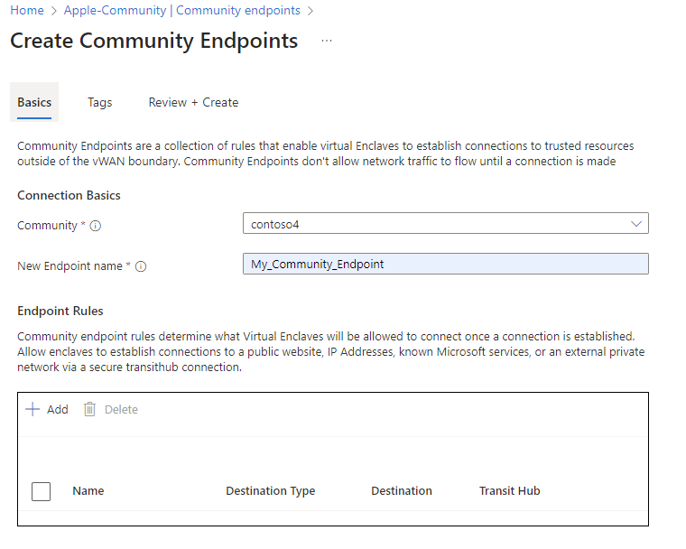
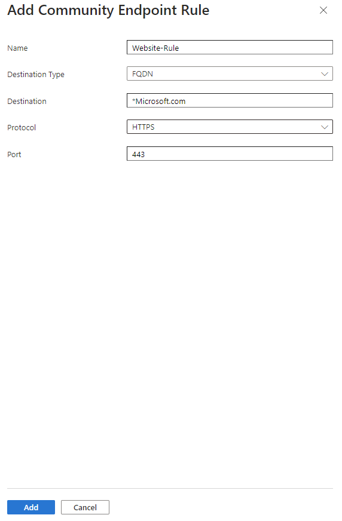
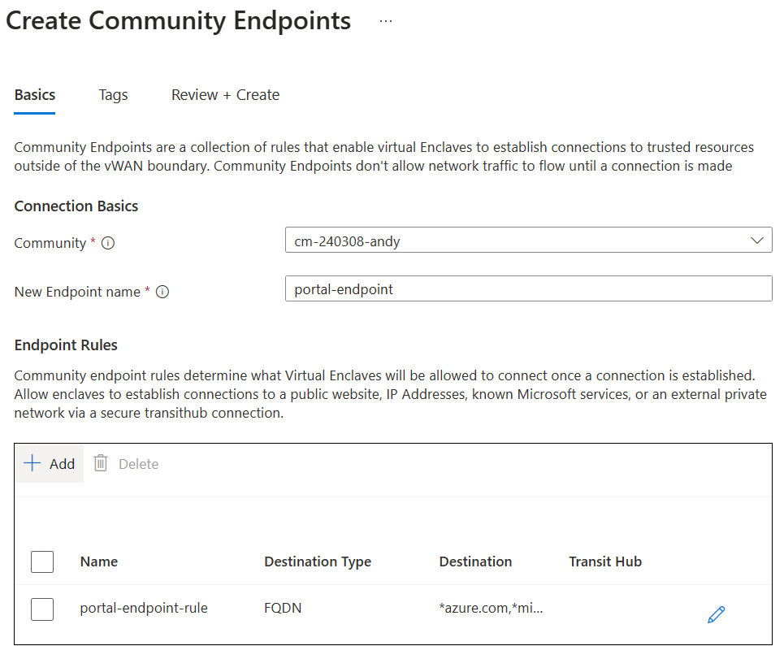
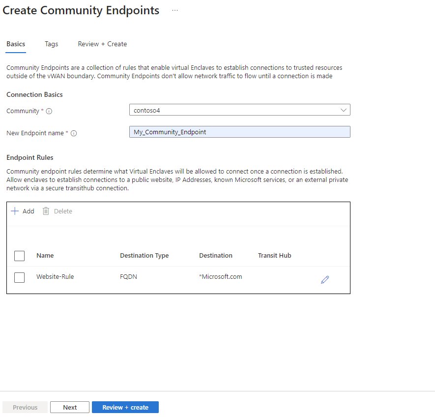

# Create an Community Endpoint in the Azure portal

Quickly create an Community Endpoint in the Azure portal.

## Prerequisites
- To access Azure Virtual Enclaves, you need an Azure subscription. If you don't already have a subscription, create a [free account](https://azure.microsoft.com/free/) before you begin.

- All access to Azure Virtual Enclaves takes place through a eommunity or an enclave. For this how-to article, create a [community](./create-community-azure-portal.md) and [enclave](./create-enclave-azure-portal.md) using the Azure portal.

## Sign-in to Azure
Sign-in to the Azure portal at https://portal.azure.com.

## Create Community Endpoint

1. Navigate to an existing Community within your Azure subscription, select the `Community Endpoints` blade, and click `Create`

2. Provide a name for the Community Endpoint and click `Add` to create a Community rule. 

Community Endpoint rule types:
- **IP Address**: Enable traffic from an Enclave to an IP address outside of the Community vWAN
- **FQDN**: Enable traffic from an Enclave to a trusted Fully Qualified Domain Name (FQDN) (for example `*portal.azure.com`)
- **FQDN Tag**: Enable traffic from Enclaves to known Microsoft Azure services via FQDN Tags (for example `AzurePortal`)
- **Private Network**: Enable traffic from Enclaves to an external private network through a [Transit Hub](./create-a-transit-hub-from-the-azure-portal.md) connection

3. Provide a name, destination type, destination, port, and protocol for the Community Endpoint Rule and click `Add`

4. Click `Review + Create` and click `Create`

**References**
- [What is a Community?](./what-is-a-community.md)
- [Create a Community](./create-community-azure-portal.md)
- [Best practices](./best-practices.md)
