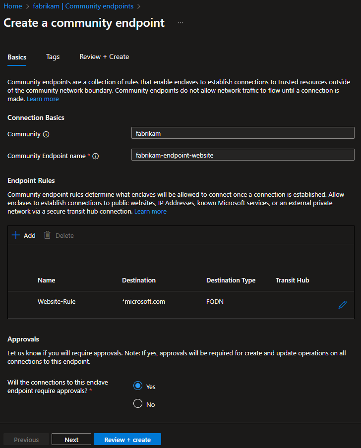

# Create a community endpoint in the Azure portal

Quickly create a community endpoint in the Azure portal.

## Prerequisites

- To access Azure Virtual Enclaves, you need an Azure subscription. If you don't already have a subscription, create a [free account](https://azure.microsoft.com/free/) before you begin.

- All access to Azure Virtual Enclaves takes place through a community or an Enclave. For this how-to article, create a [community](./create-community-portal.md) and [Enclave](./create-enclave-portal.md) using the Azure portal.

## Sign-in to Azure

Sign-in to the [Azure portal](https://portal.azure.com).

## Create community endpoint

1. Navigate to an existing community within your Azure subscription, select the `Community Endpoints` on the left side, and select `Create`

2. Provide a name for the community endpoint and select `Add` to create a community endpoint rule.

### Community endpoint rule types

- **IP Address**: Enable traffic from an enclave to an IP address outside of the community vWAN.

- **FQDN**: Enable traffic from an enclave to a trusted Fully Qualified Domain Name (FQDN) (for example `*.portal.azure.com`). FQDN rules support TCP and UDP protocols.

- **FQDN Tag**: Enable traffic from Enclaves to known Microsoft Azure services via FQDN Tags (for example `AzurePortal`).

- **Service Tag**: Enable traffic from enclaves to Azure services using Azure Service Tags. Service Tags represent groups of IP address prefixes for specific Azure services (for example `AzureStorage`, `AzureKeyVault`, `Sql`). Azure automatically maintains the underlying IP addresses, eliminating the need for manual updates when service addresses change. For a complete list of available Service Tags, see [Virtual network service tags](/azure/virtual-network/service-tags-overview).

- **Private Network**: Enable traffic from Enclaves to an external private network through a [transit hub](./create-transit-hub-portal.md) connection.

3. Provide a name, destination type, destination, port, and protocol for the community endpoint rule and select `Add`.

### Configure Service Tag rules

When creating a **Service Tag** rule:

1. Select **Service Tag** as the destination type.
2. Choose the appropriate Service Tag from the dropdown list (for example `AzureStorage`, `AzureKeyVault`, `AzureActiveDirectory`).
3. Specify the destination port(s) required for your service.
4. Select the protocol (TCP, UDP, or Any).

> [!TIP]
> Use Service Tags when connecting to Azure services that have dynamic IP address ranges. This eliminates the need to manually track and update IP addresses as they change.

4. Select `Review + Create` and select `Create`.

## Use common service endpoints

Azure Virtual Enclaves provides pre-configured community endpoints for common services. These endpoints simplify connectivity to frequently used Azure and Microsoft services.

To use common service endpoints:

1. When creating a community endpoint, select **Common Services** from the endpoint type options.
2. Choose from the available pre-configured service categories:
   - **Azure Management** - Azure portal, Resource Manager APIs
   - **Microsoft Update** - Windows Update, Microsoft Update endpoints
   - **Azure Monitoring** - Azure Monitor, Log Analytics, Application Insights
   - **Identity Services** - Microsoft Entra ID authentication endpoints
   - **Certificate Services** - CRL and OCSP endpoints

3. Review the included destinations and select `Create`.

Using common service endpoints reduces configuration complexity and ensures your enclaves have connectivity to essential Azure services following Microsoft best practices.

## Related content

- [What is a community endpoint?](./what-community-endpoint.md)
- [What is a community?](./what-community.md)
- [Create a community](./create-community-portal.md)
- [Best practices](./best-practices.md)