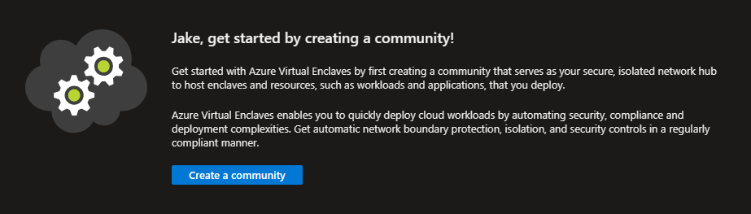
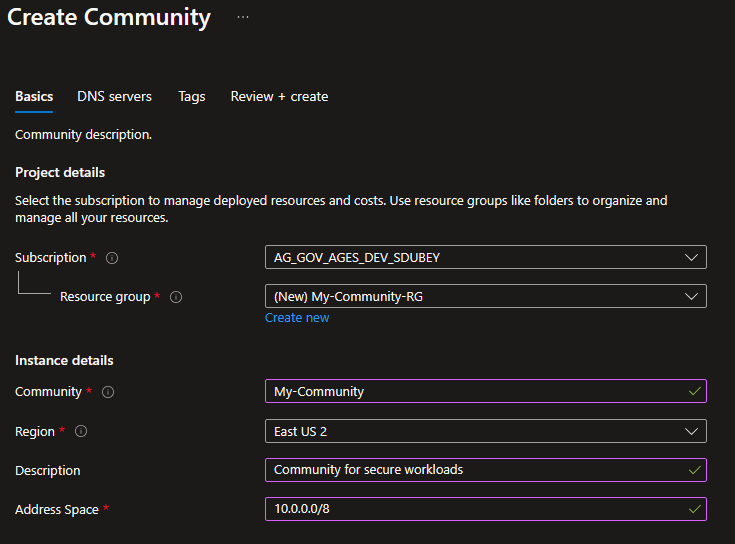
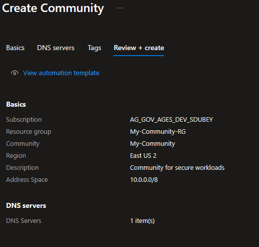
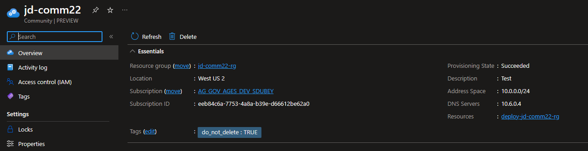

# Create a Community in the Azure portal

[Communities](./what-is-a-community.md) are isolated hub networks that can securely and logically group several Enclaves together for governance, management, and security purposes. A Community Owner can enable other Communities or on-premises networks to connect through Transit Hubs or Endpoints.

## Prerequisites
To access Azure Virtual Enclaves, you need an Azure subscription. If you don't already have a subscription, create a [free account](https://azure.microsoft.com/free/) before you begin.

## Sign-in to Azure
Sign-in to the Azure portal at https://portal.azure.com.

## Create community

1. Enter `Azure Virtual Enclaves` in the search.
2. Under `Services`, select `Azure Virtual Enclaves`. You will be directed to the Azure Virtual Enclaves homepage.

2. Click the `Create a community` button. The community deployment will take around 25 minutes to complete.
3. Enter the basic details for your community:
   - **Subscription**: Select an Azure Subscription
   - **Resource Group**: Create a new or select an existing Resource group
   - **Community**: Name of the Community (for example `My-Community`)
   - **Region**: Azure region the Community will be created in
   - **Description**: Description for the Community (for example `Community for secure workloads`)
   - **Address Space**: IP Address space of the Community (for example `10.0.0.0/8`)
   > Note:
   > `192.168.0.0/16`, `192.0.0.0/8`, `192.128.0.0/9`, or any other range that includes `192.168.x.x` addresses are reserved for the platform to manage enclaves deployed within a Community. Users shouldn't create Communities with any of these address spaces as that would create overlapping conflicts with the platform-managed enclave management IP ranges.
   
   

4. Click `Next`.
5. (Optional) Customize your governance settings on a per-service basis.

> [!NOTE]
> 
> In the context of governance for Communities, the following settings can be specified for each service:
> - Enforcement: This setting determines whether the rules defined for a service are actively enforced. When enforcement is enabled, any action that violates the rules will be blocked or flagged.
> - Audit Mode: This option allows for the monitoring of services without actively enforcing the rules. It's useful for understanding the impact of potential governance policies by logging all actions that would violate the rules if enforcement were > enabled.
> - Options: This setting declares wheter the service is:
> - - Allow: The service is allowed in the policies
> - - Deny: The service isn't allowed in the policies
> - - ExceptionOnly: The service isn't allowed in the policies, but manual [Policy Exemptions](/docs/Concepts/Governance/Policy-compliance-exemptions) can be made.

7. Click `Next`.
8. Enter any [Tags](../azure-resource-manager/management/tag-resources.md) for your community.
9. Click `Next`.
10. Click `Review + create`, ensure the details for your community are correct, and click `Create`.

## References
- [What is a Community?](./what-is-a-community.md)
- [Create an enclave](./create-enclave-azure-portal.md)
- [Best practices](./best-practices.md)
- [Name resolution for resources in Azure Virtual Networks](../virtual-network/virtual-networks-name-resolution-for-vms-and-role-instances.md)
