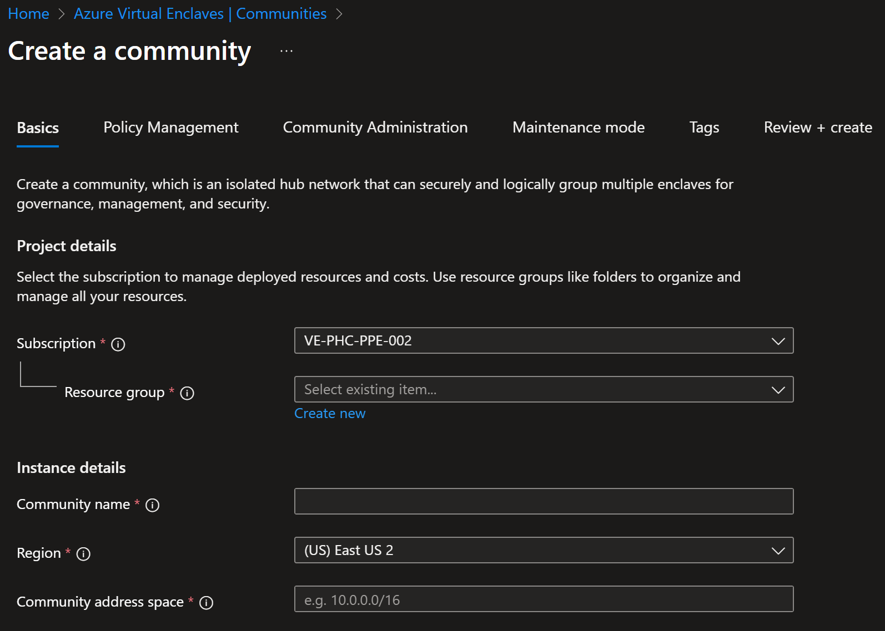
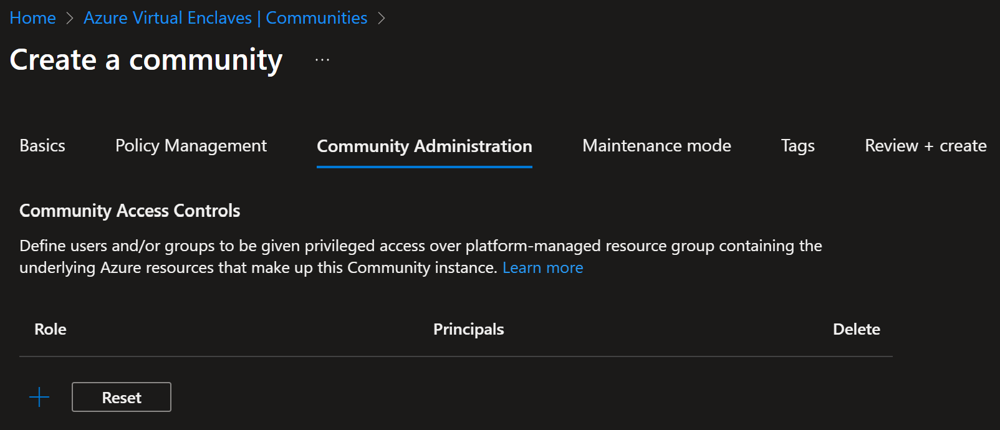
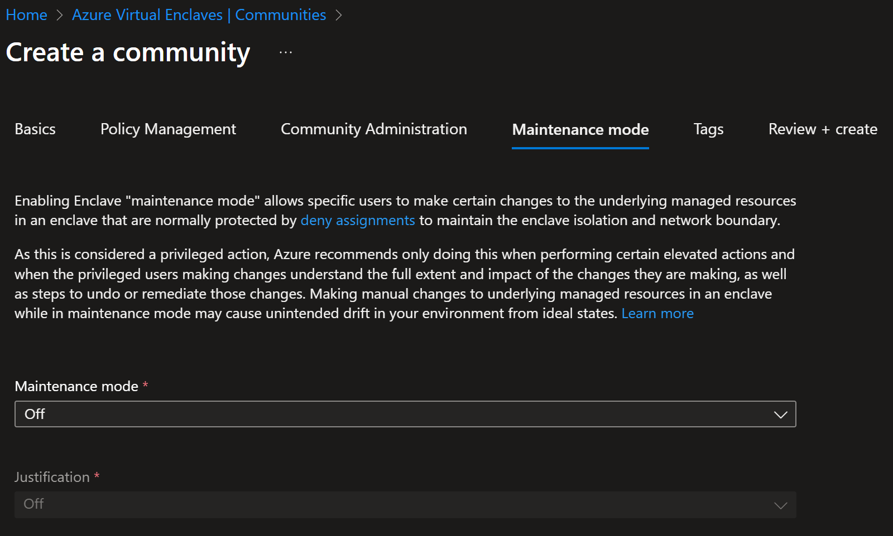

# Create a community in the Azure portal

[Communities](./what-community.md) are isolated hub networks that can securely and logically group several Enclaves together for governance, management, and security purposes. A community owner can enable other communities or on-premises networks to connect through transit hub or Endpoints.

## Prerequisites
To access Azure Virtual Enclaves, you need an Azure subscription. If you don't already have a subscription, create a [free account](https://azure.microsoft.com/free/) and sign-in to the [Azure portal](https://portal.azure.com) before you begin.

## Create community

1. Enter `Azure Virtual Enclaves` in the search.
2. Under `Services`, select `Azure Virtual Enclaves`. You will be directed to the Azure Virtual Enclaves homepage.

3. Select the `Create a community` button. The community deployment can take around 25 minutes to complete.
4. Enter the basic details for your community:
   - **Subscription**: Select an Azure Subscription
   - **Resource Group**: Create a new or select an existing Resource group
   - **Community**: Name of the community (for example `My-Community`)
   - **Region**: Azure region the community will be created in
   - **Community Address Space**: IP Address space of the community (for example `10.0.0.0/16`)
   > [!NOTE]
   > `192.168.0.0/16`, `192.0.0.0/8`, `192.128.0.0/9`, or any other range that includes `192.168.x.x` addresses are reserved for the platform to manage enclaves deployed within a community. Users shouldn't create communities with any of these address spaces as that would create overlapping conflicts with the platform-managed enclave management IP ranges.
   
   

5. Select `Next` and customize your Policy Management settings as needed.

> [!NOTE]
> 
> In the context of governance for communities, the following settings can be specified for each service:
> - Enforcement: This setting determines whether the rules defined for a service are actively enforced. When enforcement is enabled, any action that violates the rules will be blocked or flagged.
> - Audit Mode: This option allows for the monitoring of services without actively enforcing the rules. It's useful for understanding the change to potential governance policies by logging all actions that would violate the rules if enforcement were > enabled.
> - Options: This setting declares whether the service is:
> - - Allow: The service is allowed in the policies
> - - Deny: The service isn't allowed in the policies
> - - ExceptionOnly: The service isn't allowed in the policies, but manual [Policy Exemptions](/azure/governance/policy/concepts/exemption-structure) can be made.

7. Select `Next` and on the `Community Administration` page select users, groups that should have privileged access over the managed resource group for the community.

8. Select `Next` and on the `Maintenance Mode` page select if maintenance mode, allowing changes to managed resources critical to the security of the community, is turned on once the enclave is created. This makes it easier to modify the community resources quickly after community creation. [Learn more about Maintenance Mode](./maintenance-mode.md)

8. Select `Next` and enter any [Tags](/azure/azure-resource-manager/management/tag-resources) for your community.
9. Select `Next`.
10. Select `Review + create` and validate the details for your community are correct, then select `Create`.

## References
- [What is a community?](./what-community.md)
- [Create an enclave](./create-enclave-portal.md)
- [Best practices](./best-practices.md)
- [Name resolution for resources in Azure Virtual Networks](/azure/virtual-network/virtual-networks-name-resolution-for-vms-and-role-instances)
