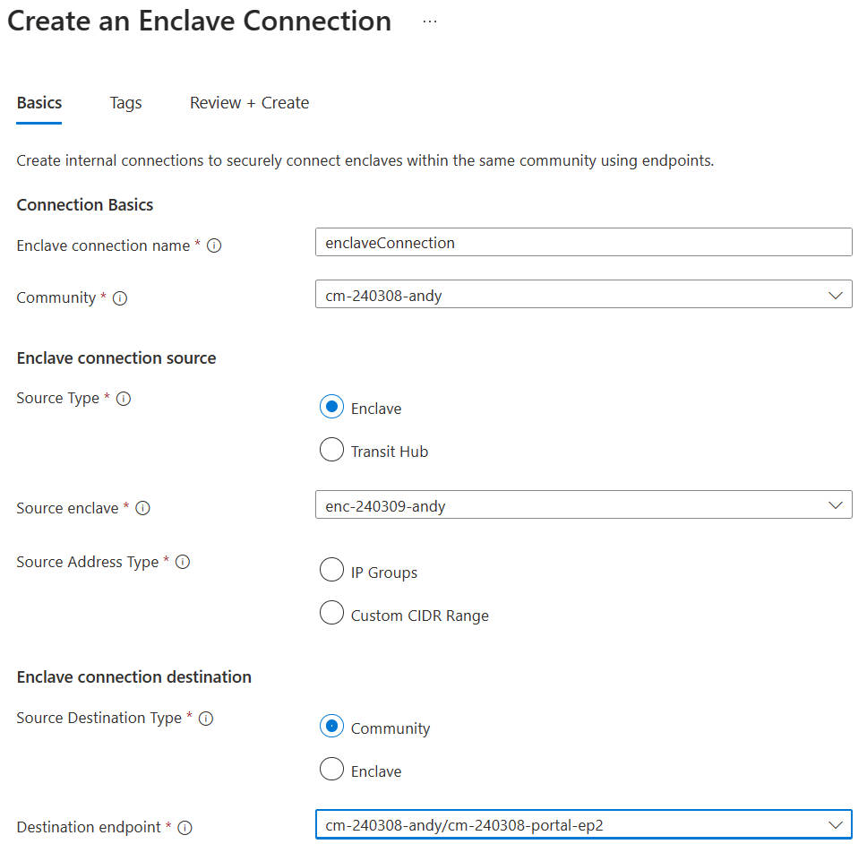

# Create an Enclave Connection from the Azure portal

Enclave Connections enable network traffic to flow into, out of, and between AVE Communities and Enclaves. Follow these steps to create an Enclave Connection within the Azure portal.

## Create Enclave Connection to Community endpoint for Azure portal access

1. From the portal, navigate to the enclave resource and select the "Enclave Connections" blade.

2. Select "Create Enclave Connection"

3. Enter the required information to make a connection from the new enclave to the community endpoint

4. Select "Review + Create" and then "Create"
