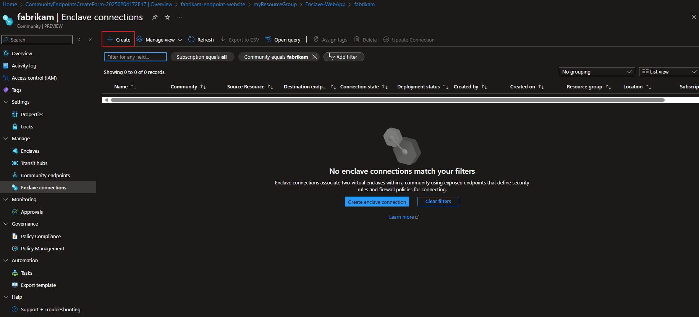
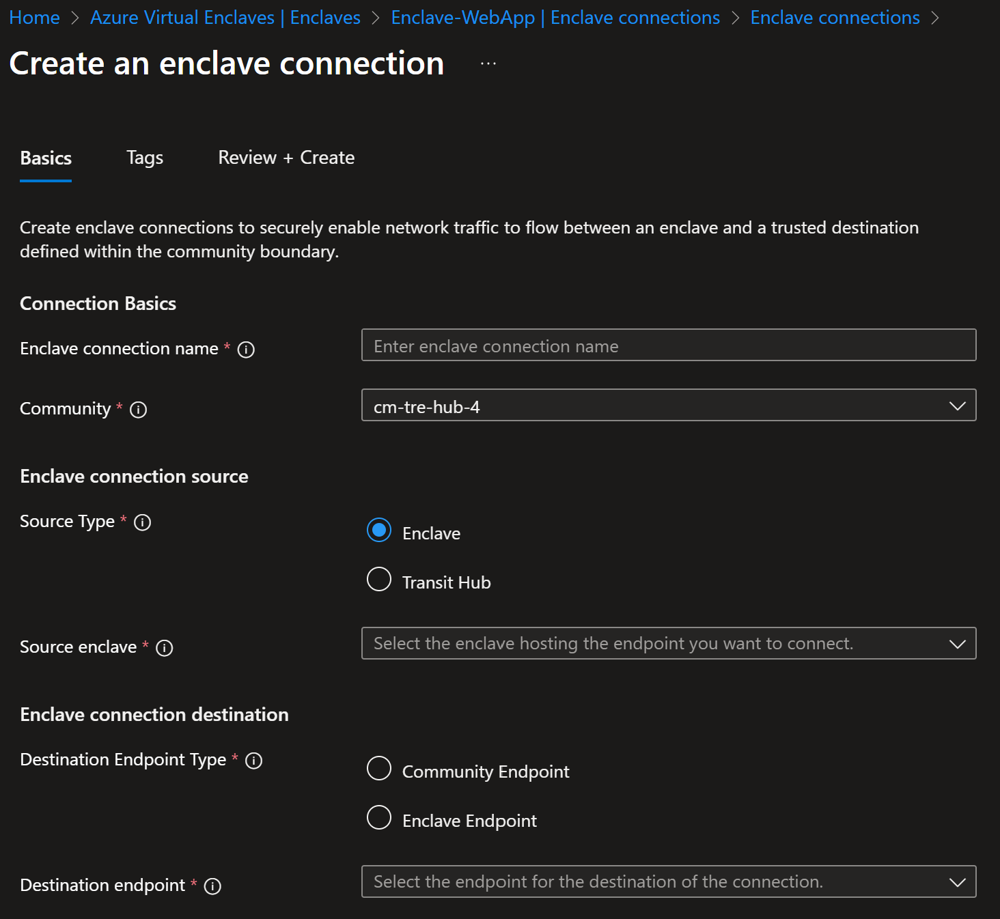
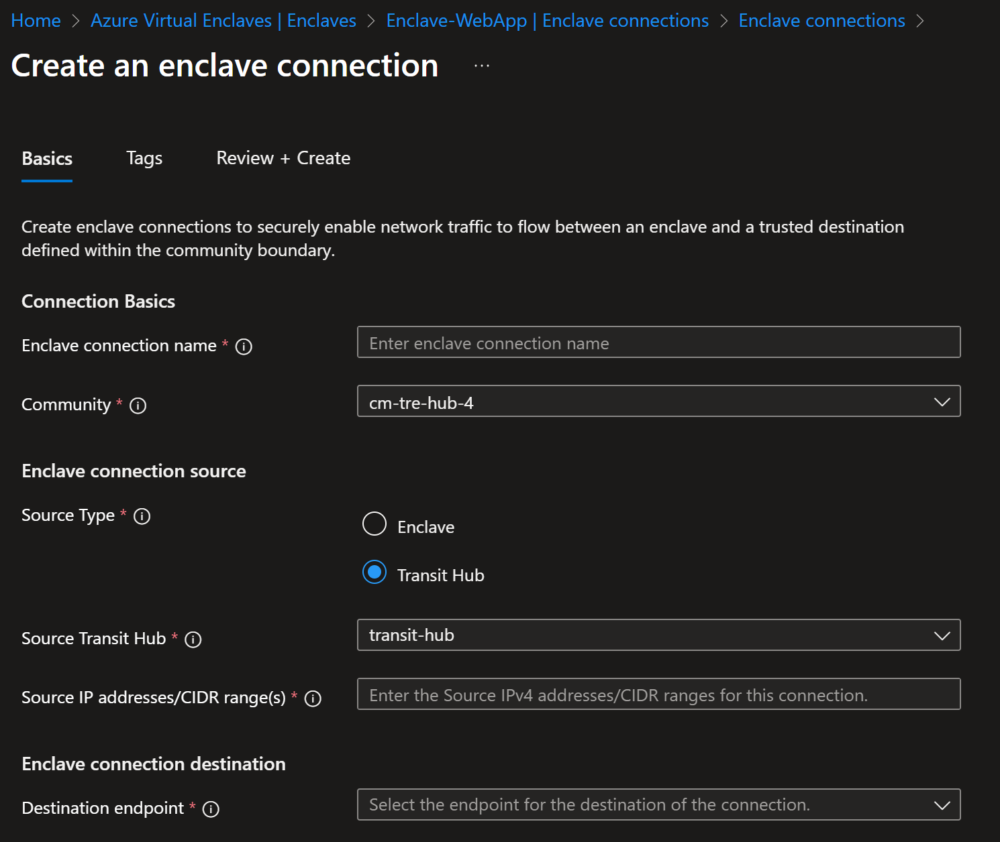

# Create an enclave Connection from the Azure portal

Enclave connections enable network traffic to flow into, out of, and between AVE communities and Enclaves. Follow these steps to create an enclave Connection within the Azure portal.

## Prerequisites

To access Azure Virtual Enclaves, you need an Azure subscription. If you don't already have a subscription, create a [free account](https://azure.microsoft.com/free/) before you begin.

All access to Azure Virtual Enclaves takes place through a community or an Enclave. For this how-to article, create a [community](./create-community-portal.md) and [enclave](./create-enclave-portal.md) using the Azure portal. Creating a connection also requires an existing [Enclave Endpoint](./what-enclave-endpoint.md) or [Community Endpoint](./what-community-endpoint.md)

## Sign-in to Azure

Sign-in to the [Azure portal](https://portal.azure.com).

## Create enclave Connection to community endpoint

1. Enter `Azure Virtual Enclaves` in the search.

2. Under `Services`, select `Azure Virtual Enclaves`.

3. In the `Azure Virtual Enclaves` page, select `Enclaves` in the left menu.

4. On the `Enclaves` page, select your Enclave's name to open the enclave resource.

5. Select `Enclave Connections` on the left and then select `Create`.

6. Enter the following information:
  - **Enclave connection name**: Create an enclave Connection name.
  - **Community**: Select the existing community from the list. 

## Enclave Source Connection
If the connection source is `Transit Hub`, skip this step.
For connections where the `Enclave` is the connection source:

7. Enter the required information for the connection
  
  - **Source Type**: Select `Enclave`.
  - **Source Enclave**: Select the existing enclave from the list.
  - **Destination Endpoint Type**: Select the `Enclave Endpoint` or `Community Endpoint` connection destination type.
  - **Destination Endpoint**: Select the endpoint from the list.

## Transit Hub Source Connection
If the connection source is `Enclave`, skip this step.
For connections where the `Transit Hub` is the connection source:

8. Enter the required information for the connection
  - **Source Type**: Select `Transit Hub`.
  - **Source Transit Hub**: Select the transit hub from the list.
  - **Source IP addresses/CIDR range(s)**: Enter the source IP addresses or CIDR ranges for this connection.
  - **Destination endpoint**: Select the endpoint from the list.

9. Select `Review + Create` and then `Create`
