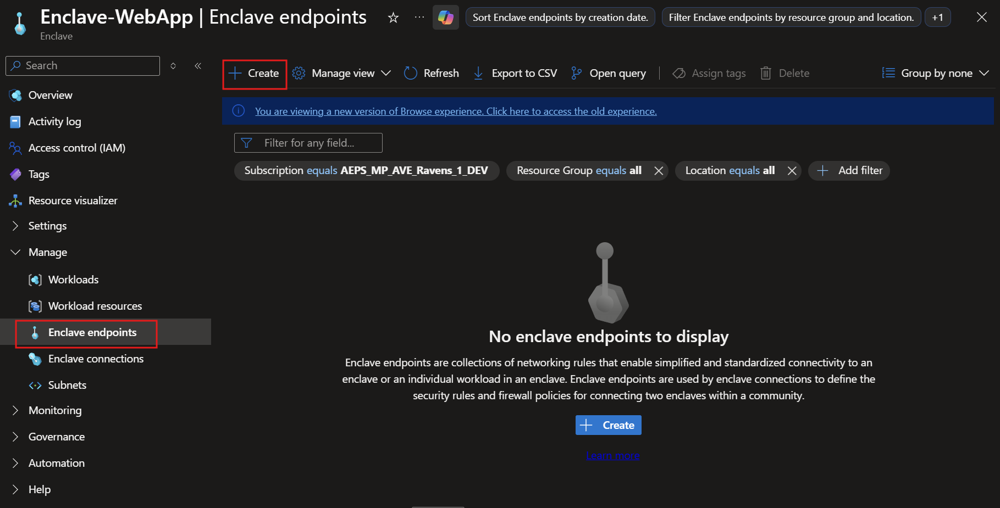
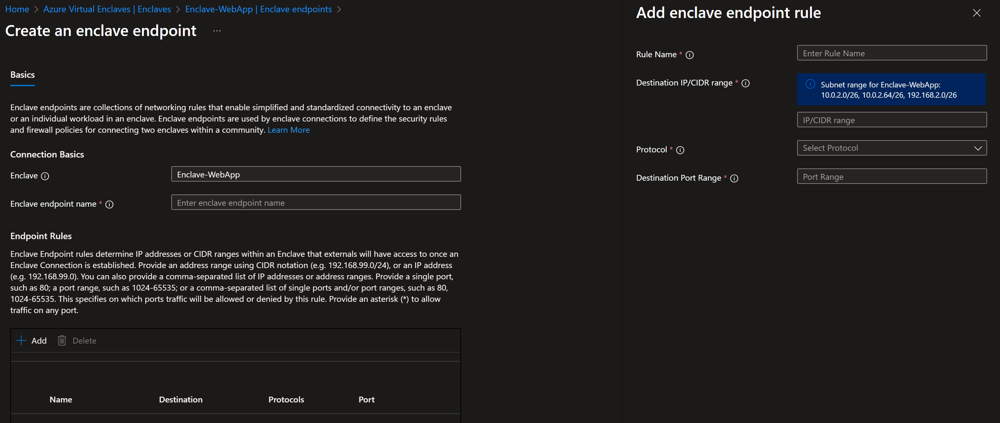

# Create an enclave endpoint in the Azure portal

## Prerequisites

To access Azure Virtual Enclaves, you need an Azure subscription. If you don't already have a subscription, create a [free account](https://azure.microsoft.com/free/) before you begin.

All access to Azure Virtual Enclaves takes place through a community or an Enclave. For this how-to article, create a [community](./create-community-portal.md) and [enclave](./create-enclave-portal.md) using the Azure portal.

## Sign-in to Azure

Sign-in to the [Azure portal](https://portal.azure.com).

## Create endpoint

1. Enter `Azure Virtual Enclaves` in the search.

2. Under `Services`, select `Azure Virtual Enclaves`.

3. In the `Azure Virtual Enclaves` page, select `Enclaves` in the left menu.

4. On the `Enclaves` page, select your Enclave's name to open the enclave resource.

5. Select `Enclave Endpoints` on the left and then select `Create`.

7. Enter the basic details for your enclave endpoint
   - Enclave endpoint name: Name of the enclave endpoint (ex: `endpoint-MyService`)
   - Endpoint rules: 
   
8. Select `Add` and enter the `Rule Name`, `Destination IP addresses/CIDR range`, `Protocol`, and `Destination Port Range`.
   - For example, if you were trying to create networking rules to allow other enclaves to talk to the `Enclave-WebApp` enclave, specifically an HTTPS server hosted on an Azure Virtual Machine (VM) with a Private IP address of `10.0.2.5` in subnet `10.0.2.0/26` in a [workload](./what-workload.md), you would supply the `Destination` (for example `10.0.0.5` or `10.0.2.0/26`) of the VM, `TCP` for the `Protocol`, and `443` for the `Destination Port Range`.

> [!NOTE]
>
> Endpoints are primarily based on another underlying Azure service called [Network security groups](/azure/virtual-network/network-security-groups-overview).

9. Select `Next` and enter any [Tags](/azure/azure-resource-manager/management/tag-resources) for your Endpoint.

10.  Select `Review + create` and validate the details for your Endpoint are correct, then select `Create`.
