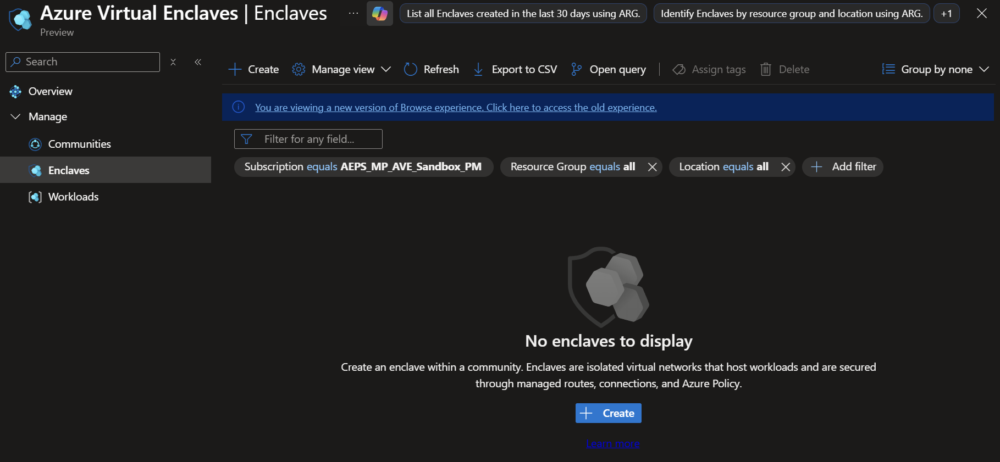
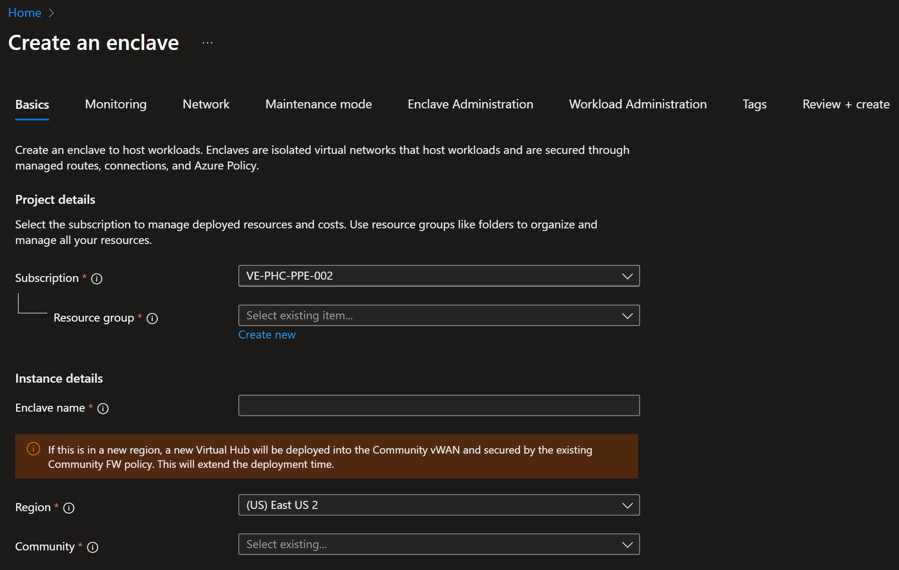
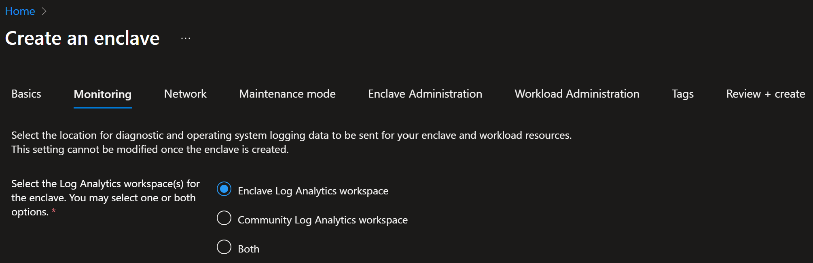
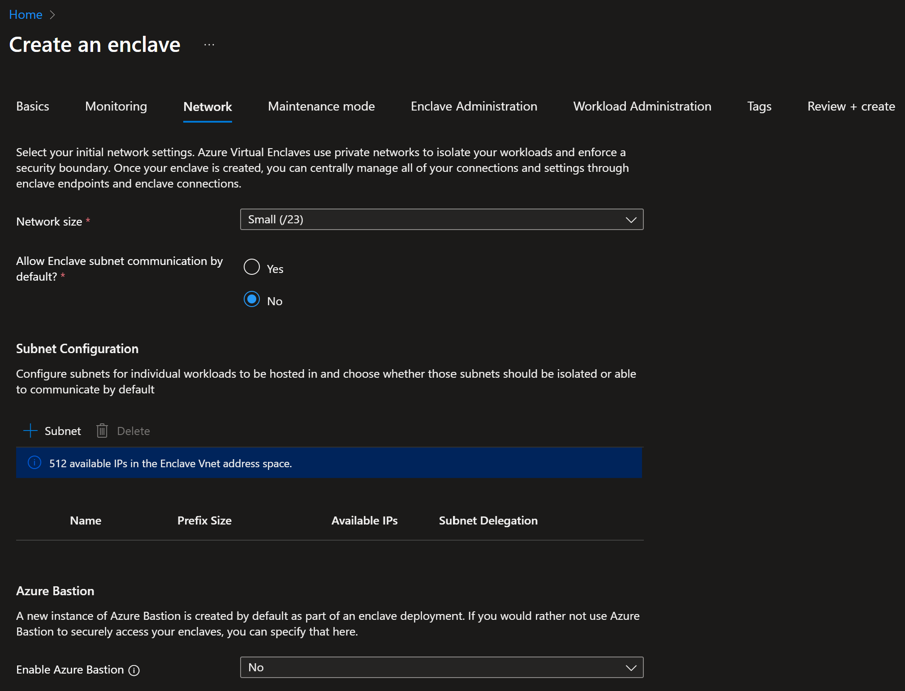
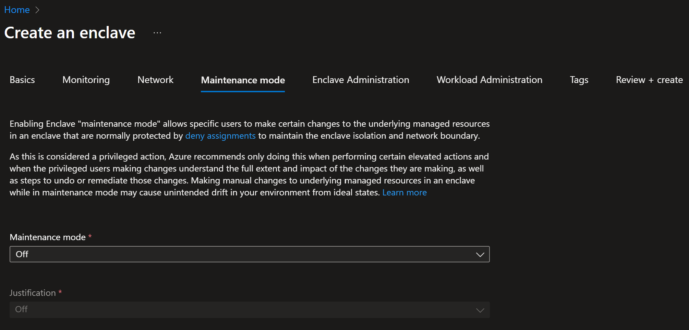
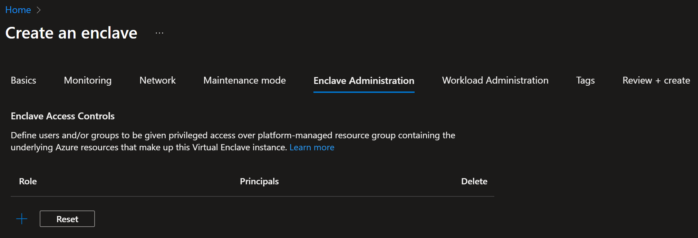
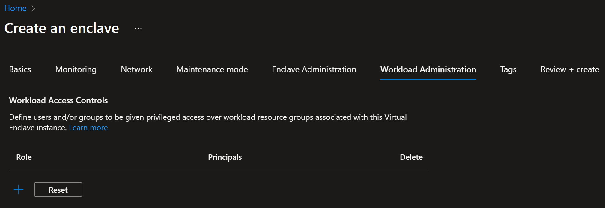

# Create an Enclave in the Azure portal

An [Enclave](./what-enclave.md) is a completely isolated Virtual Network that is part of a community in which one or more workloads are hosted. These workloads can be completely isolated from other Enclaves in the community. An enclave owner can enable other Enclaves to connect to theirs by creating an Endpoint. Endpoints are used by other Enclaves to establish Connections.

## Prerequisites

- To access Azure Virtual Enclaves, you need an Azure subscription. If you don't already have a subscription, create a [free account](https://azure.microsoft.com/free/) before you begin.
- Before you can create an enclave, you must [create a community](./create-community-portal.md) using the Azure portal.
- **If you're using on-prem/custom DNS** - each Enclave _must deploy a DNS resolver_ workload in order to resolve private endpoints for Azure Storage, Key Vault, and Log Analytics. 

## Sign-in to Azure
Sign-in to the [Azure portal](https://portal.azure.com).

## Create enclave
Enclave deployments will take around 30-45 minutes to complete. Once it completes, open your enclave and verify that the Status is `succeeded`.

1. Enter `Azure Virtual Enclaves` in the search.

2. Under `Services`, select `Azure Virtual Enclaves`.

3. In the `Azure Virtual Enclaves` page, select `Enclaves` in the left menu.

4. On the `Enclaves` page, select `Create`.

5. Enter the basic details for your enclave
   - Subscription: Select an existing Subscription
   - Resource Group: Create a new or select an existing resource group
   - Enclave name: Name of the enclave (for example `My-Enclave`)
   - Region: Azure region the enclave will be created in.
   - Select a community: Select an existing `Community`

6. Select `Next` and on the `Monitoring` page select where enclave logs will be stored.

7. Select `Next` and on the `Networking` page select the network size, if Enclave subnet communication is allowed by default, create subnets, and enable Azure Bastion as needed. Learn more about [Azure best practices regarding Azure Virtual Networks](/azure/virtual-network/concepts-and-best-practices), and how to use [Plan Azure Virtual Networks](/azure/virtual-network/virtual-network-vnet-plan-design-arm).

> [!NOTE]
>
> Azure Virtual Enclaves will automatically allocate the next best fit block of network addressable space based on the existing networks allocated to the community that the enclave is targeting.

8. Select `Next` and on the `Maintenance Mode` page select if maintenance mode, allowing changes to managed resources critical to the security of the enclave, is turned on once the enclave is created. This makes it easier to add resources quickly since joining a resource to the network requires maintenance mode. [Learn more about Maintenance Mode](./maintenance-mode.md)

9. Select `Next` and on the `Enclave Administration` page select users, groups that should have privileged access over the managed resource group for the enclave.

10. Select `Next` and on the `Workload Administration` page select users, groups that should have privileged access over the workload resource groups a customer creates and deploys their resources into based on their needs.

11. Select `Next` and create any [Tags](/azure/azure-resource-manager/management/tag-resources) for your Enclave.

12. Select `Review + create` and validate the details for your Enclave are correct, then select `Create`.

**References**
- [What is an Enclave](./what-enclave.md)
- [Create a community](./create-community-portal.md)
- [Best practices](./best-practices.md)
- [Azure best practices regarding Azure Virtual Networks](/azure/virtual-network/concepts-and-best-practices)
- [Plan Azure Virtual Networks](/azure/virtual-network/virtual-network-vnet-plan-design-arm)
