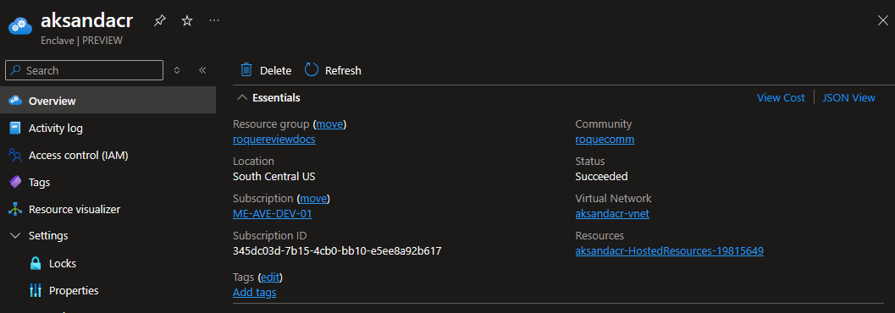
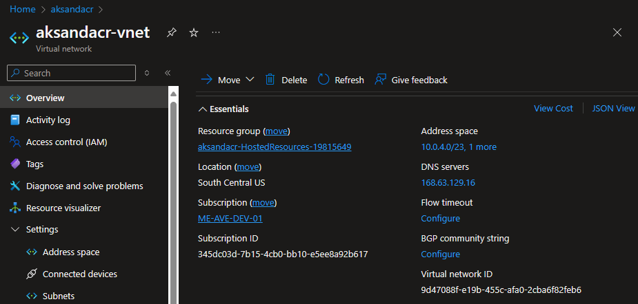
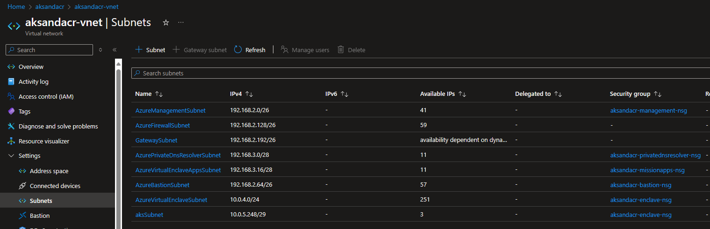

# Create New Subnet for AVE Enclave VNET

This will guide you through replacing the existing AVE Enclave VNET subnet `AzureVirtualEnclaveSubnet` with a replacement `AzureVirtualEnclaveSubnet` subnet and a new subnet of your choice. This is an important step to perform early after the Enclave is created so there are no resources attached to the existing subnet. An existing subnet cannot be deleted until there are no resources attached to it.

> **Notes**:
> * You are not able to resize a VNET with existing connections. [Official Docs](https://learn.microsoft.com/azure/virtual-network/virtual-network-manage-subnet?tabs=azure-portal#change-subnet-settings). If you need to resize an existing subnet you will need to move any connected devices out first, resize, then move them back.
> * Remember when sizing your subnets that 5 IP addresses per subnet are reserved by Azure. See [official documentation](https://learn.microsoft.com/azure/virtual-network/virtual-networks-faq#are-there-any-restrictions-on-using-ip-addresses-within-these-subnets).

## Size Table Reference


| Subnet Size | Useable IPs |
| ------
-- | ------
-- |
| /29 | 3  |
| /28 | 11 |
| /27 | 27 |
| /26 | 59 |
| /25 | 123 |
| /24 | 251 |

## Detailed Steps

### Find the existing VNET subnet

The existing subnet is called "AzureVirtualEnclaveSubnet" by default. This can be confirmed by looking at the Enclave resource's properties.

1. Record the name of the Virtual Network (vnet) associated with the enclave by navigating to the enclave's Overview page.
   
1. Navigate to the vnet's overview page and record the address space for the enclave. Usually a 10.0.X.Y/Z, the 192.168.X.Y/Z is the management address space and should not be modified.
   
1. Navigate to the vnet's Subnets page
   
1. Record the default subnet name (usually `AzureVirtualEnclaveSubnet`)
1. Record it's CIDR (e.g. 10.0.4.0/23)
1. Record it's Security group name (starting with the enclave name and ending with "-nsg")
1. Plan out what subnets you will need and their sizes.
   - Remember that Azure reserves 5 IPs per subnet
   - Factor in any growth you may need

### Update the subnets

Either using the template below or by manually going through the Azure portal modify the subnets to meet your plan. The template modifies the existing subnet and creates a new one, and attach the original NSG to the two new subnets. Modify as needed.

```
{
    "$schema": "https://schema.management.azure.com/schemas/2019-04-01/deploymentTemplate.json#",
    "contentVersion": "1.0.0.0",
    "parameters": {
        "existingVNETName": {
            "defaultValue": "aksandacr-vnet",
            "type": "String",
            "metadata": {
                "description": "Name of the VNET to add a subnet to"
            }
        },
        "newSubnetName1": {
            "defaultValue": "AzureVirtualEnclaveSubnet",
            "type": "String",
            "metadata": {
                "description": "Name of the subnet to add"
            }
        },
        "newSubnetAddressPrefix1": {
            "defaultValue": "10.0.4.0/26",
            "type": "String",
            "metadata": {
                "description": "Address space of the subnet to add"
            }
        },
        "newSubnetName2": {
            "defaultValue": "FunctionAppSubnet",
            "type": "String",
            "metadata": {
                "description": "Name of the subnet to add"
            }
        },
        "newSubnetAddressPrefix2": {
            "defaultValue": "10.0.4.128/26",
            "type": "String",
            "metadata": {
                "description": "Address space of the subnet to add"
            }
        },
        "enclaveNsgName": {
            "defaultValue": "demo-ave-mly-9777-enc-2-nsg",
            "type": "String",
            "metadata": {
                "description": "Name of NSG to associate with the subnets."
            }
        }
    },
    "resources": [
        {
            "type": "Microsoft.Network/virtualNetworks/subnets",
            "apiVersion": "2021-03-01",
            "name": "[format('{0}/{1}', parameters('existingVNETName'), parameters('newSubnetName1'))]",
            "properties": {
                "addressPrefix": "[parameters('newSubnetAddressPrefix1')]",
                "networkSecurityGroup": {
                    "id": "[resourceId('Microsoft.Network/networkSecurityGroups', parameters('enclaveNsgName'))]"
                }
            }
        },
        {
            "type": "Microsoft.Network/virtualNetworks/subnets",
            "apiVersion": "2021-03-01",
            "name": "[format('{0}/{1}', parameters('existingVNETName'), parameters('newSubnetName2'))]",
            "properties": {
                "addressPrefix": "[parameters('newSubnetAddressPrefix2')]",
                "networkSecurityGroup": {
                    "id": "[resourceId('Microsoft.Network/networkSecurityGroups', parameters('enclaveNsgName'))]"
                }
            }
        }
    ]
}
```
