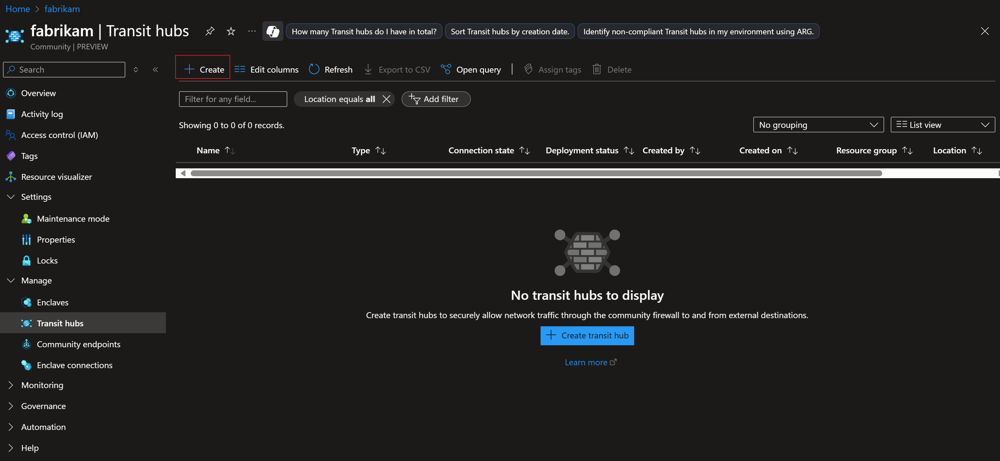
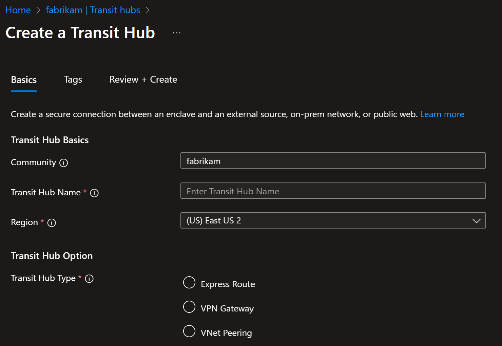

# Create a Transit Hub from the Azure portal

## Prerequisites

- To access Azure Virtual Enclaves, you need an Azure subscription. If you don't already have a subscription, create a [free account](https://azure.microsoft.com/free/) before you begin.

- All access to Azure Virtual Enclaves takes place through a Community or an enclave. For this how-to article, create a [community](./create-community-portal.md) and [enclave](./create-enclave-portal.md) using the Azure portal.

## Sign-in to Azure
Sign-in to the [Azure portal](https://portal.azure.com).

## Create a Transit Hub

1. Navigate to an existing `Community` within your Azure subscription, select the `Transit Hubs` tab, and select `Create`

2. Provide a name and type for the Transit Hub and select the type of transit hub.

Refer to this guidance for more information on the different types of Transit Hub connections:

- [Express Route](../virtual-wan/virtual-wan-expressroute-portal.md)
- [VPN Gateway](../virtual-wan/virtual-wan-site-to-site-portal.md)
- [vNet Peering](../virtual-network/tutorial-connect-virtual-networks-portal.md)

3. Select `Next`, add any tags, and select `Review + Create`.

4. Select `Review + Create` and select `Create`

> [!NOTE]
> 
> Transit Hub connectivity may be a "break-glass" scenario due to configuration variability of transit connections.
