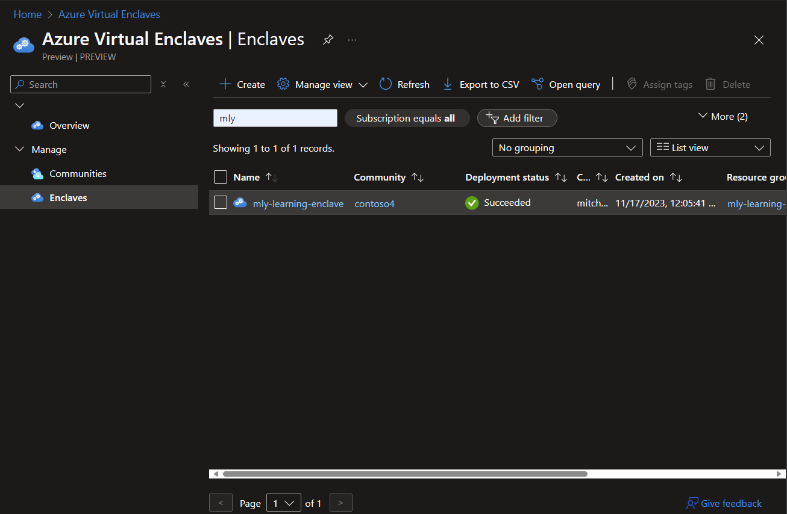
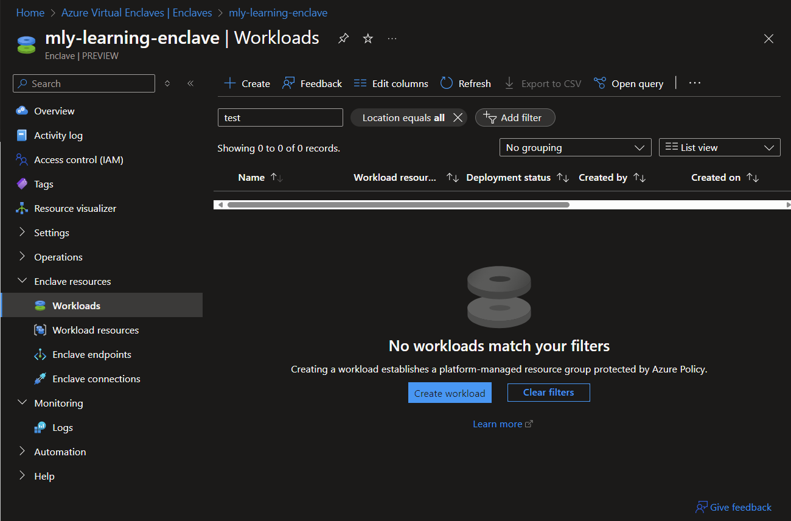
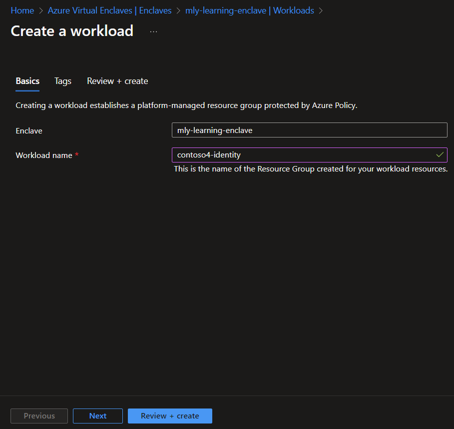

# Quickstart: Create a Workload in the Azure portal

[Workloads](./what-workload.md) are logical groups of Azure resources that you define to create and audit connections in Azure Virtual Enclaves.

## Prerequisites
- To access Azure Virtual Enclaves, you need an Azure subscription. If you don't already have a subscription, create a [free account](https://azure.microsoft.com/free/) before you begin.
- All access to Azure Virtual Enclaves takes place through a community or an enclave. For this how-to article, create a [community](./create-community-azure-portal.md) and [enclave](./create-enclave-azure-portal.md) using the Azure portal.

## Sign-in to Azure
Sign-in to the [Azure portal](https://portal.azure.com).

## Create workload

1. Enter `Azure Virtual Enclaves` in the search.

2. Under `Services`, select `Azure Virtual Enclaves`.

3. In the `Azure Virtual Enclaves` page, select `Workloads` in the left menu.

4. On the `Workloads` page, select `Create`.

5. While in your Enclave's page, select `Workloads` in the left menu.

6. In the `Workloads` page, select Create. The `Create workload` page opens.

7. Enter the basic details for your Workload
   - Enclave: Select an existing Enclave. This value is automatically applied from the Enclave you were currently browsing.
   - Workload name: Name of the Workload (for example `contoso4-identity`)

> [!NOTE]
>
> Organizations should choose a workload naming convention that makes sense for the organization. Learn more about [defining your naming convention](https://learn.microsoft.com/azure/cloud-adoption-framework/ready/azure-best-practices/resource-naming).

8. Select `Next`.

9. Enter any [Tags](../azure-resource-manager/management/tag-resources.md) for your Workload.

10. Select `Review + create`, ensure the details for your Workload are correct, and select `Create`.

**References**
- [What is a Workload?](./what-workload.md)
- [Create an Enclave](./create-enclave-azure-portal.md)
- [Best practices](./best-practices.md)
- [Defining your naming convention](https://learn.microsoft.com/azure/cloud-adoption-framework/ready/azure-best-practices/resource-naming)
