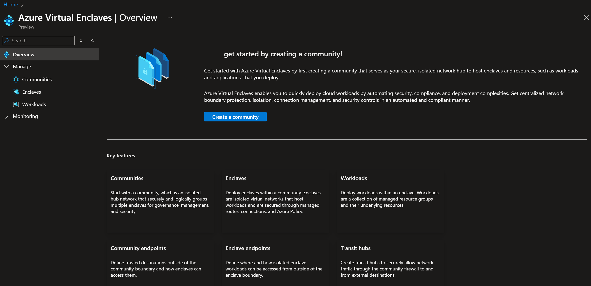
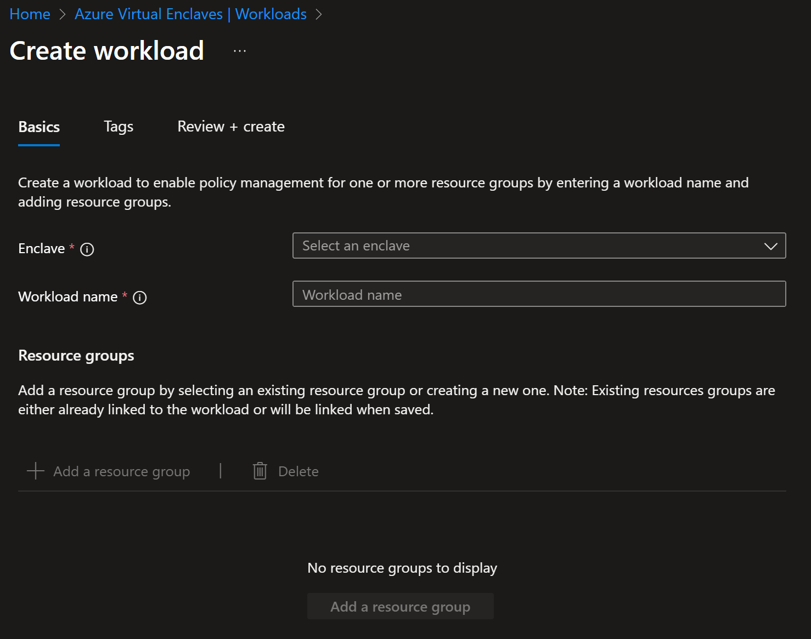

# Create a workload in the Azure portal

[Workloads](./what-workload.md) are logical groups of Azure resources that you define to create and audit connections in Azure Virtual Enclaves.

## Prerequisites
- To access Azure Virtual Enclaves, you need an Azure subscription. If you don't already have a subscription, create a [free account](https://azure.microsoft.com/free/) before you begin.
- All access to Azure Virtual Enclaves takes place through a community or an enclave. For this how-to article, create a [community](./create-community-portal.md) and [enclave](./create-enclave-portal.md) using the Azure portal.

## Sign-in to Azure
Sign-in to the [Azure portal](https://portal.azure.com).

## Create workload

1. Enter `Azure Virtual Enclaves` in the search.

2. Under `Services`, select `Azure Virtual Enclaves`.

3. In the `Azure Virtual Enclaves` page, select `Workloads` in the left menu.

4. On the `Workloads` page, select `Create`.

5. Enter the basic details for your workload
   - Enclave: Select an existing Enclave. This value is automatically applied if you started the workload creation from the existing Enclave.
   - Workload name: Name of the workload (for example `cyber-monitoring-apps`)

> [!NOTE]
>
> Organizations should choose a workload naming convention that makes sense for the organization. Learn more about [defining your naming convention](/azure/cloud-adoption-framework/ready/azure-best-practices/resource-naming).

## Create workload resource groups

6. You can also create new resource groups on this page view or later after workload creation. You can also move existing resource groups into your workload after the workload is created. To add a new resource group select `Add`, provide a name, and repeat as needed.

7. Select `Next` and enter any [Tags](/azure/azure-resource-manager/management/tag-resources) for your workload.

8. Select `Review + create` and validate the details for your workload are correct, then select `Create`.

**References**
- [What is a workload?](./what-workload.md)
- [Create an Enclave](./create-enclave-portal.md)
- [Best practices](./best-practices.md)
- [Defining your naming convention](/azure/cloud-adoption-framework/ready/azure-best-practices/resource-naming)
