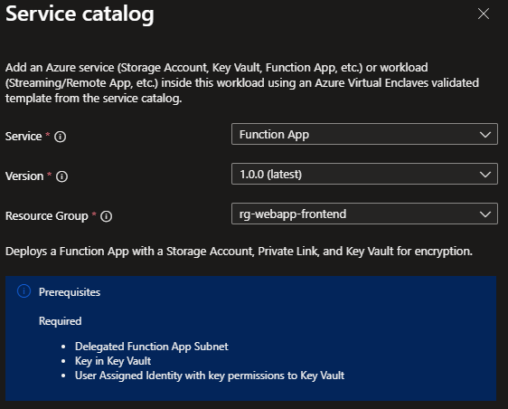

# Deploy an App Service Function App from the service catalog into a workload

Azure Virtual Enclaves (AVE) is a cloud networking service that provides organizations with highly sensitive data the ability to quickly deploy and manage workloads across Commercial and air-gapped Azure clouds at scale. In this article, you:

- Deploy a service catalog template for a Function App into an existing workload from the Portal.

> [!NOTE]
> 
> This sample deployment is just for demo purposes and doesn't represent all the best practices for network, systems, or applications administration.

## Before you begin
- This article assumes a basic understanding of networking and Azure Virtual Enclaves concepts. For more information, see [Best practices of Azure Virtual Enclaves](./best-practices.md).

- You need an Azure account with an active subscription. If you don't have one, [create an account for free](https://azure.microsoft.com/free/).

- A [deployed community](./what-community.md), [deployed enclave](./what-enclave.md), and [deployed workload](./what-workload.md) and permissions to create resources inside the workload.

## Prerequisites

There are guardrails in the enclaves to ensure a Function App is isolated with private endpoints. The App Service also requires a subnet delegation in the enclave virtual network to provide more control to the service. It is important to note that a private endpoint can't be created on a delegated subnet.

1. Two subnets 
> [!IMPORTANT]
> 
> You will not be able to resize a subnet once resources have been deployed inside of it.
  - Use the subnet management feature of the enclave so you have two subnets with size `/26` (for example, 10.0.2.0/26 [10.0.2.0 - 10.0.2.63] and 10.0.2.128/26 [10.0.2.128 - 10.0.2.191])
  - The first subnet is used for the "Subnet Name" template parameter. Create a subnet name with a name like `FunctionAppSubnet` and use the name in step 5 below.
    - Add subnet delegation `Microsoft.Web/serverFarms`
  - The second subnet is used for the "Private Link Subnet Name" template parameter. Create a subnet name like `PrivateLinkSubnet` and use the name in step 5 below.
> [!NOTE]
> 
> Two "/26" subnets leave space in the enclave subnet for more subnets (for example another "/26"). If these two subnets are the only subnets needed in the enclave, they can be resized according to your needs.

2. A `Key Vault` with `Customer Mananged Key (CMK)`, `User Managed Identity`, and `Disk Encryption Set`. You can create these using the [Common Dependencies service catalog template](./deploy-common-dependencies-service-catalog.md).
    - [Disk encryption options](/azure/virtual-machines/disk-encryption-overview)
    - [How to create a user assigned managed identity](/entra/identity/managed-identities-azure-resources/how-manage-user-assigned-managed-identities?pivots=identity-mi-methods-azp)
    - [Manage User-assigned Identity](/azure/operator-service-manager/how-to-create-user-assigned-managed-identity)
    - Create an Access Policy in the Key Vault for this identity with the following Key Permissions: `Unwrap Key, Wrap Key, Recover, Get`

## Deploy the template
1. Navigate to the workload for the intended deployment.
2. Select `Add Service` button.
3. Select the `Function App` service service template from the [service catalog list](./list-service-catalog-templates.md) dropdown, confirm the version you need (default: `latest`), and select `Next`.

4. On the Basics tab enter all the required parameters. The Storage Account name is the name of the new storage account.
5. Once the two subnets are created, enter the new subnet names on the Networking tab.
6. On the Encryption tab, enter the name of the new key added to the Key Vault for the Customer Managed Key (CMK) setup.
7. Enter the User Managed Identity Name created during the CMK setup.
8. Adjust any of the prepopulated or default parameters as needed.
9. Select `Review + Add` then `Create`.

It can take 10 minutes to finish all resource creation. Wait for the deployment to be successfully completed before you take any actions within your deployed resources.

## Validate the deployment
Go to the specified resource group to confirm the intended resources were created. Including: Function App and new Storage Account

### Open the Function App resource
1. Open the Function App resource
2. On the overview page, check functions

## Delete the deployment
If you don't plan on keeping these resources, clean up unnecessary resources to avoid Azure charges. If no other deployments exist in the resource group, the whole resource group can be deleted.

## Recommendations
- [Add tags](../azure-resource-manager/management/tag-resources.md) to service catalog deployments to track important information for that resource such as:
  - Owner: `<main POC>`
  - Deployer: `<yourName>`
  - Purpose: `<publish abc app to users>`
  - Service Catalog Name: `<RemoteApp>`
  - Service Catalog Version: `<version you deployed>`
- Consider adding an [Azure Policy to enforce and inherit tags](../azure-resource-manager/management/tag-policies.md)
