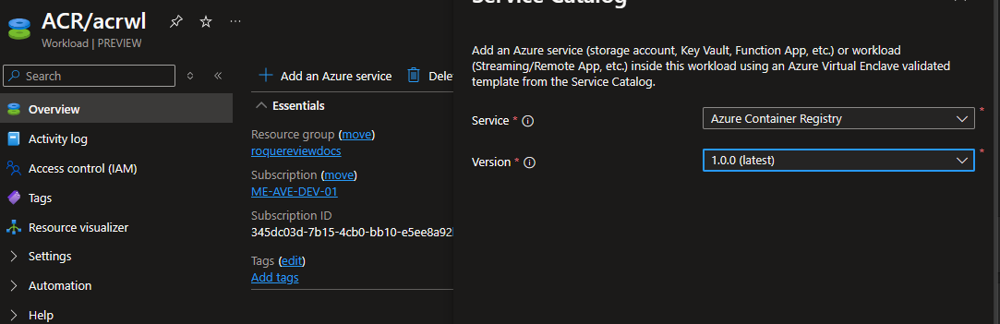
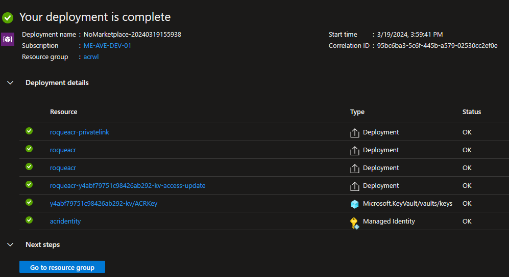
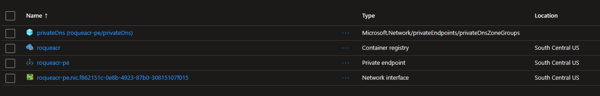

# Deploy Azure Container Registry (ACR) from the Service Catalog into a Workload

Azure Virtual Enclaves (AVE) is a cloud networking service that provides organizations with highly sensitive data the ability to quickly deploy and manage workloads across Commercial and air-gapped Azure clouds at scale. In this quickstart, you:

- Deploy a Service Catalog template for a RemoteApplication into an existing Workload from the Portal.

> [!NOTE]
> 
> This sample deployment is just for demo purposes and doesn't represent all the best practices for network, systems, or applications administration.

## WARNING

- If you plan on using this template in conjunction with the [AKS Template](./deploy-azure-kubernetes-service-from-the-service-catalog-into-a-workload.md) in the same enclave, perform the AKS Templates pre-requisite steps prior to deploying this as it will have you delete and recreate the enclave's subnets.

## Before you begin

- This quickstart assumes a basic understanding of networking and Azure Virtual Enclaves concepts. For more information, see [Best practices of Azure Virtual Enclaves](./best-practices.md).

- You need an Azure account with an active subscription. If you don't have one, [create an account for free](https://azure.microsoft.com/free/).

- A [deployed Community](./what-community.md), [deployed Virtual Enclave](./what-enclave.md), and [deployed Workload](./what-workload.md) and permissions to create resources inside the workload.

## Prerequisites

There are guardrails in the enclaves to ensure an Azure Container registry is using CMK encryption (customer-managed keys). This requires a key and identity to access the key to be accessible in the enclave.
> [!NOTE] These resources are not deployed with the enclave or workload.

1. An existing subnet to place a private endpoint into. 
    - The default enclave subnet intended for resources can be used (ex: `AzureVirtualEnclaveSubnet`).
2. A Key Vault that supports CMK and a key that can be leveraged for CMK encryption. [Setup CMK](./deploy-common-dependencies-from-the-service-catalog-into-a-workload.md)
    - The enclave Key Vault in the `HostedResources` RG can be used.
    - Create a RSA (we recommend 4096 bits) key in the Key Vault.
3. A user identity with access to the CMK key.
    - [Create a user-assigned managed identity](./create-user-managed-identity.md) in the enclave `HostedResources` RG.
    - Create an Access Policy in the Key Vault above for this identity with the following Key Permissions: `Unwrap Key, Wrap Key, Recover, Get`

## Deploy the template

1. Navigate to the workload for the intended deployment.
1. Select "Add Service" button.
1. Select the Azure Container Registry" service template from the [Catalog](./list-of-service-catalog-templates.md) of templates (the dropdown list).

   

1. Select through the tabs and enter all the required parameters.
   * Under the encryption tab you'll need to use the CMK Key and User Assigned Identity created in the pre-reqs.
1. Adjust any of the prepopulated parameters as needed.
1. Select Review + Add then Add.

It can take a few minutes to finish all resource creation. Wait for the deployment to be successfully completed before you take any actions within your deployed resources.

## Validate the deployment

1. Go to the Workload's Resource Group to confirm the intended resources were created. Including: Container registry, Private endpoint, Network interface, privateDnsZoneGroups (hidden by default)

   

1. If the Remote App was published: hostpool, app group, and workspace.

## Delete the deployment

If you don't plan on keeping these resources, clean up unnecessary resources to avoid Azure charges. If no other deployments exist in the Resource Group, the whole Resource Group can be deleted.

## Recommendations

- [Add tags](../azure-resource-manager/management/tag-resources.md) to Service Catalog deployments to track important information for that resource such as:
-- Owner: `<main POC>`
-- Deployer: `<yourName>`
-- Purpose: `<publish abc app to users>`
-- Service Catalog Name: `<RemoteApp>`
-- Service Catalog Version: `<version you deployed>`
- Consider adding an [Azure Policy to enforce and inherit tags](../azure-resource-manager/management/tag-policies.md)

## Next Steps

- Deploy any needed tools onto the management VM (examples: docker cli, azure powershell modules, ...)
- Read the [AKS Template](./deploy-azure-kubernetes-service-from-the-service-catalog-into-a-workload.md) documentation to see if you would like to use it.
