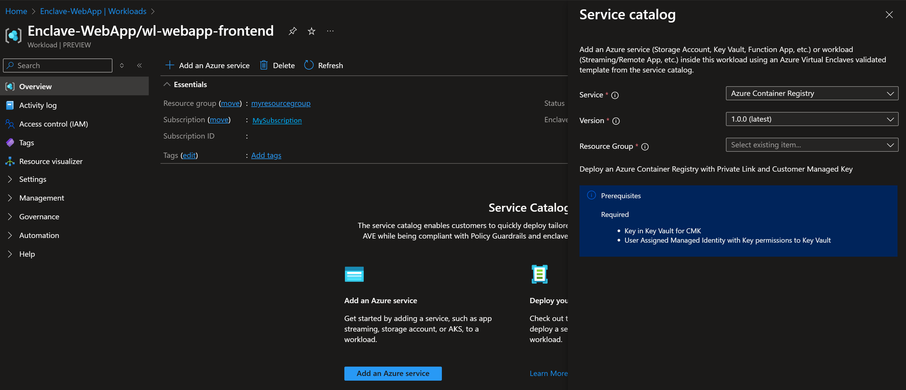

# Deploy Azure Container Registry (ACR) from the service catalog into a workload

Azure Virtual Enclaves (AVE) is a cloud networking service that provides organizations with highly sensitive data the ability to quickly deploy and manage workloads across Commercial and air-gapped Azure clouds at scale. In this quickstart, you:

- Deploy a service catalog template for an Azure Container Registry into an existing workload from the Portal.

> [!NOTE]
> 
> This sample deployment is just for demo purposes and doesn't represent all the best practices for network, systems, or applications administration.

> [!WARNING]
> 
> If you plan on using this template in conjunction with the [AKS Template](./deploy-azure-kubernetes-service-service-catalog.md) in the same enclave, perform the AKS Templates pre-requisite steps _prior_ to following this guide as it will have you delete and recreate the enclave's subnets.

## Before you begin

This quickstart assumes a basic understanding of networking and Azure Virtual Enclaves concepts. For more information, see [Best practices of Azure Virtual Enclaves](./best-practices.md).

- You need an Azure account with an active subscription. If you don't have one, [create an account for free](https://azure.microsoft.com/free/).

- A [deployed community](./what-community.md), [deployed enclave](./what-enclave.md), and [deployed workload](./what-workload.md) and permissions to create resources inside the workload.

## Prerequisites

There are guardrails in the enclaves to ensure an Azure Container Registry is using Customer-Managed Keys (CMK) encryption. This requires a key and identity to access the key to be accessible in the enclave. Create the CMK (optional Key Vault) and Managed Identity in the [Common Dependencies service catalog template](./deploy-common-dependencies-service-catalog.md)

1. A subnet with no [subnet delegation](../virtual-network/subnet-delegation-overview.md) to place a private endpoint into. You had the option to create subnets during enclave creation or you can [create new subnets](./create-new-enclave-subnet.md) after enclave creation.
2. A Key Vault, Customer Managed Key (CMK), and Managed Identity are required for this template. Create a Key Vault, CMK, Managed Identity in [the Common Dependencies service catalog quickstart](./deploy-common-dependencies-service-catalog.md) or create your own with the following requirements.
    - These resources should be created inside a [workload resource group](./create-workload-portal.md#create-workload-resource-groups)
    - The CMK key that meets or exceeds the CMK key requirements.
    - A User Managed Identity with an Access Policy to the CMK key (for example, `Key Vault Crypto Service Encryption User`) or `Unwrap Key, Wrap Key, Recover, Get` permissions.
    - Create an Access Policy in the Key Vault above for this identity with the following Key Permissions: `Unwrap Key, Wrap Key, Recover, Get`

## Deploy the template

1. Navigate to the workload for the intended deployment.
2. Select `Add Service` button.
3. Select the `Azure Container Registry` service service template from the [service catalog list](./list-service-catalog-templates.md) dropdown, confirm the version you need (default: `latest`), and select `Next`.

4. Go through each tab and enter all the required parameters. Under the encryption tab you'll need to use the CMK Key and User-assigned Identity names and resource group created in the [Prerequisites](#prerequisites).
5. Adjust any of the prepopulated parameters as needed.
6. Select `Review + Add` then `Create`.

It can take a few minutes to finish all resource creation. Wait for the deployment to be successfully completed before you take any actions within your deployed resources.

## Validate the deployment

Go to the workload resource Group to confirm the intended resources were created. Including: Container registry and Private endpoint.

## Delete the deployment

If you don't plan on keeping these resources, clean up unnecessary resources to avoid Azure charges. If no other deployments exist in the resource group, the whole resource group can be deleted.

## Recommendations

- [Add tags](../azure-resource-manager/management/tag-resources.md) to service catalog deployments to track important information for that resource such as:
  - Owner: `<main POC>`
  - Deployer: `<yourName>`
  - Purpose: `<publish abc app to users>`
  - Service Catalog Name: `<RemoteApp>`
  - Service Catalog Version: `<version you deployed>`
- Consider adding an [Azure Policy to enforce and inherit tags](../azure-resource-manager/management/tag-policies.md)

## Next Steps

- Deploy any needed tools onto the management VM (examples: docker cli, Azure PowerShell modules, ...)
- Read the [AKS Template](./deploy-azure-kubernetes-service-service-catalog.md) documentation to see if you would like to use it.
