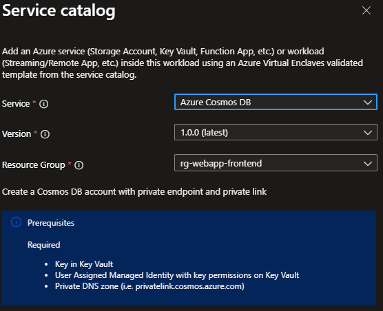

# Deploy Azure Cosmos DB from the service catalog into a workload

Azure Virtual Enclaves (AVE) is a cloud networking service that provides organizations with highly sensitive data the ability to quickly deploy and manage workloads across Commercial and air-gapped Azure clouds at scale. In this quickstart, you:

- Deploy a service catalog template for an Azure Cosmos DB account into an existing workload from the Portal.

> [!NOTE]
> 
> This sample deployment is just for demo purposes and doesn't represent all the best practices for network, systems, or applications administration.

## Before you begin
- This quickstart assumes a basic understanding of networking and Azure Virtual Enclaves concepts. For more information, see [Best practices of Azure Virtual Enclaves](./best-practices.md).

- You need an Azure account with an active subscription. If you don't have one, [create an account for free](https://azure.microsoft.com/free/).

- A [deployed community](./what-community.md), [deployed enclave](./what-enclave.md), and [deployed workload](./what-workload.md) and permissions to create resources inside the workload.

## Prerequisites

There are guardrails in the enclaves to ensure a service bus is using Customer Managed Key (CMK) encryption. This requires a key and identity to access the key to be accessible from the storage account in the enclave.
> [!NOTE]
> 
> These resources aren't deployed with the enclave or workload.

1. Subnet for Private Endpoints: You had the option to create subnets during enclave creation or you can [create new subnets](./create-new-enclave-subnet.md) after enclave creation.
2. A Key Vault that supports CMK and a key that can be used for CMK encryption. Create a new CMK, if needed, using the [Common Deploymentservice catalog template](./deploy-common-dependencies-service-catalog.md) article to:
    - Create an RSA (2048) key in the Key Vault.
    - [Create a user-assigned managed identity](./create-user-managed-identity.md) with access to the CMK key in the enclave `HostedResources` resource group (for example `your-enclave-name-HostedResources-...`).
    - Create an Access Policy in the Key Vault above for this identity with the following Key Permissions: `Unwrap Key, Wrap Key, Recover, Get`
4. Create Private DNS Zone for Azure Cosmos DB.
    - Create a new Private DNS Zone resource in the enclave HostedResources resource group.
      - Commercial cloud: "privatelink.cosmos.azure.com"
    - Next go into the DNS zone and create a virtual network link to attach the enclave virtual network.

## Deploy the template
1. Navigate to the workload for the intended deployment.
2. Select `+Add an Azure Service` button.
3. Select the `Azure Cosmos DB` service service template from the [service catalog list](./list-service-catalog-templates.md) dropdown, confirm the version you need (default: `latest`), and select `Next`.

4. Go through each tab and enter all the required parameters.
5. Adjust any of the prepopulated parameters as needed.
6. Select `Review + Add` then `Create`.

It can take up to 30 minutes to finish all resource creation. Wait for the deployment to be successfully completed before you take any actions within your deployed resources.

## Validate the deployment
1. Go to the specified resource group to confirm the resources were created: an Azure Cosmos DB account and a private endpoint.
2. Verify that the Azure Cosmos DB account was created and it its status is `Online`.
3. Check that the Azure Cosmos DB account `identity` is using the user assigned Managed Identity mentioned in prerequisites section.
4. Check that Azure Cosmos DB account encryption is using the key mentioned in prerequisites section.

## Delete the deployment
If you don't plan on keeping these resources, clean up unnecessary resources to avoid Azure charges. If no other deployments exist in the resource group, the whole resource group can be deleted.

## Recommendations
- [Add tags](../azure-resource-manager/management/tag-resources.md) to service catalog deployments to track important information for that resource such as:   
  - Owner: `<main POC>`
  - Deployer: `<yourName>`
  - Purpose: `<cosmos db account purpose>`
  - Service Catalog Name: `<AzureCosmosDB>`
  - Service Catalog Version: `<version you deployed>`
- Consider adding an [Azure Policy to enforce and inherit tags](../azure-resource-manager/management/tag-policies.md)
