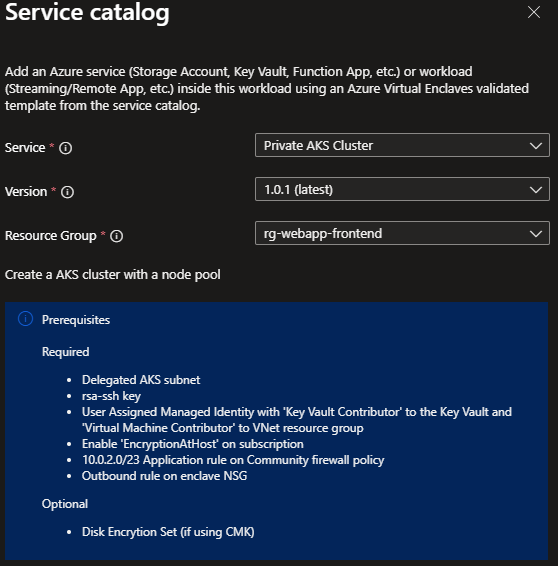

# Deploy Azure Kubernetes Service (AKS) from the service catalog into a workload

Azure Virtual Enclaves (AVE) is a cloud networking service that provides organizations with highly sensitive data the ability to quickly deploy and manage workloads across Commercial and air-gapped Azure clouds at scale. In this quickstart, you:

- Deploy a service catalog template for a RemoteApplication into an existing workload from the Portal.

> [!NOTE]
> 
> This sample deployment is just for demo purposes and doesn't represent all the best practices for network, systems, or applications administration.

## Before you begin
- This quickstart assumes a basic understanding of networking and Azure Virtual Enclaves concepts. For more information, see [Best practices of Azure Virtual Enclaves](./best-practices.md).

- You need an Azure account with an active subscription. If you don't have one, [create an account for free](https://azure.microsoft.com/free/).

- A [deployed community](./what-community.md), [deployed enclave](./what-enclave.md), and [deployed workload](./what-workload.md) and permissions to create resources inside the workload.

## Prerequisites

You'll need to create a subnet to host the AKS cluster. For a 30 pod cluster with a max node count of 3 a /26 subnet will be required. Use the following equation to calculate the minimum subnet size including an extra node for upgrade operations: `(node count + 1) + ((node count + 1) * maximum pods per node that you configure)`. Your Enclave's IP addresses might be different depending on the number of enclaves that were created before yours and the network size selected on enclave creation; assuming a `Small (/23)` subnet:

1. Subnet setup and creation: You had the option to create subnets during enclave creation or you can [create new subnets](./create-new-enclave-subnet.md) after enclave creation. Create these subnets:
    - Create new subnet `AzureVirtualEnclaveSubnet 10.0.2.0/26 [10.0.2.0 - 10.0.2.63]`
        - Add NSG rule set
        - Use this subnet for private endpoint resources
    - Create new subnet `aksSubnet 10.0.3.0/24 [10.0.3.0 - 10.0.3.255]`
        - Use this subnet for Azure Kubernetes Service agent pools
    - Create new subnet `agentSubnet 10.0.2.64/26 [10.0.2.64 - 10.0.2.127]`
        - Use this subnet for Azure Kubernetes Service managed cluster API server
2. Create an RSA key for SSH named **aks-ssh-public-key** and store it as a secret in your key vault. To create the public key type use ssh-keygen from PowerShell: `ssh-keygen -t RSA -f test`
    - This will output two files, you'll be using the public key. (located in test.pub)
    - save this as a secret named 'aks-ssh-public-key' in your keyvault
    > [!NOTE]
    >
    > You must create or use a Key Vault for your AKS cluster. If using Key Vault for secret management, it needs to be configured for Role Base Access Control (RBAC) by enabling the `RBAC Access Policy`. The RBAC roles for the AKS identity need to be set to `Key Vault Admin` and the disk encryption set in step 3 needs the `Key Vault Crypto Service Encryption User` role. After creating this new Key Vault, go to access configuration, and enable Azure Resource Manager (ARM) for template deployment (this requires disabling public network access and creating a private endpoint connected to the enclave virtual network):

3. [Create a user-assigned managed identity](./create-user-managed-identity.md) with `Virtual Machine Contributor` access on the resource group containing the Virtual Network and `Key Vault Contributor` access to the resource group containing the ssh-key. > [!NOTE] This might be the same resource group.
    - External services using the enclave Virtual Network: If using the enclave Virtual Network as the dedicated subnet for the cluster service, you'll also need to grant the managed identity `Contributor` on the Virtual Network resource group. (This seems like it should be `Network Contributor` but in testing that wasn't enough).
4. To leverage CMK you'll need to create the disk encryption set and give the disk encryption set the `wrapkey`, `unwrapkey`, and `get` permissions on the key vault that houses the key used for CMK. [Setup CMK](./configure-customer-managed-key-encryption-within-enclave.md). Use the managed identity created in step 3 while creating this disk encryption set.
5. In order to deploy AKS, you must deploy to a subscription that allows `EncryptionAtHost`. To do this, first set your azContext to ensure you're using the correct subscription, and then run the following:
`Register-AzProviderFeature -FeatureName "EncryptionAtHost" -ProviderNamespace "Microsoft.Compute"`.
> [!NOTE]
> 
> This might take several minutes, to check on the status of this registration run:
`Get-AzProviderFeature -FeatureName "EncryptionAtHost" -ProviderNamespace "Microsoft.Compute"`
6. In order to deploy AKS within a virtual enclave, you must deploy to a subscription that allows `EnableAPIServerVnetIntegrationPreview`. To do this, first set your azContext to ensure you're using the correct subscription, and then run the following: `Register-AzProviderFeature -FeatureName EnableAPIServerVnetIntegrationPreview -ProviderNamespace Microsoft.ContainerService`.
> [!NOTE]
> 
> This might take several minutes, to check on the status of this registration run: `Get-AzProviderFeature -FeatureName EnableAPIServerVnetIntegrationPreview -ProviderNamespace Microsoft.ContainerService`
7. Add the following Firewall rule to your community firewall policy as an Application rule:
    - Source: 10.0.2.0/23
    - Protocol: Https:443
    - Destination type: FQDN
    - Target FQDNs: `mcr.microsoft.com,*.hcp.useast2.azmk8s.io,*.data.mcr.microsoft.com,management.azure.com,login.microsoftonline.com,packages.microsoft.com,acs-mirror.azureedge.net`
8. Add the following outbound rule to your enclave NSG:
    - source: any
    - sourcePortRanges: *
    - Destination: Service Tag
    - Destination service tag: internet
    - Service: custom
    - Destination port ranges: 443
    - protocol: any
    - action: allow
    - priority: 1000
9. Using Azure Container Registry: Typical configuration requires granting the `Acr Pull` role to the AKS managed identity for the ACR resource. In addition if the ACR is configured to use a public storage account, that URL must be added as a community endpoint to create the firewall policy.

Documentation around these rules can be found [here](/azure/aks/outbound-rules-control-egress)

## Deploy the template

> [!NOTE]
>
> Make sure the AKS cluster version is supported in the location where the AKS resource is being deployed. Run `az aks get-versions --location <location-name>` to get a list of supported versions for a given location.

1. Navigate to the workload for the intended deployment.
2. Select `+Add an Azure Service` button.
3. Select the `Private AKS Cluster` service service template from the [service catalog list](./list-service-catalog-templates.md) dropdown, confirm the version you need (default: `latest`), and select `Next`.



4. Go through each tab and enter all the required parameters.
5. Use `172.16.0.0/16` for the serviceCidr and `172.16.0.10` for the dnsServiceIP
6. Adjust any of the prepopulated parameters as needed.
7. Select `Review + Add` then `Create`.

It can take up to 30 minutes to finish all resource creation. Wait for the deployment to be successfully completed before you take any actions within your deployed resources.

> [!IMPORTANT]
>
> If you're deploying an AKS cluster within a virtual enclave you need to make sure that the user assigned managed identity has sufficient permissions to perform operations within an enclave. To ensure that the user assigned managed identity does not get blocked by any enclave deny assignments, you'll need to make sure that its principal is either added directly to an enclave's [Maintenance Mode](./maintenance-mode.md) configuration or that the managed identity is part of a Microsoft Entra ID group that is connected to an enclave's maintenance mode.

### Associating AKS resource groups to workload

The AVE workload resource, as of API version `2024-06-01-preview`, now supports multiple resource groups. This means that an AVE workload can now apply AVE policies to multiple resource groups.

Once the AKS deployment succeeds, the AKS deployment's User RG and MRG can be brought to a workload by running an API PUT request for the workload resource. An example of a request body for an API PUT request for a workload resource is provided below:

```json
{
    "$schema": "https://schema.management.azure.com/schemas/2019-04-01/deploymentTemplate.json#",
    "contentVersion": "1.0.0.0",
    "parameters": {},
    "resources": [
        {
            "type": "Microsoft.Mission/virtualEnclaves/workloads",
            "apiVersion": "2024-06-01-preview",
            "name": "<virtual-enclave-name>/<workload-name>",
            "location": "<some-location>",
            "tags": {
                "department": "MIP",
                "company": "MIP"
            },
            "properties": {
                "resourceGroupCollection": [
                    "<resource-id-of-the-user-rg-where-aks-cluster-is-deployed>",
                    "<resource-id-of-the-aks-cluster-mrg>"
                ]
            }
        }
    ]
}
```

## Validate the deployment
Go to the specified resource group to confirm the intended resources were created.

### Connect to the Application VM
Via the Admin VM:
The Admin VM is used for administrator access the resources within the enclave boundary from outside the boundary. The Admin VM is also called a "jumpbox".
1. Sign-in to a desktop session on the Admin VM.
2. From the start menu, type `RDP`, and open the RDP window
3. Enter the RemoteApp VM IP address as the destination IP address for the RDP connection.
4. Enter RemoteApp VM credentials and select `Accept/Yes` to warnings about a new connection.
5. From the RemoteApp VM desktop, validate any VM settings set during the deployment. Otherwise, start using the RemoteApp VM (e.g. install or configure an application for RemoteApp publishing).

## Delete the deployment
If you don't plan on keeping these resources, clean up unnecessary resources to avoid Azure charges. If no other deployments exist in the resource group, the whole resource group can be deleted.

## Recommendations
- [Add tags](../azure-resource-manager/management/tag-resources.md) to service catalog deployments to track important information for that resource such as:
  - Owner: `<main POC>`
  - Deployer: `<yourName>`
  - Purpose: `<publish abc app to users>`
  - Service Catalog Name: `<RemoteApp>`
  - Service Catalog Version: `<version you deployed>`
- Consider adding an [Azure Policy to enforce and inherit tags](../azure-resource-manager/management/tag-policies.md)
