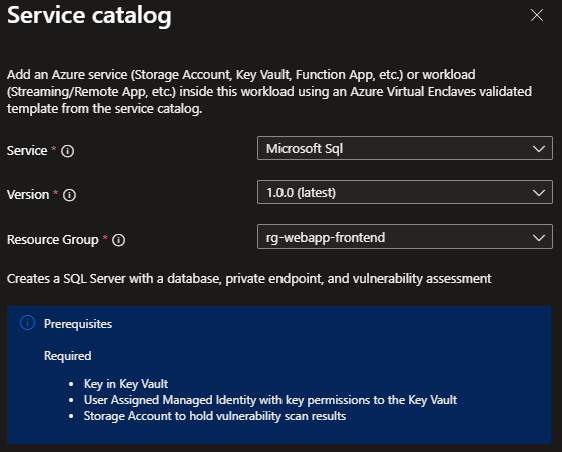

# Deploy Azure SQL from the service catalog into a workload

In this article, you:

- Deploy a service catalog template for Azure SQL into an existing workload from the Portal.

> [!NOTE]
> 
> This sample deployment is just for demo purposes and doesn't represent all the best practices for network, systems, or applications administration.

## Before you begin
- This article assumes a basic understanding of networking and Azure Virtual Enclaves concepts. For more information, see [Best practices of Azure Virtual Enclaves](./best-practices.md).

- You need an Azure account with an active subscription. If you don't have one, [create an account for free](https://azure.microsoft.com/free/).

- A [deployed community](./what-community.md), [deployed enclave](./what-enclave.md), and [deployed workload](./what-workload.md) and permissions to create resources inside the workload.

## Prerequisites

### Create CMK and identity

There are guardrails in the enclaves to ensure the Azure SQL is using CMK encryption (customer-managed keys). This requires a key and identity to access the key to be accessible in the enclave.
> [!NOTE]
> 
> These resources are not deployed with the enclave or workload.

1. Subnet for Private Endpoints: You had the option to create subnets during enclave creation or you can [create new subnets](./create-new-enclave-subnet.md) after enclave creation.
2. A Key Vault that supports CMK and a key that can be leveraged for CMK encryption. Create a new CMK, if needed, using the [Common Deployment service catalog template](./deploy-common-dependencies-service-catalog.md) article to:
    - Create an RSA (2048) key in the Key Vault.
    - [Create a user-assigned managed identity](./create-user-managed-identity.md) with access to the CMK key in the enclave `HostedResources` resource group (for example `your-enclave-name-HostedResources-...`).
    - Create an Access Policy in the Key Vault above for this identity with the following Key Permissions: `Unwrap Key, Wrap Key, Recover, Get`

### Identify Administrator User 
The Administrators tab requires login info. Here is an example of some input: 
   - Entra User Login: `core-enclave-admins`
   - Entra User SID: `c0a11793-2fa9-4d7f-894f-0f7f72615a97`
   - Entra User Tenant ID: `af783a57-4134-41d8-bea4-fdaaecef6bcc`
   - Entra User Principal Type: `Group`

## Deploy the template
1. Navigate to the workload for the intended deployment.
2. Select `+Add an Azure Service` button.
3. Select the `Azure SQL` service service template from the [service catalog list](./list-service-catalog-templates.md) dropdown, confirm the version you need (default: `latest`), and select `Next`.

4. Go through each tab and enter all the required parameters.
5. Adjust any of the prepopulated parameters as needed.
5. Select `Review + Add` then `Create`.

It can take up to 30 minutes to finish all resource creation. Wait for the deployment to be successfully completed before you take any actions within your deployed resources.

## Validate the deployment
Go to the specified resource group to confirm the intended resources were created.
