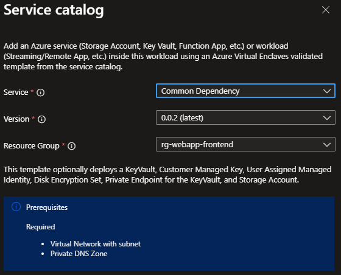

# Deploy Common Dependencies from the service catalog into a workload

Azure Virtual Enclaves (AVE) is a cloud networking service that provides organizations with highly sensitive data the ability to quickly deploy and manage workloads across Commercial and air-gapped Azure clouds at scale. In this quickstart, you:

Deploy a service catalog template for Common Dependencies when deploying Azure services into an existing workload from the Portal. The template includes the options to create a:
  - [Key Vault](/azure/key-vault/general/overview)
  - [Customer Managed Key (CMK)](../storage/common/customer-managed-keys-overview) for encryption
  - [Disk Encryption Set (DES)](/azure/virtual-machines/disk-encryption#full-control-of-your-keys) for disk encryption
  - [Storage Account](../storage/common/storage-account-overview) quickstart. See the separate Storage Account service catalog template for more deployment customization
  - [Managed Identity](https://learn.microsoft.com/entra/identity/managed-identities-azure-resources/how-manage-user-assigned-managed-identities) to securely access your resources within Azure Virtual Enclaves

> [!NOTE]
>
> This sample deployment is just for demo purposes and doesn't represent all the best practices for network, systems, or applications administration.

## Before you begin
- This quickstart assumes a basic understanding of networking and Azure Virtual Enclaves concepts. For more information, see [Best practices of Azure Virtual Enclaves](./best-practices.md).

- You need an Azure account with an active subscription. If you don't have one, [create an account for free](https://azure.microsoft.com/free/).

- A [deployed community](./what-community.md), [deployed Enclave](./what-enclave.md), and [deployed workload](./what-workload.md) and permissions to create resources inside the workload.

## Deploy the template
1. Navigate to the workload for the intended deployment.
2. Select `Add Service` button.
3. Select the `Common Dependencies` template from the [Service Catalog](./list-service-catalog-templates.md) templates (the dropdown list).

4. Select through the tabs and enter all the required parameters.
5. Adjust any of the prepopulated parameters as needed.
5. Select `Review + Add` then `Create`.

It can take 30 minutes to finish all resource creation. Wait for the deployment to be successfully completed before you take any actions within your deployed resources.

## Validate the deployment
Go to the specified resource group to confirm the intended resources were created.

## Delete the deployment
If you don't plan on keeping these resources, clean up unnecessary resources to avoid Azure charges. If no other deployments exist in the resource group, the whole resource group can be deleted.

## Recommendations
- [Add tags](../azure-resource-manager/management/tag-resources.md) to service catalog deployments to track important information for that resource such as:
  - Owner: `<main POC>`
  - Deployer: `<yourName>`
  - Purpose: `<publish abc app to users>`
  - Service Catalog Name: `<RemoteApp>`
  - Service Catalog Version: `<version you deployed>`
- Consider adding an [Azure Policy to enforce and inherit tags](../azure-resource-manager/management/tag-policies.md)
