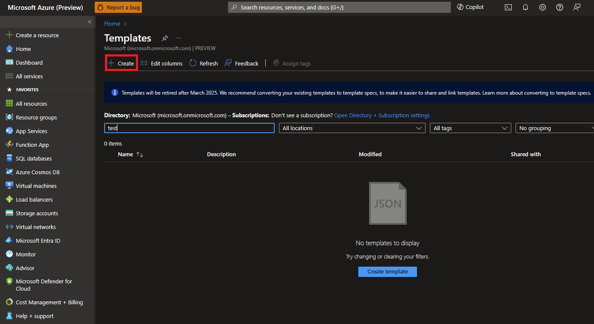

# Quickstart: Deploy an Azure Virtual Enclaves (AVE) Community with Enclaves using an ARM template

[Azure Virtual Enclaves](./what-azure-virtual-enclaves.md) accelerates and streamlines the deployment and management of secure, isolated, and compliant cloud environments for the most sensitive missions and workloads across commercial and air-gapped environments. In this quickstart, you:

- Deploy one AVE [community](./what-community.md) with two [enclaves](./what-enclave.md) using an Azure Resource Manager (ARM) template.
- Deploy [workloads](./what-workload.md), [enclave endpoints](./what-enclave-endpoint.md), [transit hubs](./what-transit-hub.md) and [community endpoints](./what-community-endpoint.md), and [enclave connections](./what-enclave-connection.md) across your community using an ARM template.

> [!NOTE]
>
> This sample deployment is just for demo purposes and doesn't represent all the best practices for network, systems, or applications administration.

## Before you begin
- This quickstart assumes a basic understanding of networking and Azure Virtual Enclaves concepts. For more information, see [Concepts and best practices of Azure Virtual Enclaves](./best-practices.md).

- You need an Azure account with an active subscription. If you don't have one, [create an account for free](https://azure.microsoft.com/free/).

- A [Azure Resource Manager (ARM) template](/azure/azure-resource-manager/templates/overview) is a JavaScript Object Notation (JSON) file that defines the infrastructure and configuration for your project. The template uses declarative syntax. In declarative syntax, you describe your intended deployment without writing the sequence of programming commands to create the deployment.

- If your environment meets the prerequisites and you're familiar with ARM templates, select Deploy to Azure to open the template in the Azure portal.

## Review the template

The template used in this quickstart can be found [here](https://github.com/Azure/virtual-enclaves/ave-templates/nightly-base.json).

### What gets deployed

- Community (x1)
- Enclaves (x2)
- Workload (x1, empty, created in `enc-1`)
- Community Endpoints: 
    - `ep-example`
        - `ep-example-workstation`; sample values of demonstrating PrivateNetwork connectivity
        - `ep-example-dataplane`, 
    - `bing-outlook`; sample values of demonstrating Internet connectivity
        - `bing.com`
        - `outlook.com`
- Enclave endpoint:
    - `ADDS-TCP` and `ADDS-UDP` - Ports/Protocols covering a fake Active Directory Doman Services (AD DS) instance
- Transit Hub:
    - Input parameter to a remote virtual network; covering Gateway connection
- Enclave connections
    - | Source | Destination |
      |--|--|
      | Enclave 2 | Enclave 1 Endpoint `ADDS-TCP/UDP` |
      | Enclave 2 | Community Endpoint `bing-outlook` |
      | Enclave 2 | Community Endpoint `ep-example` |
      | Community (via Transit hub) | Enclave 1 Endpoint `ADDS-TCP/UDP` |

## Deploy the template
1. Sign in to the Azure portal, search and select the **Template Specs** service. Select **Create template spec**. In the ARM Template section upload or copy and paste the above ARM template.

2. On the **Basics** page, leave the default values, and configure the following template parameters:
   - **Subscription**: Select an Azure subscription.
   - **Resource group**: Select Create new. Enter a unique name for the resource group, such as `myResourceGroup`, then select OK.
   - **Location**: Select a location, such as East US.
   - **Community Name**: Name of the Community (ex: `My-Community`)
   - **Enclave Name**: Name of the Enclave (ex: `My-Enclave`)
   - **Endpoint name**: Name of the enclave endpoint (ex: `endpoint-bingdotcom`)

3. Select `Review + Create` and then `Create`.

4. Once the template is created and available on the **Template Specs** page, select newly created ARM template and then select **Deploy**.  

5. On the **Deploy** page for the template spec, note the default values and configure the following parameters:
   - **Community Name**: Name of the Community (ex: `My-Community`)
   - **Enclave Name**: Name of the Enclave (ex: `My-Enclave`)
   - **Endpoint name**: Name of the enclave endpoint (ex: `endpoint-bingdotcom`)
   
6.  Select `Review + Create` and then `Create`.

It can take up to 50 minutes to finish all resource creation. Wait for the deployment to be successfully completed before you take any actions within your deployed resources.

## Validate the deployment

Learn more about what gets deployed in a [community](./what-community.md) and what gets deployed in an [enclave](./what-enclave.md).

### Connect to the admin workstations
Learn more about how to access resources within your enclave from the Enclave Admin Workstation [here](./understand-admin-vm.md).

## Delete the deployment
If you don't plan on keeping these resources, remove unnecessary resources to avoid Azure charges.
