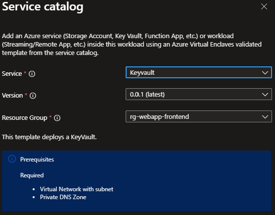

# Deploy a Key Vault from the Service Catalog into a Workload

In this article, you:

- Deploy a Service Catalog template for a Key Vault into an existing Workload from the Portal.

> [!NOTE]
> 
> This sample deployment is just for demonstration purposes and doesn't represent all the best practices for network, systems, or applications administration.

## Before you begin
- This article assumes a basic understanding of networking and Azure Virtual Enclaves concepts. For more information, see [Best practices of Azure Virtual Enclaves](./best-practices.md).

- You need an Azure account with an active subscription. If you don't have one, [create an account for free](https://azure.microsoft.com/free/).

- A [deployed Community](./what-community.md), [deployed Virtual Enclave](./what-enclave.md), and [deployed Workload](./what-workload.md) and permissions to create resources inside the workload.

## Prerequisites

There are guardrails in the enclaves to ensure resources are using CMK encryption (customer-managed keys). This requires a key vault key and managed identity with access to the key in the enclave. 
> [!NOTE]
> 
> These resources are not deployed with the enclave or workload by default. Required:

1. Subnet for Private Endpoints: You had the option to create subnets during enclave creation or you can [create new subnets](./create-new-enclave-subnet-enclave.md) after enclave creation.

## Deploy the template
1. Navigate to the workload for the intended deployment.
2. Select `+Add an Azure Service` button.
3. Select the `Key Vault` template from the [Service Catalog](./list-service-catalog-templates.md) templates (the dropdown list).

4. Enter the required parameters on each tab
5. Adjust any of the prepopulated parameters as needed.
5. Select `Review + Add` then `Create`.

It can take up to 15+ minutes to finish all resource creation. Wait for the deployment to be successfully completed before you take any actions within your deployed resources.

## Validate the deployment
Go to the specified Resource Group to confirm the intended resources were created. Including: key vault and private endpoint.

## Delete the deployment
If you don't plan on keeping these resources, clean up unnecessary resources to avoid Azure charges. If no other deployments exist in the Resource Group, the whole Resource Group can be deleted.

## Recommendations
- [Add tags](https://learn.microsoft.com/azure/azure-resource-manager/management/tag-resources) to Service Catalog deployments to track important information for that resource such as:
  - Owner: `<main POC>`
  - Deployer: `<yourName>`
  - Purpose: `<publish abc app to users>`
  - Service Catalog Name: `<RemoteApp>`
  - Service Catalog Version: `<version you deployed>`
- Consider adding an [Azure Policy to enforce and inherit tags](../azure-resource-manager/management/tag-policies.md)
