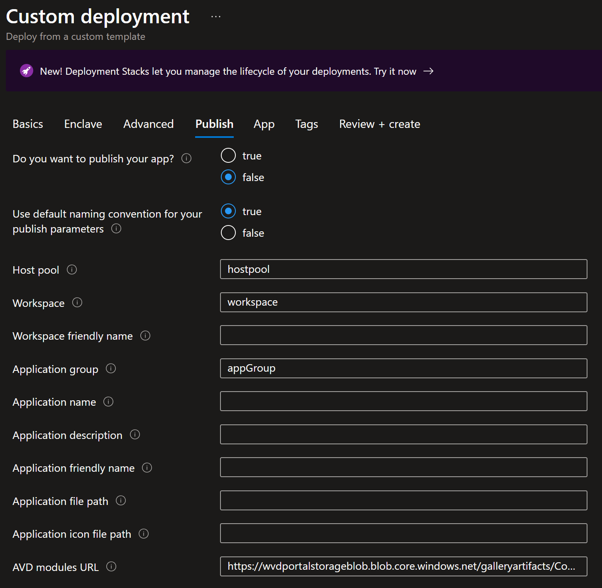

# Deploy RemoteApp VM from the Service Catalog into a Workload
The RemoteApp template allows customers to install an application they want to publish to one or more users without installing that application on each users' desktop.

In this article, you:

- Deploy a Service Catalog template for a Remote Application (RemoteApp) into an existing Workload from the Portal.

> [!NOTE]
> 
> This sample deployment is just for demonstration purposes and doesn't represent all the best practices for network, systems, or applications administration.

## Deploy Options
The RemoteApp template can be deployed in multiple configurations:
1. Virtual Machine (~10 min)
2. Virtual Machine domain-joined (~12 min)
3. Virtual Machine domain-joined and published as a Remote App (~20 min)
4. (future) Virtual Machine domain-joined and published as a Remote Desktop (~20 min)

## Before you begin
- This quickstart assumes a basic understanding of networking and Azure Virtual Enclaves concepts. For more information, see [Concepts and best practices of Azure Virtual Enclaves](./best-practices.md).

- You need an Azure account with an active subscription. If you don't have one, [create an account for free](https://azure.microsoft.com/free/).

- A [deployed Community](./what-community.md), [deployed Virtual Enclave](./what-enclave.md), and [deployed Workload](./what-workload.md) and permissions to create resources inside the workload.

## Prerequisites
Required:

1. An existing subnet. 
    - The default enclave subnet intended for resources can be used (ex: `AzureVirtualEnclaveSubnet`).
2. (optional) An existing domain to join if the RemoteApp will be domain joined.
3. A `Key Vault` with `Customer Mananged Key (CMK)`, `User Managed Identity`, and `Disk Encryption Set`. You can create these using the [Common Dependencies Service Catalog template](./deploy-common-dependencies-service-catalog.md).
    - [Disk encryption options](https://learn.microsoft.com/azure/virtual-machines/disk-encryption-overview)
    - [How to create a user assigned managed identity](https://learn.microsoft.com/entra/identity/managed-identities-azure-resources/how-manage-user-assigned-managed-identities?pivots=identity-mi-methods-azp)
    - [Manage User Assigned Identity](https://learn.microsoft.com/azure/operator-service-manager/how-to-create-user-assigned-managed-identity)
    - Create an Access Policy in the Key Vault for this identity with the following Key Permissions: `Unwrap Key, Wrap Key, Recover, Get`

## Deploy the template
1. Navigate to the workload for the intended deployment.
2. Select `+Add an Azure Service` button.
3. Select the `Remote App VM` service template from the [Service Catalog](./what-service-catalog.md) of templates (the dropdown list).

4. Enter all the required parameters on each of the tabs.
5. For `OS Disk Encryption Name` and `OS Disk Encryption Resource Group Name`, enter the names used in the prerequisites section.
6. Adjust the prepopulated parameters as needed. 
7. (Optional) [Publish your RemoteApp](#publish-remote-app-optional) to other users
8. (Optional) [Domain join](#domain-join-optional) your RemoteApp VM.
9. (Optional) [Install application](#install-remoteapp-optional) to your RemoteApp.
10. Select `Review + Create`, if all validations have passed, select `Create`

## Domain Join (Optional)
1. Should you choose to Domain Join your RemoteApp, you need to select which domain join option you want (Active Directory or Microsoft Entra ID) on the Basic tab and enter the domain joining information.
2. For the `Active Directory` Domain join options, see the following examples
   * The Domain name should be in the format of `contoso.com`
   * OU path should be in the format of `OU=Organizations,DC=contoso,DC=com`
   * `Domain admin username` and `Domain admin password` should match the domain joining credentials for the domain controller

3. For the `Microsoft Entra ID` Domain join option
   * First you need to [deploy an Entra Domain Services managed domain](https://learn.microsoft.com/entra/identity/domain-services/tutorial-create-instance)
   * Next you need to use this domain to [create an OU](https://learn.microsoft.com/entra/identity/domain-services/create-ou)
   * Use the previously created OU and Domain to fill in these respective parameters

## Publish Remote App (Optional)
If you publish your application, all of the following fields on this tab must be filled out.

> [!NOTE]
> 
> When testing domain join for the first time, it might be easiest to deploy a VM without domain joining, remotely sign in to the VM (e.g. via Bastion) and manually domain join to observe the errors and troubleshoot more quickly.

It can take 20+ minutes to finish all resource creation. Wait for the deployment to be successfully completed before you take any actions within your deployed resources.

## Validate the deployment
1. Go to the specified Resource Group, the Workload resource group by default, to confirm the intended resources were created. Including: VM, OS Disk, NIC.
2. If the Remote App was published: hostpool, app group, and workspace.

## Connect to the Application VM
Via the [Admin VM](./understanding-admin-workstations.md):
The Admin VM is used for administrator access the resources within the enclave boundary from outside the boundary. The Admin VM might also be called a "jumpbox".
1. Sign in to a desktop session on the [Admin VM](./understanding-admin-workstations.md) blade for the enclave.
2. From the start menu, type `RDP`, and open the RDP window
3. Enter the Remote App VM IP address as the destination IP address for the RDP connection.
4. Enter Remote App VM credentials and select `Accept/Yes` to warnings about a new connection.
5. From the Remote App VM desktop, validate any VM settings set during the deployment or complete any custom configuration.
6. Next, [install application](#install-remoteapp-optional)
7. Assign a security group assignment to give users access to your RemoteApp(s).

## Install RemoteApp (Optional)
Install an application on your RemoteApp VM using one of these methods or a method you're familiar with.

- [Install via Remote App VM](./application-deployment-using-remote-app-vm-in-ave.md) (install or configure an application for Remote App publishing)
- Prerequisites:
    1. A [container](../storage/blobs/blob-containers-portal.md) (artifacts) within the [storage account](./deploy-storage-account-service-catalog.md).
        - **Private or Public Container**
            - *Private Container* - securely store installers, main script, and any supporting scripts. 
                - You might want to choose this option if your scripts or installers can not be shared with others who have access to that storage account container.
            - *Public Container* - stores publicly accessible artifacts in the remoteappvm folder in the Service Catalog's container
        - App Folder:
            - app installer (ex: VSCodeSetup.exe)
            - main script to install the application (and any other supporting scripts)
    2. A copy of [AzCopy.exe](./application-deployment-using-remote-app-vm-in-ave.md#prerequisites)
    1. A [community endpoint](./create-community-endpoint-portal.md) to the storage account and AzToolBox.
    1. [Enclave connections](./create-enclave-connection-portal.md) to the previously made community endpoint.
        1. Make an enclave connection to your IP Groups ending in `(enclave-name}`-ipg-eas and another at `{enclave-name}`-ipg-mgmt-vms.
        
        > [!NOTE]
        > 
        > If the storage account is in a different enclave, create an [enclave endpoint](./create-enclave-endpoint-portal.md) in the enclave with the storage account and [enclave connection](./create-enclave-connection-portal.md) to that storage account.

1. Install Application:
    1. On the workload overview page, select `Add an Azure Service`.
    2. For `Service`, select `Remote App VM`.
    3. For `Version`, if not selected by default, select the most recent version (eg: 0.0.1(latest)).
    4. Select `Next`
    5. Basics Tab:
        - For `Virtual Machine name`, input the name of the VM.
        - For  `Admin username` and `Admin password`, input the username and password you use to log into your VM. 
    6. App Tab: 
        - For `App Folder URI` add the URI to the app folder from the container.
        - For `Main Script` add the name of the main script (ex: main.ps1) in the app folder that installs the application.
        - Private Container: 
            - For `Storage Container Resource Id` add the [resource id ](./application-deployment-using-remote-app-vm-in-ave.md) of the container.
            - For `App folder in private container` select "true". This allows reader role access to the storage account via the VM. 
        > [!NOTE] 
        > 
        > If in Microsoft Azure for U.S. Government, do the following steps: 
        > For the `AzCopy File URI` add the URI to the azcopy.exe from the container.
    1. Select `Review + Create`, if all validations have passed, select `Create`.

Otherwise, start using the Remote App VM 

## Delete the deployment
If you don't plan on keeping these resources, clean up unnecessary resources to avoid Azure charges. If no other deployments exist in the Resource Group, the whole Resource Group can be deleted.

## Recommendations
- Session host or VM [Sizing](https://learn.microsoft.com/windows-server/remote/remote-desktop-services/virtual-machine-recs)
- [Add tags](../azure-resource-manager/management/tag-resources.md) to Service Catalog deployments to track important information for that resource such as:
  - Owner: `<main POC>`
  - Deployer: `<yourName>`
  - Purpose: `<publish abc app to users>`
  - Service Catalog Name: `<RemoteApp>`
  - Service Catalog Version: `<version you deployed>`
- Consider adding an [Azure Policy to enforce and inherit tags](../azure-resource-manager/management/tag-policies.md)
- [Collect Custom Logs](https://learn.microsoft.com/azure/azure-monitor/agents/data-sources-custom-logs) from applications
