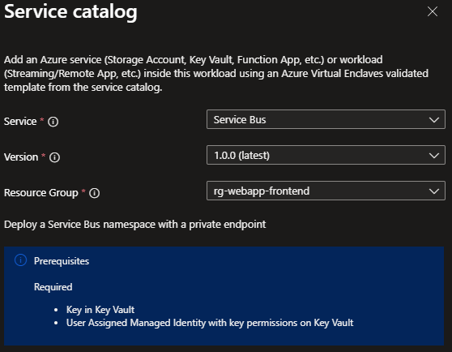

# Deploy Service Bus from the service catalog into a workload

Azure Virtual Enclaves (AVE) is a cloud networking service that provides organizations with highly sensitive data the ability to quickly deploy and manage workloads across Commercial and air-gapped Azure clouds at scale. In this quickstart, you:

- Deploy a service catalog template for a RemoteApplication into an existing workload from the Portal.

> [!NOTE]
> 
> This sample deployment is just for demo purposes and doesn't represent all the best practices for network, systems, or applications administration.

## Before you begin
- This quickstart assumes a basic understanding of networking and Azure Virtual Enclaves concepts. For more information, see [Concepts and best practices of Azure Virtual Enclaves](./best-practices.md).

- You need an Azure account with an active subscription. If you don't have one, [create an account for free](https://azure.microsoft.com/free/).

- A [deployed community](./what-community.md), [deployed enclave](./what-enclave.md), and [deployed workload](./what-workload.md) and permissions to create resources inside the workload.

## Deploy the template
1. Navigate to the workload for the intended deployment.
2. Select `Add Service` button.
3. Select the `Service Bus` service service template from the [service catalog list](./list-service-catalog-templates.md) dropdown, confirm the version you need (default: `latest`), and select `Next`.

4. Go through each tab and enter all the required parameters.
5. Adjust any of the prepopulated parameters as needed.
6. Select `Review + Add` then `Create`.

It can take up to 30 minutes to finish all resource creation. Wait for the deployment to be successfully completed before you take any actions within your deployed resources.

## Validate the deployment
Go to the specified resource group to confirm the intended resources were created. Including: Service Bus

### Connect to the Application VM
Via the Admin VM:
The Admin VM is used for administrator access the resources within the enclave boundary from outside the boundary. The Admin VM might also be called a jumpbox.
1. Sign-in to the Admin VM you have deployed for your enclave or [create a new Admin VM](./understand-admin-vm.md)
2. From the start menu, type `RDP`, and open the RDP window
3. Enter the RemoteApp VM IP address as the destination IP address for the RDP connection.
4. Enter RemoteApp M credentials and select `Accept/Yes` to warnings about a new connection.
5. From the RemoteApp VM desktop, validate any VM settings set during the deployment. Otherwise, start using the RemoteApp VM (e.g. install or configure an application for RemoteApp publishing).

## Delete the deployment
If you don't plan on keeping these resources, clean up unnecessary resources to avoid Azure charges. If no other deployments exist in the resource group, the whole resource group can be deleted.

## Recommendations
- [Add tags](../azure-resource-manager/management/tag-resources.md) to service catalog deployments to track important information for that resource such as:
  - Owner: `<main POC>`
  - Deployer: `<yourName>`
  - Purpose: `<publish abc app to users>`
  - Service Catalog Name: `<RemoteApp>`
  - Service Catalog Version: `<version you deployed>`
- Consider adding an [Azure Policy to enforce and inherit tags](../azure-resource-manager/management/tag-policies.md)
