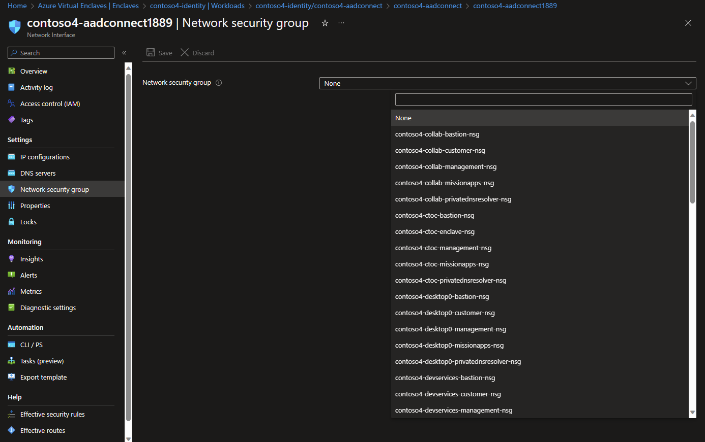

# Intra-enclave network isolation

By default, all network traffic within an [enclave](./what-is-an-enclave.md) is permitted. This means that all resources and hosts within an enclave can reach, discover, and communicate with each other. 

For certain Enclave Owners, this level of network security may not be sufficient for a variety of reasons. For example, Enclave Owners may have requirements for an enclave to host two [workloads](./what-is-a-workload.md) but that those two workloads must not be able to communicate with each other.

Currently, this is the expected behavior for network traffic within an enclave. However, should Enclave Owners require greater flexibility or granularity over network traffic, they can manually make changes to the network. This can be done using native Azure cloud networking resources, though it would require Enclave Owners to specifically modify platform-designed networking behavior on resources within their enclave.

## Overview

First, Enclave Owners must identify which individual [network interfaces (NICs)](../virtual-network/virtual-network-network-interface.md) in their Workload needs greater network isolation.

Once these NICs have been identified, Enclave Owners can add their own [Network Security Groups] to those NICs. For more details on how to perform these steps, learn more on how to [Associate or dissociate a network security group to or from a [network interface
](../virtual-network/manage-network-security-group?tabs=network-security-group-portal#associate-or-dissociate-a-network-security-group-to-or-from-a-network-interface)

In the below image, a Network interface within the `contoso4-identity` Workload in the `contoso4` Enclave requires a custom NSG to be associated.

Should further troubleshooting be required to investigate inter-enclave network traffic or routing issues, learn more about [Troubleshooting connectivity problems between Azure VMs](../virtual-network/virtual-network-troubleshoot-connectivity-problem-between-vms.md) or contact [Azure Support](https://azure.microsoft.com/support/).

## References
- [What is Azure Virtual Enclaves?](./what-is-azure-virtual-enclaves.md)
- [Best ractices](./best-practices.md)
- [What is an Enclave?](./what-is-an-enclave.md)
- [Tutorial: Filter network traffic with Network Security Groups](../virtual-network/tutorial-filter-network-traffic.md)
- [Network Interfaces](../virtual-network/virtual-network-network-interface?tabs=azure-portal.md)
- [Network security groups](../virtual-network/network-security-group-how-it-works.md)
- [Create, change, or delete a network security group](../virtual-network/manage-network-security-group.md?tabs=network-security-group-portal)
- [Troubleshooting connectivity problems between Azure VMs](../virtual-network/virtual-network-troubleshoot-connectivity-problem-between-vms.md)
- [Azure Support](https://azure.microsoft.com/support/)
