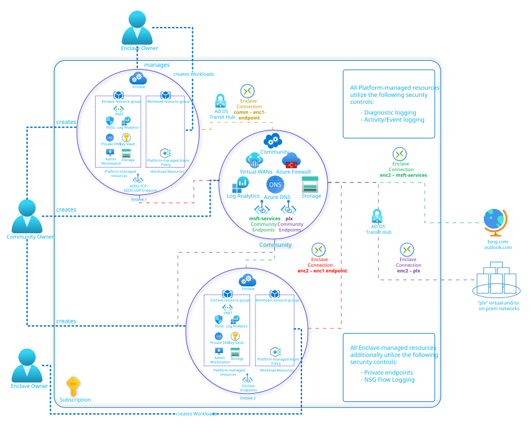

# Deploy a Multi-Enclave Community

In this Quickstart, you deploy an E2E Azure Virtual Enclaves environment using the "Deploy to Azure" deployment button.

## What gets deployed

- Community (x1)
- Enclaves (x2)
- Workload (x1, empty, created in `enc-1`)
- Community Endpoints: 
    - `plx`
        - `plx-vpaw`; sample values of demonstrating PrivateNetwork connectivity
        - `plx-dataplane`, 
    - `bing-outlook`; sample values of demonstrating Internet connectivity
        - `bing.com`
        - `outlook.com`
- Enclave Endpoint:
    - `ADDS-TCP` and `ADDS-UDP` - Ports/Protocols covering a fake AD DS instance
- Transit Hub:
    - Input parameter to a remote virtual network; covering Gateway connection
- Enclave Connections
    - | Source | Destination |
      |--|--|
      | Enclave 2 | Enclave 1 Endpoint `ADDS-TCP/UDP` |
      | Enclave 2 | Community Endpoint `bing-outlook` |
      | Enclave 2 | Community Endpoint `plx` |
      | Community (via Transit hub) | Enclave 1 Endpoint `ADDS-TCP/UDP` |

## Deploy the template

The "Deploy to Azure" deployment button will take you to a custom deployment UX for Azure Virtual Enclaves.

