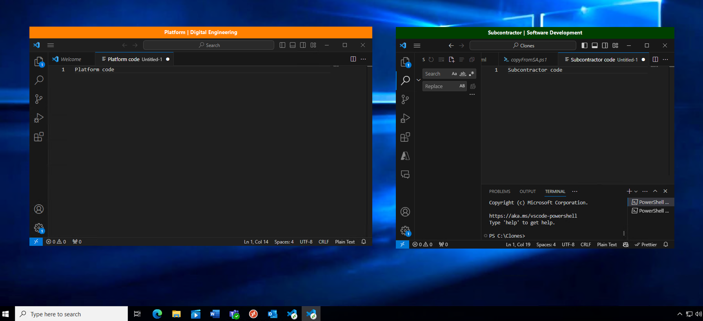

# Install BannerApp for RemoteApps
Install a small application that allows you to customize a message at the top of the Remote Application window so users have more context of which remote application they're using. This is a critical security measure for some customers and use cases.

## What is the BannerApp?
BannerApp displays additional information at the top of a RemoteApp Window. This enables an admin to display classification, permissions, or other useful information to the user when they open a RemoteApp on a separate desktop. If the user has two VS Code applications open on one desktop, the BannerApp informs the user of which application should be used for which purpose. On a common Desktop, users can access applications associated with different access restrictions on the same screen. The visible indicators provided by BannerApp help prevent accidental spillage of data with users that don't have access to that data.

## What does the BannerApp look like?
When a user accesses an app through Remote App, the BannerApp displays at the top of the window as a colored banner. The middle of the banner contains text that shows desired classification labels. The customer is responsible for ensuring this text complies with all Cybersecurity requirements for their deployment.

This image shows two VS Code RemoteApp windows with different banners at the top of the windows. They have different colors and text content which aligns with the enclave configuration.

There are 3 VMs running in the picture above. The desktop shown is running on the "desktopVM," the `Platform VS Code` app is running on the "platformVM," and the `Subcontractor VS Code` is running on the "subcontractorVM." Both VS Code apps are streamed to the single desktop even though they're running on separate VMs. [Learn More](/windows-server/remote/remote-desktop-services/clients/windows)

## What do the different BannerApp colors mean?
The color is used with the text in the banner to denote the classification and controlled access required for the hosting information system. See the appropriate customer classification guides for exact meaning. Example hex code values used for the banner color include:
*	#FF0000 is Red
*	#FFFF00 is Yellow
*	#004000 is Green
*	0x000080 is Blue
*	0X800080 is Purple
*	#400080 is Violet
*	#FF8000 is Orange

## Who sets up BannerApp and when?
Enclave owners (EO), enclave contributors (EC), or other personnel designated by the EO who are responsible for configuring BannerApp for their enclaves. BannerApp installation should be completed when the VM is deployed. EAs and other designated personnel are also responsible for ensuring their configuration meets all Cybersecurity requirements for their deployment.

## How do I get support for BannerApp?
Ensure you mention "BannerApp" and use one of the options below:
* [Report a bug](https://aka.ms/ave/newbug) or
* [Request a new Feature](https://aka.ms/ave/newfeature)
