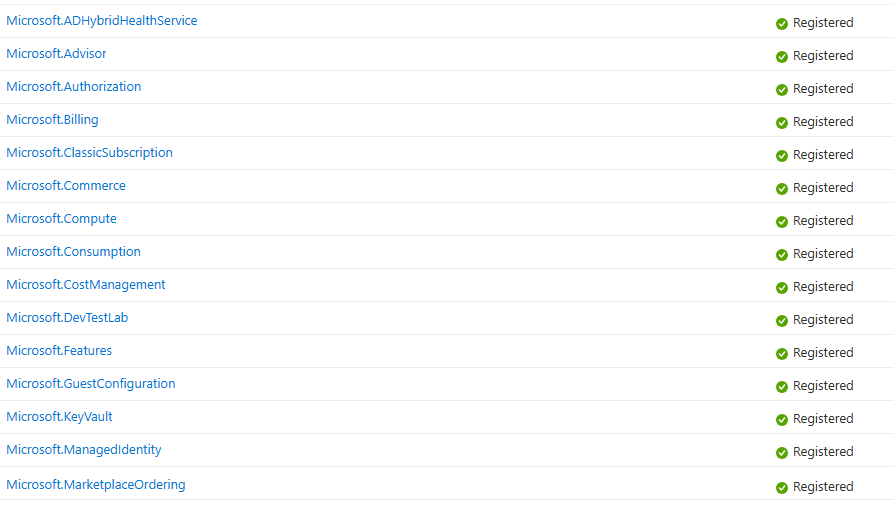
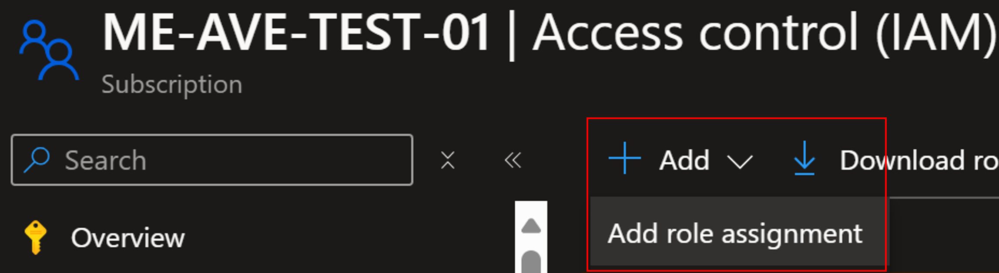
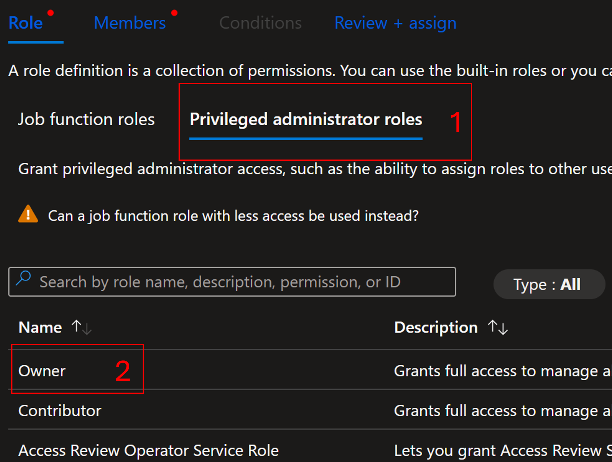
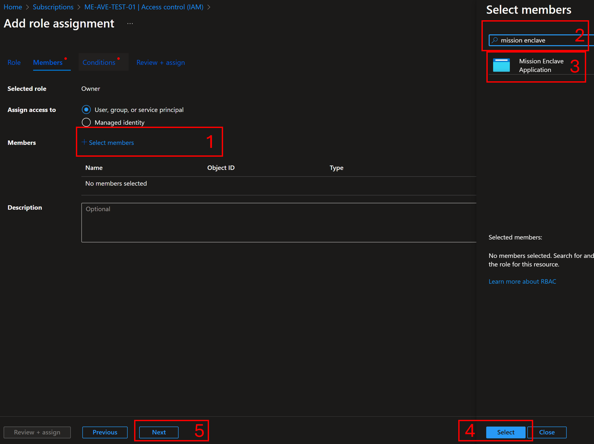
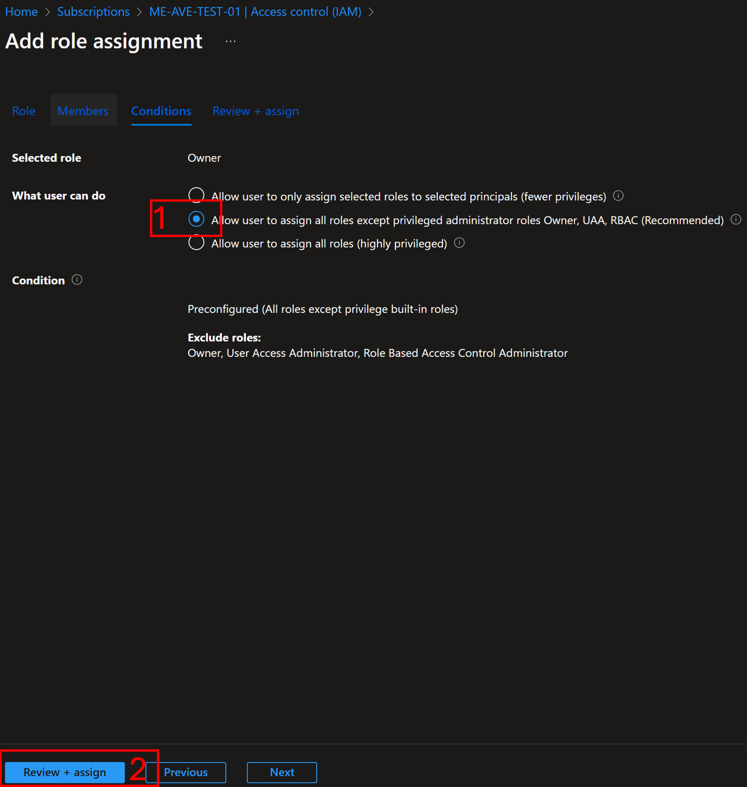

# Onboard to Azure Virtual Enclaves

This guide provides the steps to onboard to Azure Virtual Enclaves (AVE) by enabling the resource provider and granting permissions over your Azure subscription. If you experience any issues with onboarding your subscription to Azure Virtual Enclaves, submit a bug to the product group using this link:
- [Submit a Bug](https://aka.ms/ave/newbug)

## Prerequisites

  - You must already have an Azure tenant and subscription.
  - You must be an Owner of an existing Azure subscription.

## Register the `Microsoft.Mission` Resource Provider and grant permissions

### Option 1: PowerShell (Fastest)

You can run the following code to quickly register all required resource providers to begin using AVE.
1. Sign-in to your Azure tenant and open the subscription resource
2. In the Azure portal, select the `Cloud Shell` icon at the top of the window here


3. [Set context](https://learn.microsoft.com/powershell/azure/context-persistence#create-a-new-azure-context-from-subscription-information) to your subscription.
4. Copy and paste this code into the Cloud Shell and press enter.

```
# Register the Azure Virtual Enclaves Resource Provider and grant permissions to the Resource Provider application

$resourceProviders = @(
   "Microsoft.ADHybridHealthService",
   "Microsoft.Advisor",
   "Microsoft.AlertsManagement",
   "Microsoft.Authorization",
   "Microsoft.Automation",
   "Microsoft.Billing",
   "Microsoft.Capacity",
   "Microsoft.ChangeAnalysis",
   "Microsoft.ClassicSubscription",
   "Microsoft.CognitiveServices",
   "Microsoft.Commerce",
   "Microsoft.Compute",
   "Microsoft.Consumption",
   "Microsoft.CostManagement",
   "Microsoft.DesktopVirtualization",
   "Microsoft.DevTestLab",
   "Microsoft.Features",
   "Microsoft.GuestConfiguration",
   "Microsoft.insights",
   "Microsoft.KeyVault",
   "Microsoft.Logic",
   "Microsoft.ManagedIdentity",
   "Microsoft.MarketplaceNotifications",
   "Microsoft.MarketplaceOrdering",
   "Microsoft.Network",
   "Microsoft.OperationalInsights",
   "Microsoft.OperationsManagement",
   "Microsoft.PolicyInsights",
   "Microsoft.Portal",
   "Microsoft.ResourceGraph",
   "Microsoft.ResourceHealth",
   "Microsoft.ResourceNotifications",
   "Microsoft.Resources",
   "Microsoft.Security",
   "Microsoft.SecurityInsights",
   "Microsoft.SerialConsole",
   "Microsoft.SqlVirtualMachine",
   "Microsoft.Storage",
   "Microsoft.support",
   "Microsoft.Web",
   "Microsoft.Mission"
)

$resourceProviders | foreach {Register-AzResourceProvider -ProviderNamespace $_ -Verbose}

$subID = (Get-AzContext).subscription.id
$objectId = (Get-AzADServicePrincipal -DisplayName "Mission Enclave").Id
# This Powershell command assigns the "Contributor" role to a specified user or service principal within a given Azure subscription.
# 
# Parameters:
# - $objectId: The Object ID of the user or service principal to which the role will be assigned.
# - $subId: The subscription ID where the role assignment will take place.
# 
# The -Verbose flag is used to provide detailed information about the execution of the command.
New-AzRoleAssignment -ObjectId $objectId -RoleDefinitionName "Contributor" -Scope "/subscriptions/$subId" -Verbose
New-AzRoleAssignment -ObjectId $objectId -RoleDefinitionName "User Access Administrator" -Scope "/subscriptions/$subId" -Verbose  

```

### Option 2: Azure portal

1. Sign-in to your Azure tenant and open the subscription resource.
2. Open the `Resource Providers` on the left side under `Settings`.
3. The following resource providers must be registered over the subscription. The [PowerShell](#option-1-powershell-fastest) script to enable these resource providers is the fastest option.

   
   
4. Search for and select `Microsoft.Mission` and select `Register`.
   
5. Select subscription `Access control (IAM)` then select `Add` and `Add role assignment`.

6. Select `Privileged administrator roles`, select `owner`, then select `Next`.

7. Select `Select members`, type `Mission Enclave` in the search and select the `Mission Enclave` app, select `Select`, then `Next`.

8. If your subscription requires a condition, select `Allow user to assign all roles except privileged administrator roles Owner, UAA, RBAC (Recommended)`.

9. Once `Registered`, proceed to [next steps](#next-steps).

For reference, these are the generic instructions for enabling a [preview feature](/azure/azure-resource-manager/management/preview-features).


## Next Steps

Now the Azure Virtual Enclaves resource provider can begin deploying Azure Virtual Enclaves resources into your subscription on your behalf.

  - Use the following guides and start building your Virtual Enclaves Community:

    - [Create a community](./create-community-portal.md)
    - [Create an enclave](./create-enclave-portal.md)
    - [Create a workload](./create-workload-portal.md)

  - Use the following guides to establish network connectivity within your Community

    - [Create an Enclave Endpoint](./create-enclave-endpoint-portal.md)
    - [Create an Enclave Connection](./create-enclave-connection-portal.md)
    - [Create a Transit Hub](./create-transit-hub-portal.md)
    - [Create a Community Endpoint](./create-community-endpoint-portal.md)

  - Create resources within your workloads to meet your objectives.
    - Create resources from the [Service Catalog](./list-service-catalog-templates.md)
    - Create resources with an [template](/azure/azure-resource-manager/templates/deploy-to-resource-group) or [bicep template](/azure/azure-resource-manager/bicep/deploy-to-resource-group) from [these examples](https://github.com/Azure/azure-quickstart-templates/tree/master/quickstarts)
