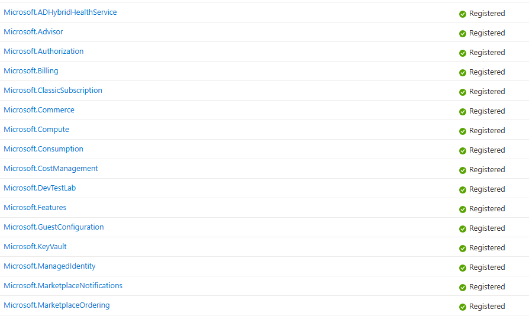
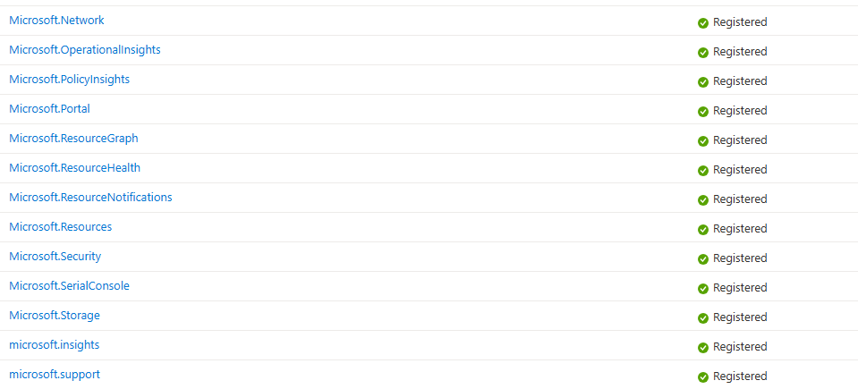

# Public Preview Onboarding

Thank you for your interest in the Azure Virtual Enclaves Public Preview Program! Please follow the guidance below to get onboard an Azure Subscription to Azure Virtual Enclaves. If you experience any issues with onboarding your subscription to Azure Virtual Enclaves, please submit a bug to the product group using the link below:
- [Submit a Bug](https://aka/ms/ave/newbug)

## Prerequisites

1. You must be an Owner of an existing Azure subscription that is approved by the Virtual Enclaves product group.
1. The following resource providers must be registered over the subscription:

   
   

## Register the Microsoft.Mission Resource Provider and grant permissions

### Azure portal

1. Login to your Azure tenant and open the subscription resource
2. Open the "**Resource Providers**" blade (under "Settings")
3. Search for and select "**Microsoft.Mission**" and click "**Register**".
   
4. Open the "**Preview Features**" blade (under "Settings")
5. Filter by "**AVE**", select "**Azure Virtual Enclaves Preview**", and click "**Register**" towards the top of the page.
   
6. Message your AVE point of contact or the AVE Product team to get approval
7. Once you get approval, proceed to [next steps](#next-steps).

### Powershell

You can run the following code to quickly register all required resource providers to begin using AVE.
1. In the Azure portal, select the `Cloud Shell` icon at the top of the window here 
2. [Set context](https://learn.microsoft.com/powershell/azure/context-persistence#create-a-new-azure-context-from-subscription-information) to the subscription you registered above.
3. Copy and past the code below into the Cloud Shell and press enter.

```
# Register the Azure Virtual Enclaves Resource Provider and grant contributor permissions to the Resource Provider

$resourceProviders = @(
   "Microsoft.ADHybridHealthService",
   "Microsoft.Advisor",
   "Microsoft.AlertsManagement",
   "Microsoft.Authorization",
   "Microsoft.Automation"
   "Microsoft.Billing",
   "Microsoft.Capacity",
   "Microsoft.ChangeAnalysis",
   "Microsoft.ClassicSubscription",
   "Microsoft.CognitiveServices",
   "Microsoft.Commerce",
   "Microsoft.Compute",
   "Microsoft.Consumption",
   "Microsoft.CostManagement",
   "Microsoft.DesktopVirtualization",
   "Microsoft.DevTestLab",
   "Microsoft.Features",
   "Microsoft.GuestConfiguration",
   "Microsoft.insights",
   "Microsoft.KeyVault",
   "Microsoft.Logic",
   "Microsoft.ManagedIdentity",
   "Microsoft.MarketplaceNotifications",
   "Microsoft.MarketplaceOrdering",
   "Microsoft.Network",
   "Microsoft.OperationalInsights",
   "Microsoft.OperationsManagement",
   "Microsoft.PolicyInsights",
   "Microsoft.Portal",
   "Microsoft.ResourceGraph",
   "Microsoft.ResourceHealth",
   "Microsoft.ResourceNotifications",
   "Microsoft.Resources",
   "Microsoft.Security",
   "Microsoft.SecurityInsights",
   "Microsoft.SerialConsole",
   "Microsoft.SqlVirtualMachine",
   "Microsoft.Storage",
   "Microsoft.support",
   "Microsoft.Web",
   "Microsoft.Mission"
)

$resourceProviders | foreach {Register-AzResourceProvider -ProviderNamespace $_ -Verbose}

$subID = (Get-AzContext).subscription.id
$objectId = (Get-AzADServicePrincipal -DisplayName "Mission Enclave").Id
# This PowerShell command assigns the "Contributor" role to a specified user or service principal within a given Azure subscription.
# 
# Parameters:
# - $objectId: The Object ID of the user or service principal to which the role will be assigned.
# - $subId: The subscription ID where the role assignment will take place.
# 
# The -Verbose flag is used to provide detailed information about the execution of the command.
New-AzRoleAssignment -ObjectId $objectId -RoleDefinitionName "Contributor" -Scope "/subscriptions/$subId" -Verbose
New-AzRoleAssignment -ObjectId $objectId -RoleDefinitionName "User Access Administrator" -Scope "/subscriptions/$subId" -Verbose  

```
## Next Steps

1. Once the above steps have been completed, the Azure Virtual Enclaves Resource provider can begin deploying resources into your subscription on your behalf.

2. Use the following guides and start building your Virtual Enclaves Community:

   1. [Create a community](./create-a-community-in-the-azure-portal.md)
   2. [Create an enclave](./create-an-enclave-in-the-azure-portal.md)
   3. [Create a workload](./create-a-workload-in-the-azure-portal.md)

3. Use the following guides to establish network connectivity within your Community

   1. [Create an Enclave Endpoint](./create-a-enclave-endpoint-in-the-azure-portal.md)
   1. [Create an Enclave Connection](./create-an-enclave-connection-from-the-azure-portal.md)
   1. [Create a Transit Hub](./create-a-transit-hub-from-the-azure-portal.md)
   1. [Create a Community Endpoint](./create-a-community-endpoint-in-the-azure-portal.md)

4. Create resources within your workload(s) to meet your objectives.
   1. Create resources from the [Service Catalog](./list-of-service-catalog-templates.md)
   1. Create resources with an [ARM template](../azure-resource-manager/templates/deploy-to-resource-group.md) or [bicep template](../azure-resource-manager/bicep/deploy-to-resource-group.md) from [these examples](https://github.com/Azure/azure-quickstart-templates/tree/master/quickstarts)
