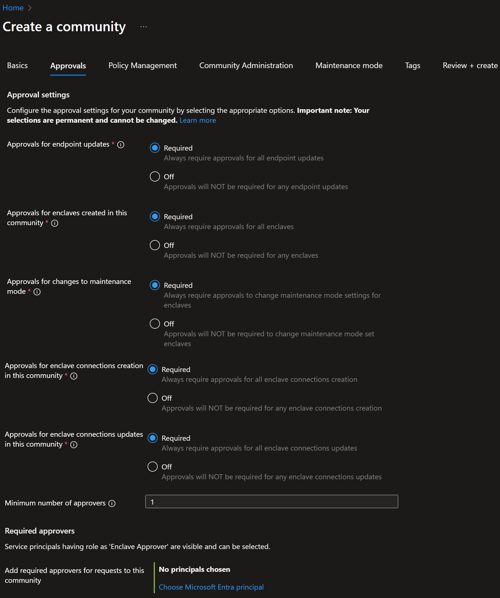
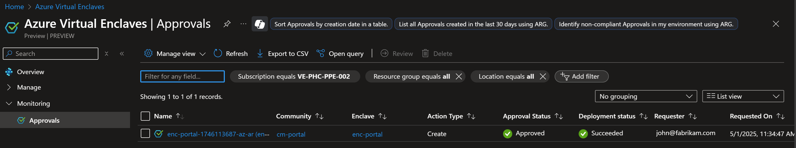
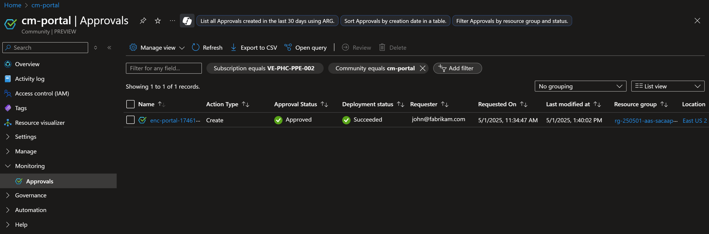
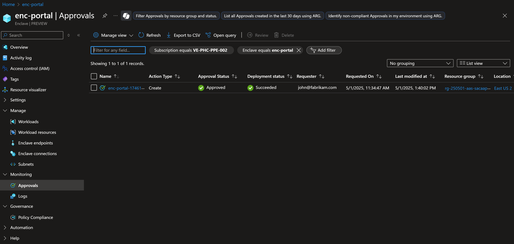
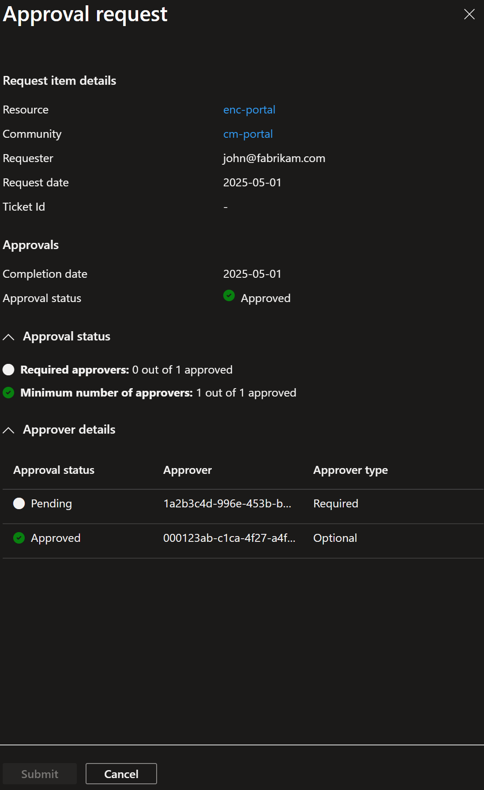

# Understand approvals in Azure Virtual Enclaves
Approvals require more oversight on critical Azure Virtual Enclaves actions. Approvals enable administrators to queue the creation of new resources or change existing resources while requiring oversight and approval before the change can be made. Approvals can only be reviewed by someone with `Enclave Approver Role` in Azure.

## Introduction to approvals

Approvals in Azure Virtual Enclaves (AVE) form a critical layer of governance, ensuring that no action—be it resource creation or modification—proceeds without explicit authorization from designated approvers. This mechanism is integral to maintaining strict oversight, particularly in highly regulated and secure environments where compliance and operational integrity are paramount. By enforcing approval workflows tied to Role-Based Access Control (RBAC), AVE empowers organizations to mitigate risks associated with unauthorized changes, prevent accidental misconfigurations, and uphold stringent security standards. This approach fosters accountability, enhances traceability, and aligns with the robust security posture AVE aims to provide for its customers.  

## Which resources are approval enabled
Currently, the below resources are approval enabled:
1. [Enclave](./create-enclave-portal.md) creation
2. [Enclave endpoint](./create-enclave-endpoint-portal.md) modification
3. [Enclave connection](./create-enclave-connection-portal.md) creation and update
4. Turn on [maintenance mode](./maintenance-mode.md) for an enclave.

## How to set approval settings on resources
Approval settings can be set for eligible resources at the Community Level. The Community Owner can set which resources should be approval enabled while creating the community itself. Once set, these settings can't be changed.

## Who can approve requests in AVE
Approval workflows in Azure Virtual Enclaves (AVE) are governed by a Role-Based Access Control (RBAC) system, ensuring that only authorized individuals or groups can approve requests. Approvers are explicitly defined based on their roles, responsibilities, and the specific approval requirements within an organization.  
Typically, approvers may include Administrators, Tenant Owners, Designated Security/Cyber Personnel, Business Unit Stakeholders, or Custom Approver Groups and Authorizing officials.

You have the flexibility to define approvers based on your requirements. This ensures that only those with the right authority and context can validate requests, maintaining strict controls over deployments and configurations in AVE. This reinforces a secure and efficient operational framework tailored to everyone's needs.  

### How to designate someone as an approver
1. Go to the particular resource that you want to grant the approver role and select on `Access Control (IAM)` on the left pane.
2. Select on `Add` button in header and then select on `Add role assignment`.
3. A new window opens. Search and select for `Enclave Approver Role` and select on `Next`.
4. Select on `Select Members` to search and select the people you want to mark as approvers and then select on `Next`.
5. On the final screen, select on `Review + Assign`. The select members get the approver role.

## Approvals FAQs
These are some of the Frequently Asked Questions (FAQs) about Approvals.

### 1. How can I view approval requests
The approvals view can be accessed from three places and is available under Monitoring section
- AVE Home Page

- Communities Page

- Enclaves Page

Once you select on `Approvals` from any of these places, you see the scoped approval requests as long as you have the [Approval role](#how-to-designate-someone-as-an-approver). You can also see the details about the approval request like, Approval Status, Deployment Status, Requestor, etc. You can change the filters on the top to view the requests as per your requirement.

### 2. How do I review approval requests?
Once you land up on the approvals page, you see if any requests were raised for approval. You also see the previous requests which were actioned earlier.
Keep in mind that only one request can be reviewed at a time.
The requests are visible to everyone but can only be approved or denied by people having RBAC role.

To review the request, follow the below steps:
1. Select an approval request.
2. Select on `Review` button in the header. This opens a right side pane with the approval details.
3. The right side pane shows the resource for which the request has been raised. To see the underlying changes, select on the resource name which will navigate you to the specific changes for perusal.
4. Once the changes are viewed, go back to previous screen and select either `Approved` or `Denied` and select on `Submit` button.
5. The deployment starts based on the earlier chosen approval action.

### 3. Can I self approve my requests?
No, approval of your own requests is not allowed. Even if you're an approver, you need to get an approval from someone else. This is to ensure highest level of security and that no change goes without eyes from multiple people.

### 4. Can I delete accidentally raised requests?
You can only delete the requests that are in Pending state. Any requests that are already Approved/Denied can't be deleted.
Furthermore, the metadata of deleted requests remain in logs for auditing purpose.

### 5. How can I attach a Ticket ID to approval request?
1. Navigate to your approval request and select on `Review`.
2. View the field called `Ticket ID`.
3. Select on `Add Ticket ID`.
4. Enter the Ticket ID in the field and select on `Save`.
5. You can select on `Edit` if you want to update the Ticket ID.
> [!IMPORTANT]
>
> Make sure to not enter any PII data or any personal details in Ticket ID field.

## References
- [What is Azure Virtual Enclaves?](/docs/overview/what%20is%20azure%20virtual%20enclaves)
- [Concepts and best practices](/docs/concepts/Concepts-and-best-practices)
- [What is an enclave?](/docs/overview/what%20is%20an%20enclave)
- [Azure support](https://azure.microsoft.com/support/)
