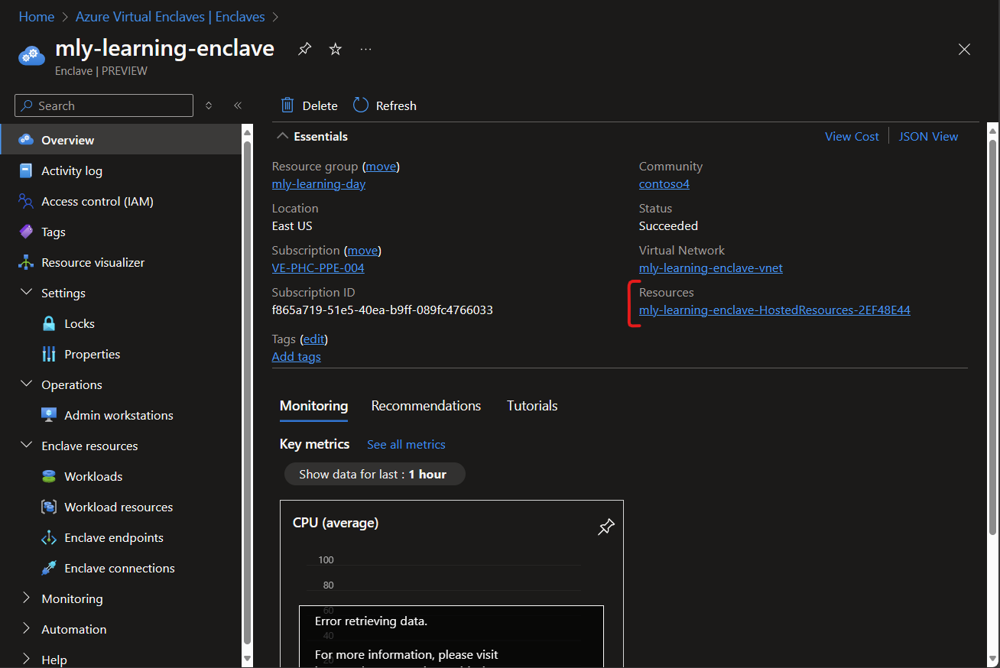

# Upgrade Enclave Key Vault SKU

There are several types of [encryption](../virtual-machines/disk-encryption-overview.md) available for securing your data on managed disks and other Azure PaaS services, including Azure Disk Encryption (ADE), Server-Side Encryption (SSE) and encryption at host.

In accordance with Azure Virtual Enclaves (AVE) default [governance and cybersecurity posture](./what-azure-virtual-enclaves.md#multi-layered-governance-security-and-monitoring) requires customer-managed-key encryption for all resources deployed in an 
[enclave](./what-enclave.md).

Every [enclave](./what-enclave.md) is deployed with an [Azure Key Vault](https://aka.ms/kv) with Standard SKU. Azure Key Vault is a cloud service for securely storing and accessing secrets. A secret is anything that you want to tightly control access to, such as API keys, passwords, certificates, or cryptographic keys. By default, Enclave Contributors should be able to upload keys, secrets, or certificates to the Enclave Key Vault and utilize existing Azure capabilities and design patterns of other Azure services to support CMK encryption.

Certain customers also have unique key management, security, encryption, or hardware requirements that dictate what Azure Key Vault SKU should be deployed. [Learn more](/azure/security/fundamentals/key-management-choose).

## Upgrade/Downgrade Enclave SKU Key Vault through PowerShell
These steps can be followed for scenarios where Enclave Owners require a different Key Vault SKU than the SKU currently configured for their enclave. If Enclave Owners require a Managed, Dedicated, or Payment HSM, AVE advises Enclave Owners to [Deploy a Managed HSM as a Workload](#deploy-a-managed-hsm-as-a-workload). Learn more about [Azure Key Vault PowerShell modules](/powershell/module/az.keyvault/?view=azps-11.4.0). 

1. Select the enclave that has the key vault you wish to upgrade or downgrade
2. Select the managed resource group in the Essentials section

3. Select the enclave key vault from the managed resource group, and copy these details for later
   - `ResourceName`
   - `ResourceGroupName`
   - `Subscription` (to set your current `AzContext`)

```
### Upgrade a Key Vault to Premium SKU
$vault = Get-AzResource -ResourceName "my-kv-name" -ResourceGroupName "my-managedResourceGroupName" -ResourceType Microsoft.KeyVault/vaults -ExpandProperties
$vault.Properties.sku.name = 'Premium'
Set-AzResource -ResourceId $vault.ResourceId -Tags $vault.Tags -Properties $vault.Properties

### Downgrade a Key Vault to Standard SKU
$vault = Get-AzResource -ResourceName "my-kv-name" -ResourceGroupName "my-managedResourceGroupName" -ResourceType Microsoft.KeyVault/vaults -ExpandProperties
$vault.Properties.sku.name = 'Standard'
Set-AzResource -ResourceId $vault.ResourceId -Tags $vault.Tags -Properties $vault.Properties
```
## Deploy your own Key Vault
Create your own Key Vault for your needs.

### Deploy a Managed HSM as a Workload
Should an Enclave Owner require either Dedicated, Payment, or Managed HSM solution(s) in their enclave, AVE recommends creating a [workload](./what-workload.md) to satisfy those requirements. If Community Owners require all Key Vaults to utilize HSM for key or secrets management, AVE advises Community Owners to break glass to delete all Standard SKU Key Vaults deployed in enclaves.

### Pre-requisites
- [Choose the right key management solution](../security/fundamentals/key-management-choose.md)
- Determine SKU types (`StandardB1`, `CustomB32`)

AVE recommends following the [Quickstart: Create and activate a Managed HSM using PowerShell](/azure/key-vault/managed-hsm/quick-create-powershell.md) guide to create a new Managed HSM as a workload in an enclave. AVE also advises Enclave Owners to follow Azure Key Vault and [Managed HSM best practices](/azure/key-vault/managed-hsm/overview). Some important notes or guidance follows:

1. AVE advises setting `PublicNetworkAccess` to `Disabled`, and within `networkAcls`: `bypass` to `None`, and `defaultAction` to `Deny`.
2. After ManagedHSM resource creation completes successfully, AVE advises Enclave Owners to create a Private Endpoint for their ManagedHSM. 
3. Enclave Owners might be required to create a [Policy exemption](./policy-compliance-exemptions.md) to create Managed HSMs in their Enclave workloads.


## References
- [Azure Key Vault developer's guide](/azure/key-vault/general/developers-guide)
- [What is Azure Key Vault Managed HSM?](/azure/key-vault/managed-hsm/overview)
- [Choose the right key management solution](../security/fundamentals/key-management-choose.md)
