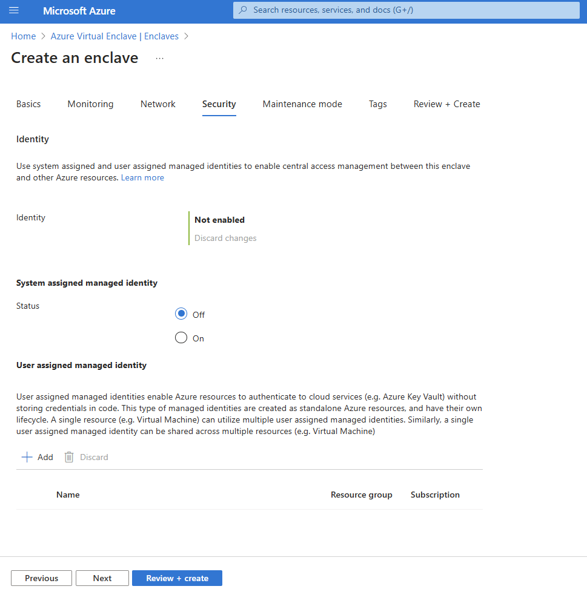
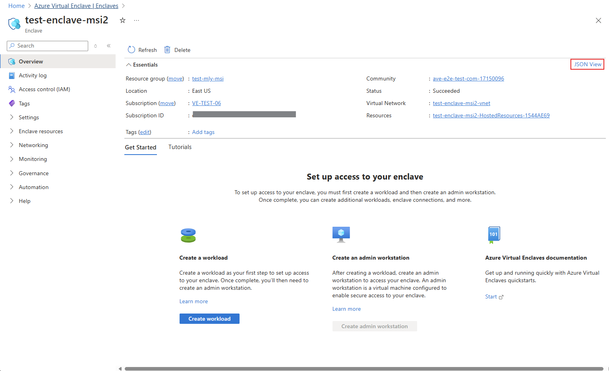

# Use a managed identity in Azure Virtual Enclaves (AVE)

Azure Virtual Enclaves (AVE) [enclaves](./what-enclave.md) require a Microsoft Entra identity to access Azure resources like [workloads](./what-workload.md) in Azure Virtual Enclaves and resources provisioned within workload resource groups.

This article shows how to enable the following types of managed identity on a new AVE enclave:

- **System-assigned managed identity**. A system-assigned managed identity is associated with a single Azure resource, such as an AVE enclave. It exists for the lifecycle of the enclave only.
- **User-assigned managed identity**. A user-assigned managed identity is a standalone Azure resource that an AVE enclave can use to authorize access to other Azure services. It persists separately from the AVE enclave and can be used by multiple Azure resources.

Both types of managed identities are managed by the Azure platform, so that you can authorize access from your applications without needing to create or rotate any secrets. Azure manages the identity's credentials for you.

To learn more about managed identities, see [Managed identities for Azure resources](https://learn.microsoft.com/entra/identity/managed-identities-azure-resources/overview).

### Create a system-assigned managed identity
A system-assigned managed identity is an identity that is associated with an AVE enclave or another Azure resource. The system-assigned managed identity is tied to the lifecycle of the enclave. When the enclave is deleted, the system-assigned managed identity is also deleted.

The AVE enclave can use the system-assigned managed identity to authorize access to other resources running in Azure. You can assign an Azure RBAC role to the system-assigned managed identity to grant the enclave permissions to access specific resources. For example, if your enclave needs to assign Azure Policies on resource groups associated to a workload for use by the enclave, you can assign to the system-assigned managed identity an Azure RBAC role that grants those permissions.

#### Enable a system-assigned managed identity on a new enclave
To enable a system-assigned managed identity on a new enclave, use the Azure portal.

##### Azure portal
During enclave creation, you have the ability to specify a system-assigned managed identity.



#### Add a role assignment for a system-assigned managed identity
You can assign an Azure RBAC role to the system-assigned managed identity to grant the enclave permissions on another Azure resource. Azure RBAC supports both built-in and custom role definitions that specify levels of permissions. For more information about assigning Azure RBAC roles, see [Steps to assign an Azure role](../role-based-access-control/role-assignments-steps.md).

When you assign an Azure RBAC role to a managed identity, you must define the scope for the role. In general, it's a best practice to limit the scope of a role to the minimum privileges required by the managed identity. For more information on scoping Azure RBAC roles, see [Understand scope for Azure RBAC](../role-based-access-control/scope-overview.md).

#### Get the principal ID of the system-assigned managed identity
To assign an Azure RBAC role to an enclave's system-assigned managed identity, you first need the principal ID for the managed identity. Get the principal ID for the enclave's system-assigned managed identity by using the Azure portal, __Show JSON__ view.



#### Assign an Azure RBAC role to the system-assigned managed identity
To grant system-assigned managed identity permissions to a resource in Azure, you can call the `az role assignment` create command via Azure CLI to assign an Azure RBAC role to the managed identity. You can also use Azure portal to assign roles.

For Azure Policy operations outside the workload resource groups, you need to assign the `Resource Policy Contributor` role on the resource group.

For example, assign the `Resource Policy Contributor` and `Managed Identity Operator` roles on the resource group you would want to add to a workload using the `az role assignment create` command. For the `--scope` parameter, provide the resource ID for the resource group for the enclave.

```
az role assignment create \
    --assignee $CLIENT_ID \
    --role "Resource Policy Contributor" \
    --scope "<resource-group-id>"
```

> [!NOTE]
> 
> It can take up to 60 minutes for the permissions granted to your enclave's managed identity to propagate.

### Enable a user-assigned managed identity
A user-assigned managed identity is a standalone Azure resource. When you create an enclave with a user-assigned managed identity for the control plane, the user-assigned managed identity resource must exist prior to enclave creation.

#### Create a user-assigned managed identity via Azure portal
If you don't yet have a user-assigned managed identity resource, create one using the Azure portal. User-assigned managed identities can be assigned Azure RBAC roles in a process similar to system-assigned managed identities. [Learn more about user-assigned managed identities](https://learn.microsoft.com/entra/identity/managed-identities-azure-resources/how-manage-user-assigned-managed-identities).


