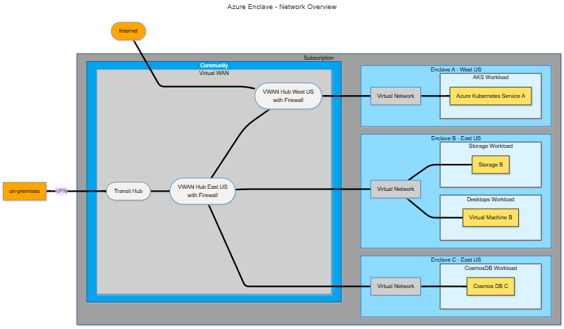
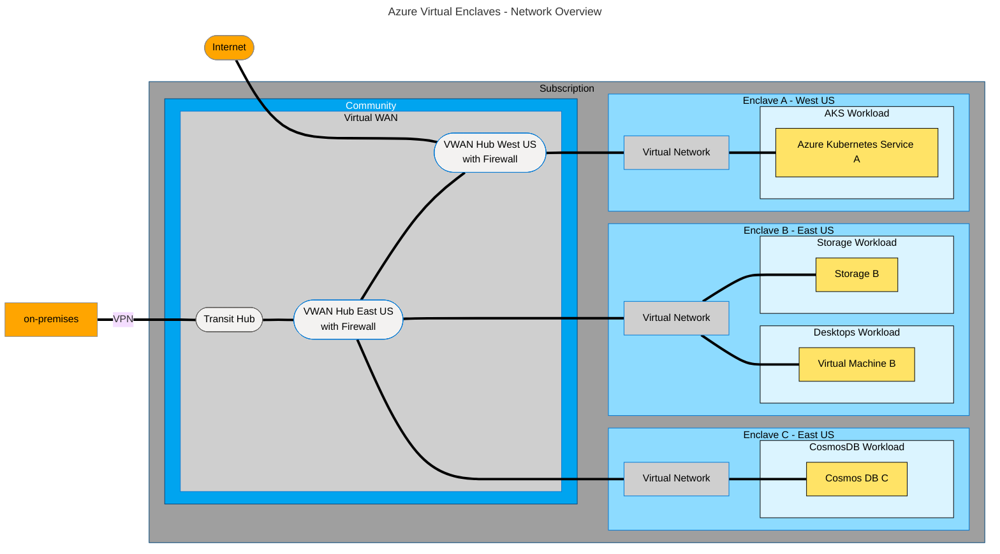

# Learn about Azure Virtual Enclaves

If you're new to Azure Virtual Enclaves (AVE), this article helps introduce core concepts to understand, communicate, and plan AVE environments.

## Visualize Azure Virtual Enclaves

You can think of a Virtual Enclaves environment as a connection of network resources or as an organization of resource groups. Both can be helpful depending on your role and goals.

### Network diagram

This diagram shows networking connections within Azure Virtual Enclaves. The diagram should look similar to a typical hub and spoke network.

:::image type="content" source="./media/mermaid-virtual-enclaves-network-links.svg" alt-text="3Diagram showing an example community with two regions, three enclaves, and 4 workloads." border="false" lightbox="./media/mermaid-virtual-enclaves-network-links.svg":::

:::image type="content" source="./media/mermaid-virtual-enclaves-network-links.svg" alt-text="4Diagram showing an example community with two regions, three enclaves, and 4 workloads." lightbox="./media/mermaid-virtual-enclaves-network-links.svg":::

:::image type="content" source="./media/mermaid-virtual-enclaves-network-links.svg" alt-text="5Diagram showing an example community with two regions, three enclaves, and 4 workloads." lightbox="./media/mermaid-virtual-enclaves-network-links.svg":::

<!--
This is the mermaid definition for the above graph. Use this to edit and regenerate the graph image.

-->