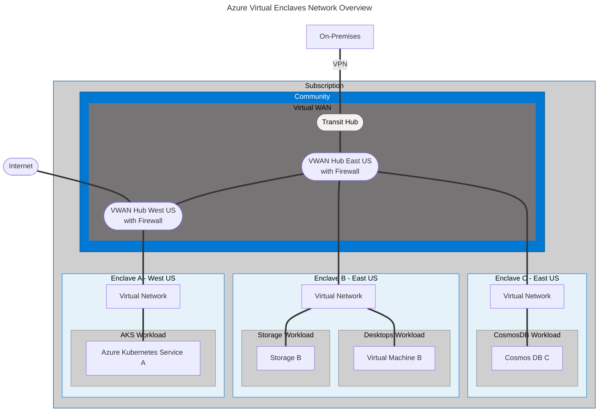
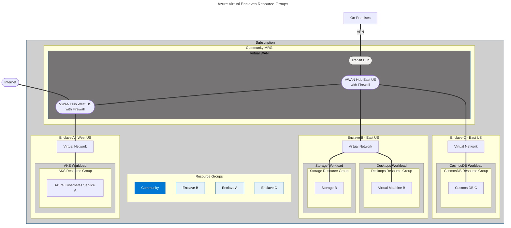

# Learn about Azure Virtual Enclaves

If you're new to Azure Virtual Enclaves (AVE), this articles helps introduce core concepts to understand and plan AVE environments.

## Visualize Azure Virtual Enclaves

You can think of a Virtual Enclaves environment as a connection of network resources or as an organization of resource groups. Both can be helpful depending on your role and goals.

### Network diagram
This is a visual showing networking connections within Azure Virtual Enclaves. This looks similar to a typical hub and spoke network.

### Organization diagram
This is a visual showing how the Azure Virtual Enclaves resources are organized in resource groups. This view is helpful if you are displaying how the resources are organized and where they are located. It can also be helpful when discussing role permissions which are often assigned at the subscription or resource group level.

