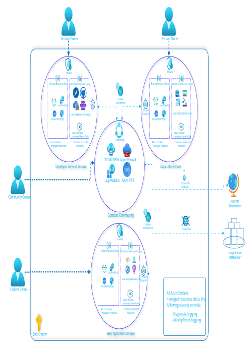
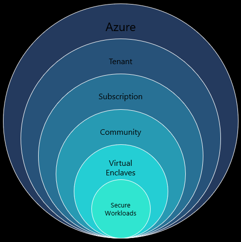

# What is Azure Virtual Enclaves?

Azure Virtual Enclaves (AVE) accelerates and streamlines the deployment and management of secure, isolated, and compliant cloud environments for the most sensitive workloads. AVE is design for commercial and air-gapped environments.

> [!IMPORTANT]
> 
> Azure Virtual Enclaves is currently in Public Preview and is provided without a service-level agreement. At this time, **Azure Virtual Enclaves shouldn't be used for production workloads**. Certain features might not be supported, might have constrained capabilities, or might not be available in all Azure locations. See the full [Azure Virtual Enclaves Terms](./public-preview-terms.md) for legal terms that apply to Azure features that are in beta, preview, or otherwise not yet released into general availability.

AVE takes a multi-layered and hierarchical approach to virtual boundary protection. A **community** serves as a central hub for networking, governance, and monitoring for a collection of isolated networks known as **enclaves**. The community itself hosts a centralized, virtual hub network (Azure Virtual WAN) secured by an intelligent firewall security platform (Azure Firewall), through which all enclave traffic is routed, logged, and monitored. Enclaves are isolated, zero-trust software-defined networks (Azure Virtual Network), hosting customer workloads deployed through Azure Cloud products. Enclaves and customer workloads are securely governed through policy configuration management (Azure Policy).

## Key Capabilities

## Isolated virtual networking and workloads
With Azure Virtual Enclaves, you can easily create new isolated, zero-trust software-defined networks and deploy workloads in those networks to satisfy your business requirements on Azure.

- [**Communities**](./what-community.md) - Isolated, zero-trust, platform-managed virtual WAN boundary protected through a combination of Azure Firewall, policy guardrails, and Role Based Access Control (RBAC) Deny Assignments that serve as a hub for one or more enclaves.  Community resources can't be modified directly and must be managed through community endpoints and transit hub resources to allow connectivity to trusted destinations outside of the community boundary. Logging and diagnostics are enabled for all Enclaves and workloads within the community by default. Each Enclave can either send logging data to the community or keep it isolated to the Enclave. The primary components of a community include:
  - Azure Virtual WAN
  - Azure Firewall
  - Firewall Policy
  - Log Analytics Workspace

- [**Enclaves**](./what-enclave.md) - Isolated, zero-trust, platform-managed virtual networks connected to the community hub protected through a combination of Network Security Groups (NSG), policy guardrails, and RBAC Deny Assignments that serve as the Virtual Network for one or more workloads. Enclave virtual networks and NSGs can't be directly modified and must be managed through enclave endpoints and enclave resources to establish network connectivity. The primary components of an Enclave include:
  - Azure Virtual Network
  - Zero-trust Network Security Groups
  - Private DNS Zones
  - Azure Bastion
  - Private-Links for the following managed resources:
    - Log Analytics Workspace (Optional)

- [**Workloads**](./what-workload.md) - The resource group for customer deployed resourcesplatform-managed resource groups protected by Azure policy guardrails and RBAC Deny Assignments that serve as the resource container for an individual service or application hosted within an Enclave. The primary components of a workload include:
  - Managed resources protected by Azure Policy and Deny Assignments
  - Service Catalog - Collection of templates that can be used to deploy well-known services and applications.

## What gets deployed
When you deploy Azure Virtual Enclave resources, these are the resources that are deployed for you:

- [**Communities**](./what-community.md) - The community managed resource group contains these resources depending on your selections during community creation.
  - Azure Virtual WAN
  - Azure Firewall
  - Firewall Policy
  - Log Analytics Workspace
  - Virtual WAN regional hub - A secured hub is created during enclave creation for each new region an enclave is deployed in.
  - Virtual WAN hub for transit - Select one below per transit hub.
    - (Optional) VPN Gateway - Based on the transit hub configuration.
    - (Optional) ExpressRoute Gateway - Based on the transit hub configuration.
    - (Optional) Virtual Network Connection - Based on the transit hub configuration.

- [**Enclaves**](./what-enclave.md)
  - Azure monitor private link scope
  - Data collection endpoint
  - Data collection rule
  - Managed Identity
  - Network Interface
  - Network security group for each subnet (1 required, 1 for each customer subnet)
  - Private DNS zone x5 
  - Private endpoint
  - Storage Account (for network flow logs)
  - May require Key Vault with Customer Managed Key (CMK)
  - (Optional) Log Analytics
  - (Optional) Bastion
  - (Optional) Bastion Subnet
  - (Optional) Public IP for Bastion

- [**Workloads**](./what-workload.md)
  - Workload Resource Groups - You create each [workload resource group](./what-workload.md#workload-resource-group) you need to organize your resources.

## Virtual connection management
With Azure Virtual Enclaves, you can easily connect your communities, enclaves, and workloads to other networks and resources, both on Azure and on-premises.

- [**Enclave Endpoints**](./what-enclave-endpoint.md) are collections of networking rules that enable simplified and standardized connectivity to an enclave or an individual workload.
- [**Community Endpoints**](./what-community-endpoint.md) are collections of networking rules that enable external connectivity to trusted destinations including public websites, well-known services, and external private networks.
- [**Transit Hubs**](./what-transit-hub.md) can be associated with community endpoint rules to allow secure site-to-site connectivity to external private networks via VPN Gateway or ExpressRoute.
- [**Enclave connections**](./what-enclave-connection.md) are associated with a community or enclave endpoint and allow network traffic based on the rules defined within the Endpoint.

## Multi-layered governance, security, and monitoring

Azure Virtual Enclaves provides the following security layers built directly into the service:

**Azure Policy Guardrails**: Built in guardrails that secure the Virtual boundary ensuring only authorized resource types can be deployed into a given workload within an Enclave.
These guardrails include:
  - Resource type protections
  - Network protections
  - Protections toward specific services and applications

**Managed networking boundary** - Managed networking through endpoints and connections that ensure each connection is authorized and trusted from the Firewall to individual subnets.  

**Logging and Monitoring**: Each activity is logged an auditable and can be centralized to a community Workspace, isolated to an Enclave, or both.

**Virtual Network Isolation**: Next-level zero-trust networking that uses Azure vWAN, Firewall, Policy, RBAC, Network Watcher, Monitor, Microsoft Sentinel, Defender, and others to ensure that you know where your data is and who is accessing it at all times.

**Connection Management**: All connections, internal or external, are governed by strict, user-defined rules to prevent unwarranted access through.

**Policy Guardrails**: Ensure your environments remain secure through build-in policies at the community, Enclave, and workload levels to audit and/or enforce consistency and compliance across your environment.

**Mandatory Access Control**: Access is granted not merely by identity but by role, ensuring users only access what they need, and nothing more.

**Observability**: Azure Virtual Enclaves uses Azure's built-in logging, alerting, and auditing that seamlessly integrates with Microsoft Sentinel, Defender, and other network monitoring and security tools to ensure that your data remains secure.

**Secure transit hub**: Managed VPN Gateway, ExpressRoute, or Virtual Network peering connections.

**Service Catalog**: Ensure workload deployments simple and repeatable through a collection of pre-built templates.

Learn more about how Azure Virtual Enclaves [governance](./what-azure-virtual-enclaves.md#multi-layered-governance-security-and-monitoring).

## Defense-in-depth 
Azure Virtual Enclaves simplifies integration with existing secure Azure security and monitoring services including:

**Microsoft Sentinel**: Combine the power of Microsoft Sentinel's SIEM and SOAR capabilities with Azure Virtual Enclaves to enhance threat detection, investigation, and response across your cloud environment.

**Azure Monitor**: Get end-to-end visibility and in-depth monitoring of your Azure Virtual Enclaves operations, benefiting from Azure Monitor's advanced analytics.

**Microsoft Defender for Cloud**: Bolster the security posture of your Azure Virtual Enclaves by leveraging the comprehensive threat protection features and security baseline insights of Microsoft Defender for Cloud.

**Azure Virtual Desktop**: Integrate your enclaves with Azure Virtual Desktop to provide users with a secure, remote desktop experience from anywhere.

Learn more about how Azure Virtual Enclaves incorporates [defense-in-depth](./defense-in-depth.md).

## Next steps
Here are some other articles to learn about Azure Virtual Enclaves:

1. [Create a community](./create-community-portal.md) 
2. [Create an enclave](./create-enclave-portal.md)
3. [Create a workload](./create-workload-portal.md)
4. [Create a community endpoint](./create-community-endpoint-portal.md)
5. [Create an enclave endpoint](./create-enclave-endpoint-portal.md)
6. [Create a transit hub](./create-transit-hub-portal.md)
7. [Create an enclave connection](./create-enclave-connection-portal.md)
