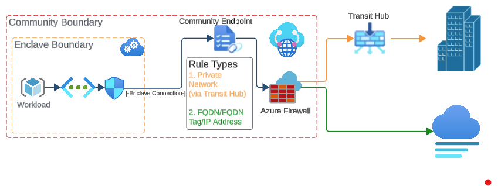

# What is a community endpoint?

A community endpoint is a collection of trusted destinations or transit hub connections to private networks outside of the community boundary. 
Enclave connections associated with a community endpoint allow the Source Enclave to connect to the destination defined within the community endpoint. 

## Architecture of a community endpoint

## Community endpoint rule types:

- IP Address: Enable traffic from an Enclave to an IP address outside of the community vWAN
- Fully Qualified Domain Name (FQDN): Enable traffic from an Enclave to a trusted FQDN (for example, *portal.azure.com)
- FQDN Tag: Enable traffic from Enclaves to known Microsoft Azure services via FQDN Tags (for example, "Azure portal")
- Private Network: Enable traffic from Enclaves to an external private network through an existing transit hub connection (Transit Hub must exist before a Private Network rule can be created).
