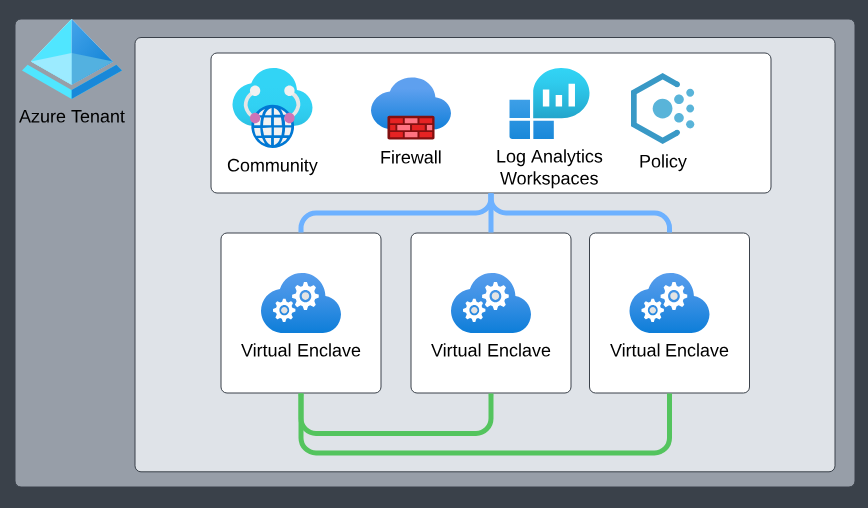

# What is a community?

Communities are isolated hub networks that can securely and logically group several [enclaves](./what-enclave.md) together for governance, management, and security purposes. A community owner can enable other communities or on-premises networks to connect through [transit hubs](./what-transit-hub.md) or [community endpoints](./what-community-endpoint.md).

## Architecture of a community

Communities come with the following primary platform-managed and platform-deployed resources:
- Isolated [Azure Virtual WAN](/azure/virtual-wan/virtual-wan-about) hub networks. By default, these communities aren't connected to the rest of the Internet outside of [certain authorized Microsoft services](/azure/azure-portal/azure-portal-safelist-urls?tabs=public-cloud).
- [Azure Firewall](/azure/firewall/overview). By default, all Communities are deployed with a secure-by-default Azure Firewall in which all community network traffic is routed through.
- [Log Analytics Workspace](/azure/azure-monitor/logs/log-analytics-overview). By default, all community resources are integrated into Azure Log Analytics, ensuring all activities within a community are effectively monitored, logged, and audited, laying the foundation for actionable insights. More specifically, all resources deployed in a community send their [diagnostic platform logs](/azure/azure-monitor/essentials/diagnostic-settings) to this Log Analytics Workspace.

### Community address space
> [!NOTE]
> 
> `192.168.0.0/16`, `192.0.0.0/8`, `192.128.0.0/9`, or any other range that includes `192.168.x.x` addresses are reserved for the platform to manage enclaves deployed within a community. Users shouldn't create communities with any of these address spaces as that would create overlapping conflicts with the platform-managed enclave management IP ranges.

## Community managed resource group
When you create a community, the Azure Virtual Enclaves resource provider also creates and manages a separate resource group called the community managed resource group. For more details regarding the community managed resource group, learn more about [Best practices of Azure Virtual Enclaves](./best-practices.md).

## Template
See [template documentation](./virtual-enclaves-templates.md#community-template)

## Managed Resources
- [Azure Virtual WAN](/azure/virtual-wan/virtual-wan-about)
- [Azure Firewall](/azure/firewall/overview)
- [Log Analytics Workspace](/azure/azure-monitor/logs/log-analytics-overview)

## Next Steps
- [What is Azure Virtual Enclaves?](./what-azure-virtual-enclaves.md)
- [What is an Enclave?](./what-enclave.md)
- [Best practices of Azure Virtual Enclaves](./best-practices.md)
- [Tutorial: Create a community](./1-create-community.md)
