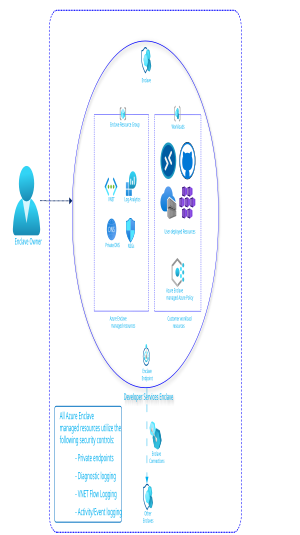

# What is an Enclave?

An enclave is an isolated Azure Virtual Network that is part of a [community](./what-community.md) in which one or more [workloads](./what-workload.md) are hosted. These workloads can be isolated from other enclaves in the community. An enclave owner can enable other enclaves to connect to theirs by creating an [enclave endpoint](./what-enclave-endpoint.md). Enclave endpoints are used by other enclaves to establish [enclave connections](./what-enclave-connection.md).

## Architecture of an enclave

Enclaves come with the following primary platform-managed and platform-deployed resources:
- Isolated [Azure Virtual Network](/azure/virtual-network/virtual-networks-overview) with [Subnets](/azure/virtual-network/concepts-and-best-practices.md#virtual-network-concepts) you define. By default, these Enclaves aren't connected to the rest of the Internet outside of [certain authorized Microsoft services](/azure/azure-portal/azure-portal-safelist-urls). Enabling connections is done through the use of platform-managed [Network Security Groups](/azure/virtual-network/network-security-groups-overview).
- [Log Analytics Workspace](/azure/azure-monitor/logs/log-analytics-overview). By default, all enclave resources are integrated into Azure Log Analytics. This integration ensures all activities within a community and enclave are effectively monitored, logged, and auditable. You can then use this data to form actionable insights. More specifically, all resources deployed in an enclave send their [diagnostic platform logs](/azure/azure-monitor/essentials/diagnostic-settings) to this Log Analytics Workspace.
- [Azure Bastion](/azure/bastion/bastion-overview).
- [Private Endpoints](/azure/private-link/private-endpoint-overview) and [Private DNS Zones](/azure/dns/private-dns-privatednszone). By default and for private networking security, Azure Private DNS Zones, along with certain private DNS records, are created for every new enclave. All platform-managed Enclave resources are configured to use Azure Private Link Service.

## Enclave managed resource group 
When you create an enclave, the Azure Virtual Enclaves resource provider also creates a resource group which is managed by the Azure Virtual Enclaves service. This managed resource group has a controlled configuration that allows for specific control plane actions. When an enclave is created, Azure places a [deny assignment](/azure/role-based-access-control/deny-assignments) to protect resources in the enclave managed resource group.

For more details regarding the Enclave managed resource group, learn more about [Best practices of Azure Virtual Enclaves](./best-practices.md)

### Maintenance mode
Maintenance mode is a feature that allows enclave owners to temporarily place their enclaves into a "maintenance mode" state. This mode permits privileged users to make certain changes to the underlying managed resources in an enclave that are normally protected by Deny Assignments. This helps maintain the enclave isolation and network boundary. [Learn more](./maintenance-mode.md).

## Template
See [template documentation](./virtual-enclaves-templates.md#enclave-template)

## Managed Resources
The following resources types are deployed into the enclave managed resource group:
- [Azure Virtual Network](/azure/virtual-network/virtual-networks-overview)
- [Subnets](/azure/virtual-network/concepts-and-best-practices.md#virtual-network-concepts)
- [Network Security Groups](/azure/virtual-network/network-security-groups-overview)
- [Log Analytics Workspace](/azure/azure-monitor/logs/log-analytics-overview)
- [Azure Bastion](/azure/bastion/bastion-overview)
- [Private Endpoints](/azure/private-link/private-endpoint-overview)
- [Private DNS Zones](/azure/dns/private-dns-privatednszone)

## Next Steps
- [What is a workload?](./what-workload.md)
- [What is the service catalog?](./what-service-catalog.md)
- [What is a community?](./what-community.md)
- [Best practices](./best-practices.md)
- [Maintenance mode](./maintenance-mode.md)
- [Tutorial: Create an Enclave](./2-create-enclaves-inside-community.md)
