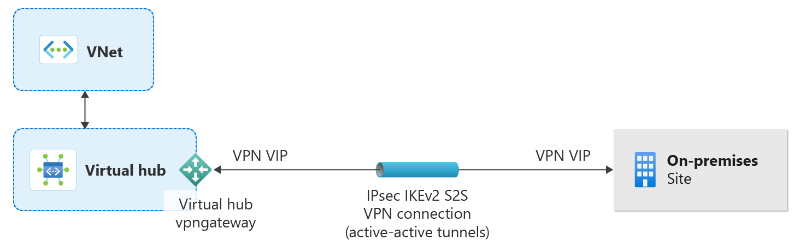

# What is a Transit hub?

A Transit hub establishes a virtual hub within a Community vWAN that serves as a secure tunnel between the Community and an external private network. A Transit Hub can be associated with a Private Network rule within a Community Endpoint to enable Virtual Enclaves to connect to trusted private networks outside of the Community boundary.

## Architecture of a transit hub

## Transit hub types

Transit hubs support the following types of secure connectivity:

- VPN Gateway
- ExpressRoute
- vNet Peering

## Next Steps

- [Create a Transit Hub in the Azure portal](./create-a-transit-hub-from-the-azure-portal.md)
- [Create a Community Endpoint in the Azure portal](./create-a-community-endpoint-in-the-azure-portal.md)
