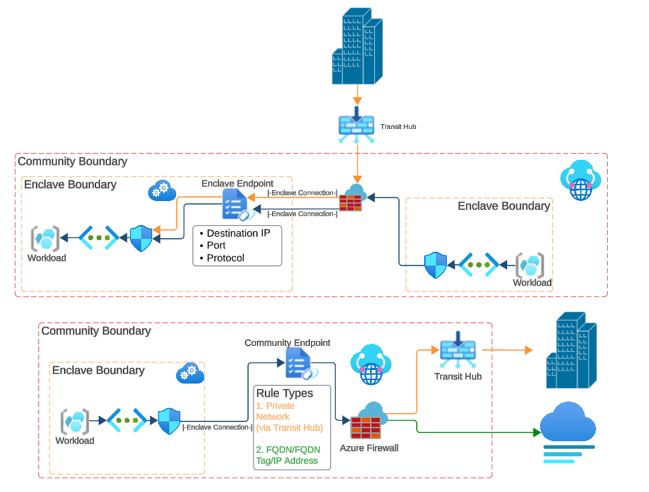

# What is an Enclave connection?

Enclave Connections enable network traffic to flow between a Virtual Enclave and a trusted destination defined within the Community boundary. The destination of every Enclave Connection is either an Enclave or Community Endpoint. Enclave Connections allow resources within your Enclave to access services and data running within another Enclave (Enclave Endpoint), or to trusted private and/or public destinations defined at the Community level (Community Endpoint). 

Enclave Connections can also enable secured public access to resources within a Virtual Enclave through a Transit Hub connection. In these cases, the Transit Hub would be the source of the Connection and an Enclave Endpoint would be the destination. 

## Architecture of an enclave connection

## Template
See template documentation [here](./ave-templates.md#connections-template)

## About enclave connection resources
coming soon

## Next Steps
- coming soon
