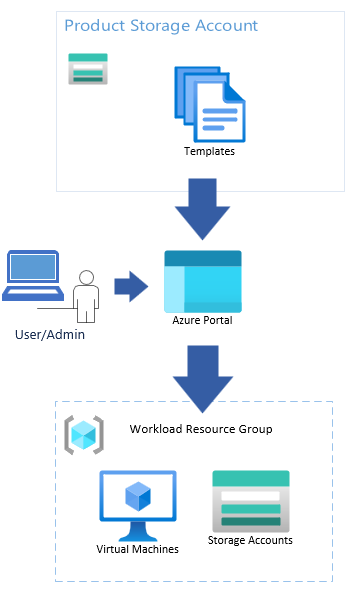

# What is the service catalog?

The service catalog enables you to quickly deploy tailored Azure Resource Manager (ARM) templates of Azure services into Azure Virtual Enclaves (AVE) while being compliant with Policy Guardrails and enclave isolation requirements. The service catalog helps customers springboard their setups within the secure boundary of AVE without getting blocked by the security they want.

Diagram Description: The user/admin accesses the service catalog through the portal. Once they select the service catalog template they want to deploy, the service catalog will read the correct template and deploy the resources specified in the template according to the parameter inputs the user provides.

## What is in the service catalog?

The service catalog contains two template categories:
1. Azure Services - custom templates to allow common Azure Services to be deployed with the secure AVE boundaries without being blocked by policy or hardened network settings.
1. Customer workload templates - Collections of Azure resources to meet specific customer needs

See the [Service Catalog List](./list-service-catalog-templates.md) to view the available templates in the service catalog. Review the documentation for each service catalog template you wish to deploy to determine if there are any prerequisite steps.

## Editing service catalog templates before deployment
You can edit the service catalog template itself but edits might change the formatting of the parameter input flow. 

## Ready? Deploy from the service catalog!

- [Service Catalog How-To Guides and tips for each template](./list-service-catalog-templates.md)
- [Service Catalog Storage Account deployment Quickstart](./deploy-storage-account-service-catalog.md)
- [What is Azure Virtual Enclaves?](./what-azure-virtual-enclaves.md)
- [What is a community?](./what-community.md)
- [Tutorial: Create resources from the service catalog](./4-use-service-catalog-create-azure-resources-workloads.md)
- [What is an Enclave?](./what-enclave.md)
