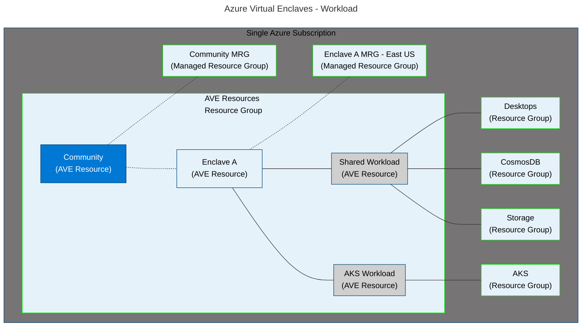

# What is a workload?

Workloads are logical groups of Azure resources that you define to create and audit connections in Azure Virtual Enclaves. Only community and enclave owners can view the workloads and networks that have network access to their data. Workloads aren't discoverable to external networks. Enclave owners can deploy Azure resources or services into workloads. Workloads are created within an enclave. Maintenance of customer workloads belongs to the customer, following the standard [Shared responsibility model in the cloud](/azure/security/fundamentals/shared-responsibility). 

Workloads also automatically inherit security posture and policies of their enclave. Workloads can also, by default, utilize community services reachable from their Enclave.

## Why use a workload?
Workloads are a logical way to organize your Azure resource groups and create a link to your Azure Virtual Enclaves environment. Workloads are another level where you can separate groups of policies and exceptions scoped and applied to a workload and the resources in the Workload Resource Groups. When using the managed resource group that comes with a workload, there are minor restrictions described [here](./best-practices.md).

The alternative is to deploy an Azure resource group through the portal that isn't managed. The workload managed resource group is equivalent to a normal Azure resource group aside from these minor restrictions, which help to keep the resource group secured within the enclave boundary. Deploying a normal Azure resource group through the portal is still an option, but a normal Azure resource group wouldn't be secured within the enclave boundary.

## Architecture of a workload
Workloads are linked as a child resource to [enclaves](./what-enclave.md) and are linked as the parent resource to [Workload Resource Groups](#workload-resource-group).

- [Azure Virtual Enclaves governance](./what-azure-virtual-enclaves.md#multi-layered-governance-security-and-monitoring)
- [Enclave services and properties](./what-enclave.md)

This diagram shows two example Workloads. The `Shared Workload` is linked to three Workload Resource Groups and the `AKS Workload` is linked to one Workload Resource Group. Resource Groups are highlighted in green and Azure resources are highlighted in dark blue.

<!--
Change arrow styles to include a double hyphen to make it work in the markdown mermaid renderer. The space between the hyphens is a workaround for the HTML end comment tag.

-->

## Workload resource group
When you create an Azure Virtual Enclaves workload, you create linked workload resource groups where you can organize your Azure resources. 

For more details regarding the workload managed resource group, learn more about [Best practices of workload resource groups](./best-practices.md#workload-resource-group).

## What can I add to my workload?
The workload resource groups function like an Azure resource group and you can deploy Azure resources that are compliant with the workload policies. You can create new resources using the methods you're familiar with for your Azure resources. Additionally, you can create resources from the Portal through the service catalog: [What is the service catalog](./what-service-catalog.md)

## Next Steps
- [What is the service catalog?](./what-service-catalog.md)
- [What is Azure Virtual Enclaves?](./what-azure-virtual-enclaves.md)
- [What is a community?](./what-community.md)
- [What is an Enclave?](./what-enclave.md)
- [Shared responsibility model in the cloud](/azure/security/fundamentals/shared-responsibility)
- [Best practices](./best-practices.md)
- [Tutorial: Create a workload](./3-create-workloads-inside-enclave.md)
