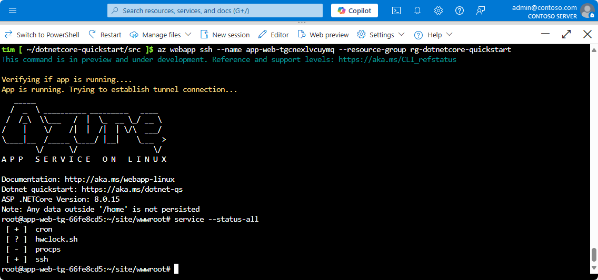

Your app and its container must be running before you open a browser session.

In the [Azure portal](https://portal.azure.com), open your App Service app. Under **Development Tools**, select **SSH**, and then select **Go**. Sign in with your Azure account if prompted.

The session opens in your browser, where you can run commands inside the app container.

